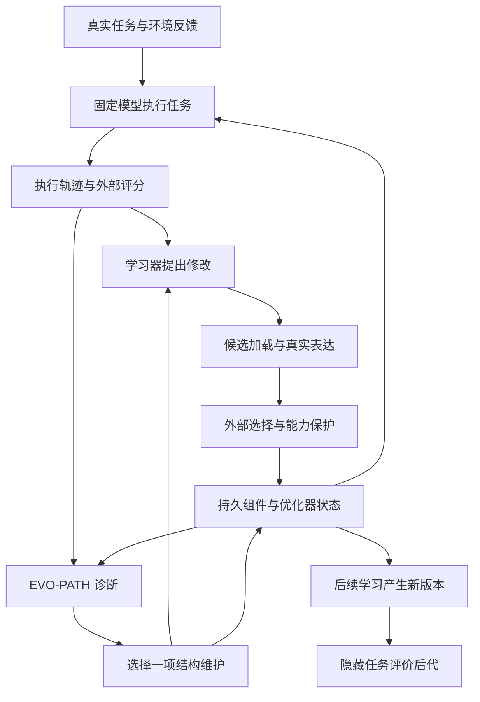
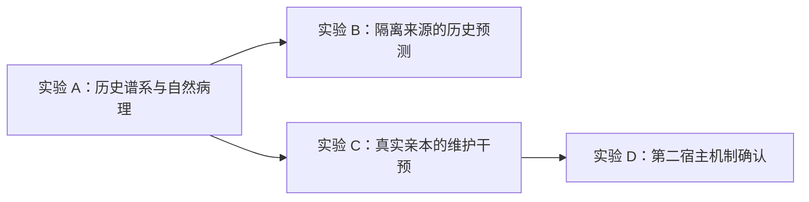

# EVO-PATH：从生命的熵减构造到 Agent 的持续演化

**研究计划 v1.1 · 2026-10-12 · Asia/Singapore**

工作名称：**EVO-PATH — Evolutionary Pathology Analysis for Self-Improving Agents**。

论文工作标题：**EVO-PATH: Maintaining the Capacity to Improve in Self-Evolving Agents**。

中文题目：**EVO-PATH：自进化智能体的演化能力维护**。

研究状态：方案已完成，新实验尚未启动。GNOSIS 结果见第三节，EVO-PATH 的研究命题与判定协议见第七节和第十一节。

## 1. 研究决策与关键假设

| 关键假设 | 撤掉假设，结论是否还成立？ |
|---|---|
| 相同模型与工具权限下，Agent 的持久结构会影响其后续产生有效修改的能力 | 不成立。EVO-PATH 的核心研究对象消失，应结束“结构维护恢复演化能力”的主张 |
| 至少存在一种可由真实执行证据定位、可通过宿主允许的修改修复的结构失效 | 不成立。只能交付观测研究，维护方法缺少作用对象 |
| 历史记录能关联候选、父版本、真实执行和保留决定 | 无关联部分退出纵向分析，保留可追溯的横截面事实；不自动启动新谱系生成 |
| 新任务仍有可改进空间，且环境反馈包含有用信息 | 不成立。平台期应解释为任务余量或反馈不足，不能归为演化结构损伤 |
| 维护的费用可以在后续学习期间收回，且历史能力得到保留 | 不成立。维护策略没有实际优势，即使过程指标有所改善 |
| 能取得独立来源和第二种宿主中的确认数据 | 撤掉后，结论限定于已测宿主和来源；跨系统主张结束 |

**EVO-PATH 研究自进化 Agent 的功能组织如何在连续修改中受损，以及诊断驱动的结构维护能否在固定学习预算下，提高后续有效后代的产出并保留历史能力。**

现有 GNOSIS 结果提供一个明确起点：增加修改、保存经验和执行验证，尚未组成稳定的能力积累过程。新的研究需要解释经验如何在这一过程中失效，以及针对失效环节的维护能否恢复后续改进。

研究单位定为一次**带父版本的修改及其后代**。论文回答三个连续问题：

1. 自然演化历史中，哪些已保存的经验由于表达路径或继承关系变化而失去实际作用？
2. 对这些结构关系进行针对性维护，是否改变之后的修改质量和能力积累？
3. 这种收益能否超过维护本身的即时修复收益及完整计算成本？

最先实施的工作是重建真实演化谱系，并冻结一份能对应到具体版本和执行事件的病理定义。论文的主实验则从同一检查点分叉，通过维护干预和后续学习，直接测量这项能力。

费用安排采用 [GPT 报告第三节与第五节](<E:/AI/GNOSIS Agent/docs/research-find/GPT/Normal.md>) 的路径：历史轨迹离线分析与少量真实失败点干预。实验 A 提供付费研究所需的亲本资格和成本依据；此后 B 的历史预测与 C 的维护干预独立推进。A、B 不新增模型 API 调用；C 最多纳入 8 个已有独立来源，每个来源只运行原机制与针对性维护两组短程学习。第二宿主最多确认 2 个机制案例。

## 2. 论文的故事：生命如何持续构造自己

### 2.1 “熵减体”的含义

生命维持自身的组织，需要持续与环境交换物质和能量。薛定谔在《生命是什么》第六章用“负熵”解释这种维持秩序的过程，并在章节注释中进一步讨论自由能。[B1]

迁移到 Agent，研究关注的是**功能组织的维持**：外部任务带来反馈，计算把反馈加工成修改，真实执行筛选修改，持久结构把有效经验带入下一次任务。这个系统必须持续处理自身变化造成的冲突，才能继续吸收经验。

本文将“熵减体”用作这一构造过程的叙事名称。实验测量采用明确的行为和成本指标。热力学熵、候选分布的信息熵和软件结构失效分别定义，各自解释。

### 2.2 从保存结构到表达功能

遗传信息需要经过表达才能形成可被选择的性状。可演化性研究进一步关注：一个系统的构造如何支持可遗传的表型变异。[B2]

Agent 的持久文件承担类似的组织角色。一个修复被写入工具后，仍需经过加载和真实调用，才能改变行动。后续版本还需要保留这一行为关系。由此可以区分两个对象：

- **结构的保存**：修改是否进入持久版本，后代是否继承对应内容。
- **功能的保存**：在适用任务中，这项修改是否持续发挥原先得到验证的作用。

两者之间的距离就是 EVO-PATH 要测量的对象之一。Agent Plasticity 的象棋案例已经展示：修复规则写在代码中，开局库却在规则执行前返回了错误走法。持久化成立，表达路径出现阻断。[L1，附录 E，图 18]

### 2.3 从维持功能到保留演化空间

Bloom 等人的蛋白质研究提供了更具体的启发：额外结构稳定性可以让蛋白质容纳带来新功能的变异。当前功能相近的两个亲本，在后续变异中产生改进后代的能力可以不同。[B3]

对应的 Agent 假设是：两个版本当前成绩相近，其中一个保留了清晰、可达的经验表达关系，另一个积累了相互遮蔽的规则或失真的修复依据。它们接下来产生有效修改的概率可能不同。

这项迁移将生命故事变成一个具体实验：**比较同一历史版本在维护前后的后代质量。** 当前分数是起点，后续学习增益是主要结果。生物学研究为假设提供构造启发，Agent 中的关系由新实验判定。

### 2.4 自进化中的结构负担

一次修改可能提高当前任务成绩，同时增加未来修改的难度。例如，新规则改变了调用顺序，旧工具仍被登记为有效，下一轮提议者又依据这份过期记录继续修改。每一步都有局部解释，连续运行后却可能形成难以纠正的反馈。

由此提出**演化维护负担**：为了维持已有能力并继续获得新能力，系统因历史修改而需要付出的额外组织和验证成本。该负担必须通过真实费用或受控干预估计，文件数量仅作为候选解释变量。

这个故事的核心矛盾是：自进化会构造新的功能，也会改变后续进化所依赖的条件。持续改进要求系统维护这些条件。

### 2.5 可直接用于论文引言的叙事草稿

> 生命通过持续交换和内部更新维持自身的组织。已有结构使新的变化能够发生，而新的变化又要求系统不断修复和重新组织自身。这种构造关系，为理解持续自进化的智能体提供了一个具体视角。
>
> 一个智能体可以把经验写成工具和记忆，再把这些结构传给后续实例。经验积累由此获得了物质载体。随着修改继续发生，工具的实际入口、规则的适用关系和版本选择所依赖的证据也会变化。存储的经验能否继续表达为功能，决定了后续学习可以从什么起点开始。
>
> 更深层的问题出现在后续演化中。当一项已有修复被新的执行路径遮蔽，受到损伤的不仅是当前任务的执行表现。后续优化器还可能基于失效的组件关系继续提出修改，将历史中已经解决的问题重新当作未知问题，或者反复修复无法真正触达的功能。先前积累的经验因此逐渐失去对新变化的支持作用，系统的下一次改进也变得更加困难。
>
> 这形成了一种自我强化的演化病理：系统通过修改自身积累能力，积累的修改又可能损伤产生新能力所依赖的组织。维护这些组织关系，因而可能改变未来有效后代出现的概率。
>
> 现有研究已经能够追踪 Agent 的能力获得与遗忘，也能够修复可执行技能中的结构错误。但一个直接关系到持续演化的问题仍待回答：修复当前的功能组织，是否能让系统在下一轮学习中更容易产生有效后代？这一问题需要区分维护带来的即时功能恢复，以及维护之后产生的新增学习收益。[L1，L12，L14]
>
> EVO-PATH 以真实版本谱系为研究对象，追踪修改从提出到表达、保留和迁移的过程。我们提出从同一检查点分叉的实验协议，分别测量维护的即时影响与后续学习收益，并检验诊断驱动的维护能否在相同费用下提高有效后代的产出。

## 3. GNOSIS 已有证据如何进入新研究

### 3.1 已经成立的事实

| 已有证据 | 对 EVO-PATH 的直接含义 | 后续需要补齐的证据 |
|---|---|---|
| 时机实验 240 条正式执行保留资格；主要交互为 −0.042，p=1.0，95% CI [−0.250, 0.125] | 时机路线未得到目标效应，停止沿此主张追加实验 | 演化停滞的原因应从候选和版本过程重新定位 |
| L 相对 G 的成功率差 +0.021，95% CI [−0.042, 0.083]，原协议非劣效成立 | 局部提前在这组固定修复和路由条件下保留效用 | 新宿主、新任务的收益分别评价 |
| 6/8 来源的 N 与 G 成功率相同 | 部分修复的净效用本身需要检验 | 带修复和移除修复的同期重复执行 |
| 宿主依赖集合覆盖完整审计池；选择性验证费用更高 | 当前任务池没有兑现验证节省 | EVO-PATH 的收益须来自新机制与完整费用比较 |
| P4：24 个槽位、19 个合法候选、8 个成熟候选，成熟候选来自 4 个来源 | 合法性和来源成功之间存在流失 | 每个候选的父版本、失败原因和实际增益 |
| 19 个合法候选均含 GLOBAL | 修改范围集中于全局暴露 | 全局范围与修改内容、接口限制的分别分析 |
| 原冻结 E 组件在 36 次新任务执行中没有非空 effects | 该任务集没有观测到该组件输出的实际干预 | 组件适用、加载、触发和无效输出各环节的记录 |
| P2/P3：fixed 20/36，global 25/36，GNOSIS 20/36，noE 23/36 | 原 GNOSIS 效果路线维持失败结论 | 新机制需要独立实验 |
| P1 无编辑重复出现 4/36 标签翻转 | 个体任务的结果变化需要同期背景参照 | 按新版本和新任务重新估计波动 |
| SKILLAA 三来源未达到外部门槛，其中两个预测输出不合规 | 格式失败属于真实操作失败；外部覆盖缺口证据不足 | 新宿主机制实验使用新的协议和身份 |

来源为 [GNOSIS 研究结论](<E:/AI/GNOSIS Agent/docs/GNOSIS-研究结论-2026-10-11.md>)、[原研究计划](<E:/AI/GNOSIS Agent/docs/GNOSIS-下一步研究计划-2026-10-10.md>) 和 [恢复交付](<E:/AI/GNOSIS Agent/docs/GNOSIS-实验恢复交付-2026-10-11.md>)。恢复交付正文包含历史交接现场，最终状态以其首尾完成说明和研究结论为准。

### 3.2 数据身份与解释

240 条时机执行的统计结构是八个固定来源下的处理、迁移题和重复执行。它们支持修复效用与表达位置的分析。连续演化分析需要另从学习工作区重建真实父子关系。

同一个内容版本可以被多次尝试、比较或重新选中。内容哈希标识版本内容，独立的事件 ID 标识每次修改与选择。不得把重复加载一个版本计成新一代。

2026-10-07 之前报废资产永久退出正式证据集。新发现集仅纳入有效版本和有资格的运行。历史留出结果一旦用于 EVO-PATH 的方案设计，就属于新研究的发现材料；新研究的确认集另行隔离。

“均含 GLOBAL”与“修改多样性下降”分别检验。不同内容可以共享 GLOBAL 范围。E 组件的空 effects 也需要结合适用机会判断；没有遇到适用条件时，空输出是正常行为。

### 3.3 优先级裁决

首篇论文优先检验**经验表达与功能继承关系维护**。维护对象包括已有组件的加载与登记关系、实际调用路径，以及活动组件的组合顺序；检查已验证修复在后代版本中是否仍能发挥作用。当前 E 组件提供调查线索，Agent Plasticity 提供表达阻断的原始案例。

主付费实验集中于实验 A 找到的、具有充分自然证据的同一种机制。每个入选案例需要串起历史有效功能、自然结构变化及其造成的损伤，再将维护后的过程变化连接到真实后续学习和独立后代评价。

演化证据更新、活动组合维护和验证投入调整保留在完整框架内，其他类型依据实验 A 的发现开展描述性分析。插件库规模和修改类型集中度作为辅助变量。不得为覆盖更多类型制造故障或生成额外演化谱系。

## 4. 相关研究决定的新颖性位置

| 文献 | 已有贡献 | EVO-PATH 采用的基础 | 本研究需要新增的证据 |
|---|---|---|---|
| Agent Plasticity [L1] | 经验获取效率、工件复用故障、跨检查点评价 | 持久工件与新上下文隔离；完整成本曲线 | 从同一亲本干预，分离即时修复与未来演化收益 |
| VERSE [L2] | 优化器自我修改和执行验证 | 修改改进机制本身；用真实执行检验诊断 | 预先诊断能否选中更有效的维护对象，及其后代收益 |
| PluginRSI [L3] | 单插件变异、持久库和工作流重组；库可加速后续优化 | 记录组件继承和组合关系 | 何种自然产生的结构损伤降低后代产出，维护能否恢复 |
| ModularRSI [L4] | 跨任务诊断、模块演化与集成 | 同任务成败对照；第二种运行结构 | 演化能力维护在不同宿主上是否成立 |
| Dream-RSI [L5] | 历史发现树用于策略重放与元探索 | 复用已观测历史，研究改进过程本身 | 状态性任务中的真实分叉续跑与未观测后代评价 |
| HarnessEvolve [L6] | 参考轨迹、失败聚合、质量与性能门禁 | 跨任务证据和历史能力保护 | 定位的结构维护对后续学习收益的影响 |
| Ecdysis [L7] | 跨任务重复失败指导持久修改 | 按独立来源聚合故障 | 版本结构对未来候选质量的影响 |
| Self-Healing Harness [L8] | 外部准入、保护任务及累计规则集重测 | 持久更新接受和功能保留 | 当前能力保持之外，后续学习能力是否恢复 |
| Phantom Gains [L9] | 对能力转变指标实测无更新基线 | 同期无编辑重复；分别报告增益与损失 | Agent 版本和维护干预下的后代差异 |
| Harness Evolution Hits a Ceiling [L10] | 按失败构成选择改进手段，分析提议者证据包 | 研究提议者实际能看到的反馈 | 冻结模型下，维护干预对后续学习收益的独立影响 |
| EvalResearchBench [L11] | 自主评价设计与隐藏目标上的检验 | 测量设计和最终评价隔离 | 诊断器的预测价值由隐藏的真实结果评价 |
| EvoPathBench [L12] | 跨检查点能力跟踪，分析候选与选中更新之间的差距 | 保留候选与提交版本的分别评价 | 从观察演化过程推进到维护干预与后代检验 |
| AI R&D intelligence explosion [L13] | 讨论递归研发反馈和限制条件 | 将持续正反馈作为背景问题 | 单个 Agent 改进机制的微观实证 |
| SkillScriptBench [L14] | AST 与调用关系指导的可执行技能修复，保护已有正确行为 | 结构定位与正确行为保护 | 修复自然发生的功能组织损伤后，继续学习是否产生更多有效后代 |

**研究贡献聚焦“功能组织维护如何提高未来有效后代产出”的机制与分叉实验。** 上述近邻研究提供经验复用和结构修复基础，EVO-PATH 进一步追踪维护之后的真实学习及后代收益。

本研究使用 EVO-PATH 作为病理分析方法名。EvoPathBench 已有独立论文，引用时始终使用其全名和文献编号，避免名称混淆。[L12]

外部实现按固定提交核查，关键机制关联到对应代码和原始执行证据。

## 5. 从生命构造到可执行研究对象

### 5.1 构造映射

| 生命构造视角 | Agent 中的对象 | 可观测证据 | 可检验问题 |
|---|---|---|---|
| 开放交换与代谢 | 环境反馈、计算支出和经验加工 | 原生执行结果；提议与验证费用 | 投入是否转化为后续可用能力 |
| 遗传载体 | 持久组件、记忆和优化器状态 | 内容版本与继承关系 | 有效结构是否保留到后代 |
| 表达与调控 | 实际加载、调用路径和适用条件 | 真实请求与运行事件 | 已保存修复能否影响行动 |
| 功能选择 | 外部任务评价与版本接受 | 候选、父版本的同期成绩 | 选择是否保留真实改进 |
| 维护与更新 | 修正失效连接、更新依据、停用已验证有害的组合 | 维护差异与干预后的执行 | 维护是否改善后续候选质量 |
| 可演化性 | 在固定学习制度下产生有效后代的能力 | 多轮新候选和隐藏迁移成绩 | 维护后的亲本是否更容易继续改进 |

功能组织通过表达关系与继承过程测量，演化效果通过后代成绩评价，计算费用以货币和调用量记录。

### 5.2 两个时间尺度

任务内，Agent 用当前结构完成操作。任务之间，学习器用训练反馈产生修改，选择器决定持久版本，维护器检查经验如何继续发挥作用。

评分器和正式确认结果处于学习器权限之外。维护器可以修改宿主允许的执行结构、优化器证据组织和活动组件清单；任务权限和外部评分规则保持固定。

### 5.3 版本谱系采用图结构

一次候选可以同时影响多个环节。一个被拒绝的候选也可能在其他任务上有用。主数据模型采用带事件的版本图；漏斗仅展示同一明确分母上的阶段流失。

每次修改至少关联：`experiment_id`、`lineage_id`、`source_family`、`attempt_id`、`parent_version`、`candidate_version`、`optimizer_version`、`evidence_ids`、`selection_event`、`retained_version`。

每次执行再关联：`task_id`、`task_role`、`repeat_id`、`environment_version`、`execution_id`、`strict_success`、`cost`、`billed`。

缺少父版本时记录 `unknown_parent`。格式失败保留提议事件。未验证候选记录 `not_evaluated`，服务中断记录原始状态。它们都保留在总尝试分母中。

## 6. 病理定义与测量

### 6.1 修改生命周期

| 环节 | 判定依据 | 需要区分的状态 |
|---|---|---|
| 产生 | 原始提议及结构校验结果 | 无提议、格式失败、合法提议 |
| 表达 | 从组件版本到实际执行的事件关系 | 未加载、无适用机会、已适用未到达、到达后无影响、产生影响 |
| 选择 | 父版本和候选的真实比较 | 接受、拒绝、证据不足、未进入比较 |
| 继承 | 下一版本内容及后续表达记录 | 内容保留、功能保留、被替换、被其他修改遮蔽 |
| 迁移 | 学习不可见任务上的严格评分 | 改善、退化、区间未分辨 |
| 后续演化 | 新版本继续学习后产生的真实结果 | 有效后代、无效后代、未观察到后续学习 |

表达证据分三层记录：输入可见性、组件实际执行、任务结果影响。文本进入模型请求可以确认可见性；模型是否利用该文本，要结合行为证据与干预。调用一个工具只确认工具执行，内部修复分支需要对应的运行事件。

### 6.2 正式病理标签

| 标签 | 成立所需证据 | 维护方向 |
|---|---|---|
| 表达失效 | 有真实适用机会；修复存在；执行关系阻止其发挥作用；对应关系可定位 | 模型修改已定位的连接、入口或组合顺序 |
| 反馈失真 | 提议者依据与真实记录存在可定位分歧，且分歧影响下一次修改 | 提供对应原始证据，重建优化器的有效经验记录 |
| 选择误差 | 接受或拒绝决定与独立重复评价分歧，超过同期无编辑波动 | 在相同费用内重新分配候选比较的证据 |
| 功能继承损伤 | 已经验证的功能在后续版本失效，内容与路径变化可追踪 | 修正相关依赖；停用导致损伤的活动组合 |
| 修改空间受限 | 合法表达接口阻止一类有执行证据支持的修复，替代接口能表达它 | 修改宿主允许的修复接口，保持任务能力权限固定 |
| 迁移失败 | 来源收益可靠，隔离任务上的收益不足或出现退化 | 用独立训练来源的机制证据修订候选 |

“演化停滞”是待解释的结果：在规定后续学习费用内，没有检测到持续的迁移增益。它不与上表的原因标签混成一个互斥分类。未知原因保持未知；多个原因可以同时记录。

### 6.3 几项主要过程指标

**表达到达率**：在有证据支持的适用执行中，目标修复实际到达的比例。适用性由任务要求、组件契约和轨迹共同确认；语义判断由模型或人工完成，代码仅核对字段与事件关联。

**原生候选接受率（Native Acceptance Rate）**：

\[
r_{\mathrm{accept}}=
\frac{N_{\mathrm{accepted}}}{N_{\mathrm{proposed}}}.
\]

依据宿主原有的候选提议、门禁和接受记录计算。格式失败、拒绝和无效提议保留在全部提议分母中；合法候选数另行报告。该指标反映原生学习过程的候选接受情况。

**独立确认有效后代率（Confirmed Beneficial Descendant Rate）**：

\[
r_{\mathrm{desc}}=
\frac{N_{\mathrm{beneficial,\ evaluated}}}
{N_{\mathrm{descendants,\ evaluated}}}.
\]

仅在具有独立迁移评价的后代版本上计算。确认有效的后代须相对于对应冻结版本取得可辨认的正向迁移收益，并满足预先登记的历史功能保护条件。评价完成但收益未分辨的版本保留在已评价分母中，确认有效、已评价未确认与未评价的数量分别报告；分母为零时比例记为未定义。

中间候选只有原生门禁结果时，其迁移质量保持未确认状态。终点后代的效果归属于累计学习过程，不拆分归功于未经独立评价的单次修改。重复执行同一后代仅增加成绩测量，不增加后代数量。

**功能保持率**：固定保护任务上，终点 L 相对初始化 F 的表现；同时比较两组终点。逐任务原始成功率与配对差值同时保留，个体能力转变采用重复结果判定。

**有效后代费用**：完整学习、维护和必要验证支出除以独立确认有效的后代数。所有失败与未确认修改的真实费用都保留在分子中；独立研究评价费用另列。确认有效后代为零时报告数量为零和已付费用，比例记为未定义。

**后续学习收益**：继续学习后的隐藏任务成绩，减去干预后冻结版本在相同隐藏任务上的成绩。这是核心结果，正式定义见第七节。

### 6.4 熵和有序性的操作定义

生命故事中的“组织”在实验中用一个向量描述：表达是否可靠、功能是否保留、后代是否有效，以及维持这些性质的费用。各项分别报告，避免任意加权掩盖相反变化。

如果研究修改多样性，按冻结的结构类别计算 Shannon 熵：

\[
H_{\mathrm{mutation}}=-\sum_k p_k\log p_k.
\]

类别依据修改对象和实际接口定义，如执行组件、持久文本、优化器工具、组合关系。GLOBAL 单独记录为暴露范围。低熵可能来自合理集中，也可能来自搜索受限，需结合后续收益判断。

**维持有效经验的组织，同时保留产生有价值变化的空间。** 组织维护的效果由表达可靠性、历史功能保留和后代收益共同判定，费用单独报告。

## 7. 理论对象与可检验命题

### 7.1 区分当前能力和演化能力

设 Agent 状态为：

\[
A_t=(M,H_t,K_t,O_t),
\]

其中 \(M\) 为固定模型，\(H_t\) 为运行结构，\(K_t\) 为持久经验，\(O_t\) 为优化器状态。外部环境、任务权限和评分协议独立登记。

当前能力定义为：

\[
S_D(A_t)=\mathbb E_{x\sim D,\,\xi}[Y(A_t,x,\xi)],
\]

其中 \(Y\in\{0,1\}\) 是原生严格成功，\(\xi\) 包括模型和环境的执行随机性。

在固定学习制度 \(\Pi\)、训练分布 \(D_{\mathrm{learn}}\) 和学习费用 \(B\) 下，定义演化能力：

\[
\mathcal E_B(A_t;\Pi)
=\mathbb E\left[S_{D_{\mathrm{sealed}}}
\bigl(\operatorname{Learn}_{\Pi,B}(A_t)\bigr)
-S_{D_{\mathrm{sealed}}}(A_t)\right].
\]

这一定义把演化能力落实为未来可测的增益。它随学习制度和任务分布变化。当前分数相同的两个版本，可以具有不同的 \(\mathcal E_B\)。

另记给定学习制度和费用下的有效后代概率：

\[
q_{t,B}=P\bigl(\text{后代具有迁移增益且满足功能保护条件}\mid A_t,\Pi,B\bigr).
\]

\(q_{t,B}\) 描述有效后代出现的概率，\(\mathcal E_B\) 描述后续收益大小。实证中分别报告原生候选接受率与独立确认有效后代率，明确哪些版本具有独立评价。

### 7.2 维护的即时收益与后续收益

维护策略 \(a\) 将同一检查点变成 \(A_t^a\)。从该版本建立两个分支：冻结分支 \(F\) 与继续学习分支 \(L\)。

\[
I_a=S(A_t^a)-S(A_t),
\qquad
G_a(B)=S\bigl(\operatorname{Learn}_{B-C_a}(A_t^a)\bigr)-S(A_t^a),
\]

其中 \(C_a\) 为初始化处理的全部费用，EVO 包含诊断与维护支出；\(B\) 为从分叉时刻开始的共同学习额度。维护节省或消耗的资源，都会影响剩余学习机会。

记 EVO 为 \(E\)，Original 为 \(O\)。两组采用共同费用额度和修改机会限制，在同一时段交错评价冻结版本 \(F\) 与终点版本 \(L\)。每个来源统一计算：

\[
\Delta I=S_{F,E}-S_{F,O},
\]

\[
\theta=(S_{L,E}-S_{F,E})-(S_{L,O}-S_{F,O}),
\]

\[
\Delta T=S_{L,E}-S_{L,O}=\Delta I+\theta.
\]

\(\Delta I\) 是两组初始化处理后的即时成绩差；\(\theta\) 是两组后续学习增益差，承担演化能力维护的核心效果判断；\(\Delta T\) 是终点成绩差，承担维护实际收益的判断。各来源计算后再等权汇总，完整区间与来源级检验见第十三节。

\(I_a\) 保留为相对于共同亲本的理论即时收益。共同亲本项在 \(\Delta I\) 中消去，无需新增亲本评价，也不把旧亲本分数与新执行拼成同期即时收益。

每个来源同时展示 \(\Delta I\)、\(\theta\)、\(\Delta T\)，并报告初始化后的剩余成绩空间 \(1-S_{F,E}\) 与 \(1-S_{F,O}\)。维护成本、后续学习费用和功能保护损失分别列出。低起点恢复至相同终点按初始化损失恢复解释。两组干预直接检验功能组织维护对后续学习和终点价值的影响。

### 7.3 一个可检验的预算关系

若在一个局部预算窗口内，学习平均每元获得 \(v_0\) 的确认收益，维护后变为 \(v_1\)，维护费为 \(m\)，则维护收回成本的条件为：

\[
(B-m)v_1>Bv_0,
\qquad
\frac{v_1}{v_0}>\frac{B}{B-m},\quad v_0>0.
\]

这是局部线性近似下的记账关系，用于安排实验和解释费用。正式结果使用实测学习曲线，保留平台期和退化。当 \(v_0\le0\) 时直接比较两组累计净收益。

这也给“熵减体”一个可执行的要求：维护自身需要支出，其价值必须由保留的能力和之后新增的能力共同兑现。

### 7.4 四项研究命题

| 命题 | 正向预测 | 支持它的实验 | 终止对应主张的结果 |
|---|---|---|---|
| H1：当前结构包含未来演化的信息 | 在当前成绩和已有费用之外，表达、继承指标提高未来收益预测 | 隔离来源的前向预测 | 与只看成绩和费用的预测器无可分辨增量 |
| H2：功能组织维护提高未来有效后代产出 | 在共同预算下，后续学习增益差 \(\theta>0\)、终点差 \(\Delta T>0\)，且历史能力得到保护 | 真实失败检查点上的两分支短程干预，独立评价后代 | 后续收益无优势、终点价值不足或历史功能损失与目标冲突 |
| H3：瓶颈具有状态依赖 | 不同检查点的病理及后续失败关系发生可追溯变化 | 历史纵向分析，已有不同维护记录的配对比较 | 历史记录缺少变化或缺少可比较干预 |
| H4：机制能跨宿主出现 | 同样的表达或反馈关系，在第二种宿主中具有同向后代效应 | 独立宿主确认 | 新宿主效应缺失或方向相反 |

**H2 是唯一主要效果命题。** 核心贡献是检验诊断驱动的结构维护能否在固定学习预算下，提高后续有效后代的产出并保留历史能力。H1 属于历史预测证据，H3 属于纵向机制分析，H4 属于外部宿主复现证据。B 的预测结果不决定 C 是否开展。两次后续修改检验短期演化能力，历史谱系解释跨检查点的功能获得与失效。

## 8. EVO-PATH 的方法设计

### 8.1 输入和输出

输入由当前版本和截至分叉前的训练记录组成，包括真实提议、运行事件、训练评分与版本接受结果。诊断只读取已有证据；看不到确认任务的题目、成绩或轨迹。历史研究由本地程序提取客观事件，研究者依据原始记录作语义判断；新增维护调用只读取已筛选的相关证据片段及原始位置。

输出是一份简短的结构化诊断：

- 当前最可能的失效关系及证据事件 ID。
- 一项维护操作、预计先改变的过程指标，以及预计影响的后续学习结果。
- 对“当前证据不足，维持原结构”的明确选择。

诊断提示和模型配置在确认实验前冻结。格式失败按原生有限重试处理；失败后保留原状态、计入费用并继续该分支规定的后续学习，实验结果标记诊断失败。

### 8.2 维护操作集合

首篇论文的主要维护机制是**经验表达与功能继承关系维护**，集中处理已有组件的加载与登记、实际调用路径和活动组件组合顺序，并恢复已验证修复在后代版本中的功能可达性。

| 操作 | 具体修改对象 | 执行约束 | 预期首先变化的量 |
|---|---|---|---|
| 维护表达与功能继承关系 | 已有组件的加载、登记和实际调用关系；组合顺序与后代功能可达性 | 按真实损伤提出关系修改，沿用任务权限与外部评价协议 | 适用执行中的实际到达率、历史修复的功能恢复 |
| 更新演化证据 | 优化器的经验索引、过期结论、反馈组织方式 | 只使用原本可获得的训练证据，保留原始记录 | 引用错误减少；后续候选质量提高 |
| 维护活动组合 | 停用有重复证据支持的有害组合，修正依赖关系 | 完整历史资产保留；活动清单变更通过同一外部门禁 | 历史功能恢复；后续组合修改成功率提高 |
| 调整验证投入 | 训练范围内的候选复测与来源分配 | 总费用条件和外部接受规则固定 | 独立复测与接受决定的分歧减少 |

一个合格的维护案例须具备完整证据链：**历史有效功能 → 自然发生的结构变化 → 可定位的表达或继承损伤 → 维护操作 → 预期过程变化 → 后续真实学习 → 独立评价的后代效果**。

维护由模型根据历史执行证据生成，宿主仅约束修改权限与评价协议。语义诊断依据实际功能关系，不建立意图关键词词典。

主付费实验优先集中于同一种有充分真实证据的机制。表中其他维护类型继续保留在框架内，按实验 A 的发现开展描述性分析；活动组合变化若直接造成表达或继承损伤，可作为主要机制的具体维护对象。不得为覆盖更多类型制造故障或新增演化谱系。

本实验将修改集中在一次分叉前的维护。后续学习器继续使用各分支继承的状态，按共同协议运行。这样可以追踪一项维护带来的后代变化。更高层诊断器自身保持冻结。

### 8.3 主导瓶颈的判定

阶段通过率较低只负责提示调查位置。主导瓶颈最终按**解除该限制后，对后续净收益的增量**判定。

例如，大量坏候选被正确拒绝时，选择通过率低体现门禁发挥作用。只有在独立评价中发现高质量候选被错误拒绝，或复测投入明显错配，才把选择环节列为维护对象。

诊断必须在干预前登记。事后解释单独保存为分析意见，不能覆盖原预测。

### 8.4 一个完整的研究案例结构

1. 在真实谱系中发现某项修复曾经有效，随后功能失效。
2. 关联前后组件版本和实际执行，定位新组合导致的表达阻断。
3. 冻结该检查点，登记“恢复表达将改善后续有效后代产出”的预测。
4. 从同一检查点建立各对照分支；维护分支由模型修正表达关系。
5. 保存初始化冻结版本，运行共同后续学习任务流，再统一独立评价冻结与终点版本。
6. 比较隐藏任务上的后代收益，检查新增收益是否仍保留到终点。

案例来自真实谱系中自然发生的修改，原始版本与执行记录须能恢复完整损伤过程。

## 9. 实验 A：离线重建演化谱系

### 9.1 明确的数据入口

| 数据入口 | 用途 | 身份处理 |
|---|---|---|
| `E:/AI/GNOSIS Agent/experiments/research.source_20261007/` | 查找有效的原学习谱系、工作版本和发布版本 | 按实际协议与资格检查，目录日期只用于定位 |
| `E:/AI/GNOSIS Agent/experiments/ecai_2027/` | P1 与后续学习、候选和机制执行 | 按独立来源关联，保留真实尝试顺序 |
| `E:/AI/GNOSIS Agent/experiments/ecai_2027/scope_execution_ab/` | P4 候选、来源比较和验证决定 | `p4_candidates.csv` 等用于索引，原始证据承担判断 |
| `E:/AI/GNOSIS Agent/experiments/timing_v4/` | 固定修复下的表达与效用对照 | 按 protocol 与 blocks 确定正式分母 |
| `E:/AI/GNOSIS Agent/experiments/timing_v4_recovery/` | 资格、盲审和最终分析 | 区分历史原始执行与后来追加的审阅 |

账本读取采用明确路径和允许字段，费用仅输出统计值。私有运行配置不进入分析文件。

### 9.2 首项具体工作

读取每个有效工作区的 `workspace.json`、`executions.jsonl` 与版本清单，连接提议文件和比较事件。当前 `EvolutionWorkspace` 已区分 `working`、`released`、`frozen`；这些状态承担不同角色，逐项恢复。[C1]

离线分析先产生四张机器可读表：

| 表 | 一行代表什么 | 必需字段 |
|---|---|---|
| lineage | 一次版本关系或选择事件 | 父版本、候选版本、事件顺序、协议身份 |
| proposal | 一次真实提议 | 来源、合法性、费用、提交与拒绝状态 |
| expression | 一次修复在任务上的表达观测 | 适用状态、加载/到达/影响、证据位置 |
| outcome | 一次正式执行或候选比较 | 任务角色、严格成绩、重复关系、成本 |

四张表统一写到 `E:/AI/GNOSIS Agent/experiments/evo_path/discovery/`。原实验只读。

### 9.3 分析问题和结果标准

对全部有效提议恢复状态分布，检查流失集中在哪些真实关系。按来源展示合法候选和成熟候选，确认是否存在足够长的继承序列。随后连接修复的适用机会与执行事件，逐例分析功能是否保持。

纵向分析至少需要同一谱系的三个有真实继承关系的检查点；研究趋势和先行信号时，目标为六个以上。缺少后代时只保留横截面结果。连续 API 调用和同版本重复任务不增加检查点数量。

实验 A 以现有四张数据表为依据，必须给出以下实际数量：

| 数量 | 计数依据 |
|---|---|
| 可完整恢复的独立谱系数 | 能关联父版本、真实提议与修改过程；按共同祖先核对独立性 |
| 具有三个及以上继承检查点的谱系数，以及具有六个及以上检查点的谱系数 | 只计真实继承检查点，分别对应纵向描述与更长趋势分析的条件 |
| 自然表达或继承损伤数 | 存在历史有效功能、自然结构变化与真实适用机会 |
| 可执行维护并继续学习的独立亲本数 | 能定位维护关系，恢复环境并运行后续学习 |
| 具备独立后代评价条件的合格来源数 | 同时具备真实学习余量、隐藏迁移题与功能保护条件 |

每个合格亲本在四张表的关联记录中给出原始证据位置、结构损伤与可执行维护对象，登记后续学习条件和预计完整成本。timing 的 8 个来源与 P4 的 4 个成熟候选来源逐一核实，不能直接填写为可分叉谱系数。

交付明确区分三类证据：**历史中观察到的损伤、可以实际干预的损伤、能够完成独立后代评价的损伤**。后续付费实验只从最后一类选择。费用测量所需的发现运行也遵循这一资格要求。

最后冻结诊断定义、主要维护机制和亲本入选规则。历史中已经看到的收益用于提出假设，干预效果由新的配对执行与隔离任务评价。离线阶段不为每条轨迹调用模型，不新增候选，不执行完整演化搜索。

**实验 A 是付费研究的唯一入口。** 其清单决定研究可以推进到的范围：

| 实验 A 的实际结果 | 执行决定 |
|---|---|
| 具备多个独立、可干预且可评价的来源 | 推进 H2 主实验，以功能组织维护的方法证据为目标 |
| 只有少量高质量自然损伤来源，具备后续学习与评价条件 | 完成短程机制干预，以来源级效应与可追溯机制为主要贡献 |
| 只有历史失效，缺少后续学习恢复或独立评价条件 | 完成演化病理观测研究，停止付费方法实验 |
| 缺少真实可定位结构损伤 | 终止当前维护假设，不再围绕该机制新增实验 |

## 10. 实验 B：前向预测未来演化

实验 B 使用 A 的历史材料验证 H1，需要足够的前向标签、独立来源与可比较学习窗口。它只使用已有记录和本地计算，与实验 C 独立推进。B 未获得显著预测优势不构成取消 C 的理由；其发现阶段结果可以提供维护线索，但 C 的病例入选、维护映射及判断规则须在正式确认评价前冻结。

### 10.1 预测目标

在历史检查点 \(t\) 只读取当时已经存在的证据，预测历史记录中下一次修改或固定后续窗口的结果。所有特征按产生时间截断，标签取自已经完成的真实执行。没有后续记录的检查点不进入预测评价；不为补标签付费续跑。

历史记录有可比冻结成绩与后续成绩时，预测后续 \(G(B)\)；记录只支持候选或失败位置时，预先选择其中一个可观测目标。不同学习费用窗口分别处理。二分类的零事件比例、概率校准和缺失状态一起报告。

### 10.2 对照与切分

| 预测器 | 可读取的输入 | 所回答的问题 |
|---|---|---|
| 成绩基线 | 当前成功率、过去成绩变化、已花费用 | 只看能力曲线能预测多少 |
| 过程统计基线 | 成绩基线及合法率、接受率、候选数 | 常规运行统计能增加多少信息 |
| EVO-PATH | 相同基础输入及表达、功能继承和证据有效性关系 | 结构诊断是否具有新增预测价值 |

先按共同祖先和任务模板家族划分，再在训练部分按时间前向训练。共享祖先的分支全部放在同一折；同一模板的参数变体全部放在同一任务家族。最终测试来源全程不参与规则修订。

低维统计预测器使用本地正则化回归，超参数在训练来源内部选择。结构关系由执行事件与研究者盲于后续结果的判读提供，不用关键词词典替代语义判断。来源较少时采用按来源留一的外层评价；每折的规则选择与特征选择均只使用其训练部分。仅保留足够支持预测评价的目标，无法形成有效隔离时如实报告数据缺口。

### 10.3 评价方式

连续收益比较来源级误差与校准；二分类报告 Brier score，AUROC 仅在正负事件均足够时提供。置信区间按来源重采样。

早期预警设为次要分析：预测未来固定窗口的演化收益下降，比较只看成绩的基线。警报阈值在发现集选择并冻结。不存在后续退化事件时，灵敏度记为未定义。

**实验 B 的通过条件**：在隔离来源上，EVO-PATH 对预先选定的可观测目标具有更低预测误差，且误差差值的区间排除零。连续收益用误差比较，候选或失败位置用相应概率评分比较；结构特征相对过程统计基线的增量另行报告。预测没有增量时，删除“提前预警”的论文主张。

## 11. 实验 C：同检查点分叉，检验演化能力维护

### 11.1 主实验分支

每个纳入的历史亲本只建立两种处理，两组读取相同的历史训练证据，获得相同修改权限和学习费用额度。

| 组别 | 初始化处理 | 后续学习 | 用途 |
|---|---|---|---|
| Original | 按原学习协议完成一次常规改进机会 | 原学习协议 | 衡量投入维护相对继续常规改进的价值 |
| EVO | 按事先登记的病理选择一项维护，模型据真实证据提出修改 | 相同原学习协议 | 检验针对性维护的效果 |

每种处理完成初始化后保存**冻结版本 F**，继续学习后保存**终点版本 L**。每个来源共两条学习分支、四个待评价版本。保存 F 使用已有版本文件，不另跑一条学习过程；只在终点评价时执行该版本。

实验 C 只依赖 A 找到可恢复、可维护、仍有学习余量且具备独立后代评价条件的真实亲本，以及冻结的维护和评价协议。主要机制依据 A 的证据确定；B 的发现结果可提供线索，其预测显著性不作为 C 的入口条件。不在每个来源上穷举维护类型。原学习器可以正常修复自己发现的问题，两组同期重新执行。

### 11.2 初始化与后续学习条件

每条分支规划 **3 次修改机会**：初始化 1 次，之后继续学习 2 次。一项机会包含提议、必要执行及原生门禁；按宿主协议允许的一次格式重试属于同一机会。被拒绝、格式失败和无修改均消耗一次机会。模型可以判断不需修改，保持亲本状态。

共同费用额度 \(B\) 在运行前依据合资格历史记录中一个完整修改周期的费用确定，取其第 75 百分位数的 3 倍。完整周期必须包含门禁和验证费用。历史周期无法恢复时，仅在 A 已认定具备干预与独立后代评价条件的一个发现来源上测量实际周期费用，再冻结 \(B\)；该测量来源退出确认比较，费用单列。

初始化修改仍通过宿主原生结构检查与外部接受规则。维护未被接受时，该组继续使用原版本；失败分支保留在主要分析中。

后续阶段按相同训练任务流推进，任务顺序在每个亲本内配对并随机交错各组调用。组内版本更新严格串行。评价器、评分和任务工具集合固定，维护模型使用相同基础模型配置。先建立身份独立的亲本副本，再在来源块内随机分配处理标签；随机分配记录在执行前保存。

每条分支在完成 3 次机会或已结算学习费用达到 \(B\) 时结束，先满足哪项就按哪项结束。一次已经开始的原生操作完成后记账，跨过额度的支出如实保留。两组均包含初始化费用；验证所需的完整任务数由原生门禁决定，纳入费用测算。

每次修改后保存版本和训练结果，付费独立评价只覆盖初始化与终点。完整学习曲线主要由已有历史产生，新实验呈现短窗口内的两端结果。实际已花费用存在差异时报告差额，不把共同额度表述为实际支出相等。

若某分支提前终止，按其真实终点版本和实际费用评价，未花费用保留为未使用。资源耗尽、格式失败与无收益均纳入方法结果。共同服务中断按原协议有限重试和断点规则处理。

### 11.3 任务隔离

| 任务集合 | 谁能读取 | 使用方式 |
|---|---|---|
| 学习任务 | 执行器、提议者、维护器 | 产生经验和修改 |
| 选择与保护任务 | 原生外部门禁；按宿主原协议提供允许反馈 | 选择版本、保护既有能力 |
| 最终迁移任务 | 独立研究评价程序 | 主要终点，结果只在全部分支冻结后读取 |

主宿主优先从固定提交的 AutomationBench 中选取未进入本研究设计和历史学习的真实模板。每个来源至少安排相关的新模板与跨业务模板，分别报告近迁移和跨业务迁移。共享模板按任务家族聚类。

每个来源安排 **4 道最终迁移题**，近迁移与跨业务各 2 道；另选 **2 道历史功能保护题**。四个版本均执行这 6 道题，每题重复 2 次。保护题用于比较功能保持，不能替代原生门禁要求的任务。允许来源共享评价题，但保留任务家族身份与相关性；没有可用隔离迁移题的来源退出该分析，不为凑题自动扩建基准。

根据历史已验证能力，在正式确认前登记保护题对应的必需功能与损失判据。使用现有四个版本的评价，分别检查初始化维护后的两组差异、后续学习中的功能变化和终点两组差异；维护造成的功能损失保留在结果中。损失判定结合预先固定的自然波动分析，结果未分辨时保持未确认状态。

### 11.4 样本规模与独立性

主宿主从现有资产中纳入 **最多 8 个合资格独立来源，每个来源每组进行 1 次后续学习**。两组从同一亲本出发，共享训练任务顺序，调用独立采样。来源数由实际可恢复记录决定；不为达到某个整数生成新谱系。

一个来源块包括共同祖先相同的一组检查点和分支。P4 的四个来源与 timing 的八个来源先核对祖先关系，重叠部分合并；同一来源默认只选择一个可干预检查点。来源、模板和谱系数分别报告。

亲本入选依据完整记录、可定位的自然失效及隔离任务余量。合资格来源超过 8 个时，按预先登记的随机抽样规则选择；来源较少时全部纳入。入选在新干预效果可见前完成，未成功的干预保留在结果中。

本实验按来源呈现配对效应、完整区间与可追溯机制。精确随机化检验同时报告分配数及其对应的最小可达 p 值。来源清单与重复数一次冻结，任务重复用于测量版本成绩；实验按预定规模结束。

### 11.5 测量安排

初始化后保存两组冻结版本，短程学习结束后保存终点版本。全部学习完成后统一评价，使确认结果在学习期间始终不可见。

冻结与终点版本在相同题目上各执行两次，随机交错调度。每个来源的独立评价总数为 \(4\times6\times2=48\) 次；8 个来源合计 **384 次**，其中 256 次用于迁移，128 次用于功能保护。

384 次执行承担版本成绩测量，主要效应的独立统计单位仍是实际独立来源。两次后续修改承担短期演化能力干预检验；历史谱系承担跨检查点的纵向解释，呈现功能获得、失效及继承关系的真实变化。历史观察与新干预结果分别展示。

候选层面的过程分析使用原生学习和验证记录，不逐个候选增加隐藏任务评价。历史已经存在的合法比较直接复用。没有独立迁移评价的候选保留未知质量，不能根据来源题成功把它计为可迁移候选。

### 11.6 过程链与机制反证

每次维护预先登记一个首先应变化的过程量。例如，修正调用关系后，已验证修复在适用任务上的实际到达率提高；该变化随后能连接到真实学习中产生的后代效果。

机制证据按时间连接结构关系改善、真实后续学习和有效后代。过程指标与独立任务成绩分别量化，后代收益依据冻结版本与终点版本的配对评价判定。

机制撤除限定在运行前选定的最多 2 个来源，每个来源额外评价 1 个撤除版本、2 道有机制适用机会的任务，每题 2 次，共最多 8 次执行。优先使用已有合法历史版本；需要构造副本时用文件编辑工具撤去目标结构。原始资产保持完整。来源选择根据机制可定位性，不能根据干预成绩选择最好案例。

### 11.7 主要成功标准

主要效果判断共同考察即时成绩差 \(\Delta I\)、后续学习增益差 \(\theta\) 与终点成绩差 \(\Delta T\)。方法主张成立需要同时满足：

1. **后续能力**：\(\theta>0\)，来源级主要效应区间支持这一方向，沿用 95% 区间下界大于零的判据。
2. **最终价值**：\(\Delta T>0\)，并报告完整区间；低起点恢复至相同终点判为初始化损失恢复。终点点估计为正而区间跨零时，终点优势仍属未分辨。
3. **历史保护**：维护没有造成与研究目标冲突的既有功能损失，按第 11.3 节预先登记的功能与损失判据判断。初始化维护与后续学习阶段的保护变化分别报告。
4. **机制成立**：预先登记的结构关系改善能够连接到真实后续学习和新增后代收益。仅有到达率或日志变化时，保留对应过程结论。
5. **预算成立**：所有收益均在共同额度与修改机会限制内取得，维护和验证费用完整计入，按原协议记录已开始操作造成的额度超出。

每个来源展示三个效应量及其区间，列出初始化后的剩余成绩空间、完整成本与功能保护结果。来源级汇总遵循同一判据。

| 结果模式 | 研究解释 |
|---|---|
| \(\theta>0\)、\(\Delta T>0\)，功能得到保护 | 支持演化能力维护及实际收益，统计支持按预定区间判断 |
| \(\theta>0\)、\(\Delta T=0\)，EVO 初始成绩更低 | 主要表现为初始化损失恢复 |
| \(\theta=0\)、\(\Delta T>0\) | 主要表现为即时修复收益 |
| \(\theta>0\)、\(\Delta T<0\) | 后续学习有所改善，终点价值不足 |
| \(\theta\le0\) | 未观察到后续学习能力优势 |

表中零值与方向描述效应模式；区间跨零按未分辨报告，不能直接等同于零效应。原有来源级随机化检验、置信区间和自然波动分析继续执行，不根据结果改变样本或判据。主效应区间跨零时交付来源级效应与完整案例，主要命题未获得支持，不追加执行。

两次后续修改的结果对应短期干预。来源规模较小时，实证呈现以真实效应大小、来源间一致性及可追溯机制为重点，完整保留预定显著性判据的结果。

## 12. 实验 D：外部确认与瓶颈迁移

### 12.1 外部宿主选择

**选择 ModularRSI 作为第二宿主。** 它具有独立模块实现和动态组合机制，适合检验表达与功能继承；任务形式也能扩展到终端或代码执行。采用官方公开实现，固定提交后使用其原生任务、工具与评分流程。[L4]

外部确认限定为最多 **2 个已有自然失败检查点**，采用主实验相同的 Original/EVO 两组及 F/L 评价。每组只运行一次短程学习，每个案例最多 48 次独立评价，共最多 96 次。来源可以来自公开可恢复的实验资产，也可以来自已经完成的本地运行；不为外部确认从头生成长谱系。

诊断定义和维护类型沿用主宿主的冻结设计，外部费用额度按该宿主完整原生周期的历史费用确定。主宿主获得可重复的机制关系、外部状态恢复完成后，启动外部确认，逐例报告结构变化与后代效应。

外部确认需要官方可执行环境与未见任务。缺少任一条件时，D 记录具体缺口并停止执行，主宿主实验按原协议完成。

### 12.2 最接近的外部方法比较

外部宿主上的 Original 保留原生诊断与演化流程，EVO 针对同一检查点中自然发生的已定位问题维护。主宿主若只有一种病理，跨宿主验证也只检验该机制。

VERSE 的执行验证工具作为近邻机制讨论。本研究的实证重点是修复的表达与继承关系，以及维护前后产生后代的差异。

### 12.3 瓶颈迁移的正式定义

某来源在前后两个历史检查点上，可定位的失效关系发生变化，记为病理变化。历史若同时包含不同维护类型的真实比较，才进一步分析主导瓶颈的收益排序是否改变。失败类型占比变化仅作为候选信号。

同一来源的多个检查点属于重复测量，按来源聚类。检查点依据费用位置预先确定，不能按观察到的最大退化选择。不为补足类型对照新增多轮演化。

纵向分析解释结构损伤如何形成，配对干预检验维护如何改变后续学习，两部分共同支撑功能组织维护的机制结论。

## 13. 统计、执行波动与结果判定

### 13.1 主要估计

先在每个来源内汇总任务和执行重复，计算 \(\Delta I\)、\(\theta\) 与 \(\Delta T\)，再按来源等权汇总。每个来源同时报告成本、功能保护及预先登记的机制证据。版本评价的 384 次执行不作为 384 个独立效果样本。

主要分析使用按来源配对的随机化检验及来源级区间。来源是从目标任务池取样时，用来源级重采样估计区间；固定来源集合的随机化推断另行标明。评价题跨来源共享时，补充按来源和任务家族处理相关性的分析。

近迁移、跨业务与功能保持列为次要结果；需要同时作显著性判断时采用 Holm 调整。外部宿主按案例独立报告，不与主宿主合并增加来源数。

### 13.2 自然波动和虚假能力转变

每个初始化冻结版本是同期无学习对照。重复执行估计该版本的分数波动，并以完全相同的程序计算“新增能力”“丢失能力”等转换指标的背景值。[L9]

独立确认有效后代的判定，以终点后代和对应冻结版本的迁移比较及区间为依据，同时满足预定功能保护条件；样本不足时记为未分辨。中间候选按原生门禁记录报告接受率。

来源级后续收益是主指标，单任务能力转变是解释材料。这样可以避免对大量稀疏单题判断进行过度阈值化。

### 13.3 回放与环境状态

历史轨迹用于恢复已发生的事实。新的分支行为通过原生环境真实执行获取。

GNOSIS 恢复记录已显示，重放动作会因环境重新生成 ID 或时钟变化而偏离原执行。新实验从原生可复现任务初态启动分支，各分支使用自己运行中得到的 ID；已保存动作不替代新的 Agent 决策。

环境支持完整快照时可从快照分叉，必须包含环境和 Agent 持久状态。只能恢复 Agent 文件时，从任务初态重新运行。前缀重放被限定在原生环境明确支持的状态范围内。

### 13.4 停止与最终结论

| 结果 | 研究处置 |
|---|---|
| 有明确结构损伤，后续学习与终点均有正向效果，历史功能得到保护 | 按预定统计判据推进演化能力维护及实际收益主张 |
| 维护只产生即时收益 | 按具体修复机制报告，结束演化能力恢复主张 |
| 历史诊断没有预测增量 | 结束提前预警主张，C 仍按 A 的亲本资格独立推进 |
| 阶段流失明显，但解除后无收益 | 该流失未构成有价值的瓶颈，结束对应归因 |
| 无足够可追溯谱系 | 完成横截面诊断，记录纵向证据缺口，不自动生成新谱系 |
| 所有策略均无改进且任务余量不足 | 停止该任务条件下的演化效果实验 |
| 主结果区间仍跨零，且已完成预定规模 | 报告效应与区间，主要命题未获得支持；不按显著性追加 |
| 第二宿主效果缺失 | 结束跨宿主主张，明确主宿主成立条件 |
| API 余额不足 | 进程退出并保留断点，按原协议续跑 |

## 14. 工程实施与运行协议

### 14.1 复用现有执行基础

| 现有位置 | EVO-PATH 的使用方式 | 需要新增的能力 |
|---|---|---|
| [engine/evolution.py](<E:/AI/GNOSIS Agent/engine/evolution.py>) | 读取工作、发布和冻结版本；复用原生接受规则 | 显式保存亲本关系及每次尝试的身份 |
| [engine/activation.py](<E:/AI/GNOSIS Agent/engine/activation.py>) 与 [engine/automation_adapter.py](<E:/AI/GNOSIS Agent/engine/automation_adapter.py>) | 关联组件版本、适用位置和真实运行事件 | 表达观测附带具体执行 ID，区分无适用机会与未到达 |
| [engine/research_evaluator.py](<E:/AI/GNOSIS Agent/engine/research_evaluator.py>) | 运行原装任务与严格评分 | 接收分支和任务角色，独立评价保存版本 |
| [engine/research_model.py](<E:/AI/GNOSIS Agent/engine/research_model.py>) 与 [engine/llm_client.py](<E:/AI/GNOSIS Agent/engine/llm_client.py>) | 真实模型请求、有限重试和断点 | 给诊断与维护请求登记独立费用阶段 |
| [engine/scoped_units.py](<E:/AI/GNOSIS Agent/engine/scoped_units.py>) | 复用账本与原始事件记录 | 按研究、来源和处理组汇总费用 |
| [engine/timing_analysis.py](<E:/AI/GNOSIS Agent/engine/timing_analysis.py>) | 参考已有来源级配对分析方式 | 实现 F/L 差分和来源级重采样；新协议独立命名 |

新增研究入口规划为 `engine/evo_path.py`，分析模块规划为 `engine/evo_path_analysis.py`。这两个文件目前尚未实现。入口依次支持谱系提取、发现阶段执行、冻结确认协议、分叉学习和独立评价；分析模块只读取已经产生的结果。

数据根目录采用 `E:/AI/GNOSIS Agent/experiments/evo_path/`，其下按 `discovery`、`confirmation`、`external` 划分实验身份。每个运行保存协议、版本引用及执行记录，候选内容使用现有版本存储。敏感服务配置留在私有配置入口，不复制进研究资产。

### 14.2 固定运行条件

主宿主使用项目既定的 AutomationBench 提交 `4a8e106`，`--toolset api`，每题最多 50 步。模型采用项目约定的 DeepSeek 官方 `deepseek-flash`，思考模式开启，`reasoning_effort=high`，温度 1，输出上限 393216。服务实际模型标识和请求参数随运行记录保存。

模型服务可用性与参数支持在正式冻结前用真实任务核实。主实验开始后，模型或服务配置变化导致跨分支条件不一致时，结束该批次，按批次分别分析。不得把不同服务版本的结果默认为同一处理条件。

任务执行总并行度不超过 8，同一学习谱系中的修改按顺序执行。两组采用来源块内随机交错调度，安排在项目规定的闲时时段。服务断流沿用最多 10 次、2→60 秒的退避；格式错误重试 1 次。每次失败的费用和执行状态保留。

评分器与版本接受规则保持在受测 Agent 权限之外。确认数据使用独立评价进程读取，学习侧仅取得训练阶段允许的信息。维护器执行允许的文件编辑和组件操作，代码校验负责格式与权限。

### 14.3 实施验收

谱系提取先覆盖现有全部合资格来源，核对汇总数量能回到原始提议和执行事件。表达观测通过一条真实历史修复的原生再执行验证，检查事件能关联到实际运行分支。

分叉执行在首个已登记来源上验证两组版本保存和费用归属，完整运行直接计入对应实验。若调试导致协议变化，该来源转为发现材料，支出计入准备费用；不得反复运行完整实验充当工程检查。学习过程读不到独立评价结果，中断恢复复用已经完成的请求记录。

工程修改完成后运行受影响模块的项目标准检查，并执行上述真实环境流程。正式实验从已经冻结的研究版本启动。

## 15. 费用、样本与推进顺序

### 15.1 费用投入位置

| 工作 | 新增模型 API 支出 | 执行范围 |
|---|---|---|
| 实验 A：谱系与病理分析 | 0 元 | 全部合资格历史记录，本地提取与研究者判读 |
| 实验 B：隔离来源预测 | 0 元 | 已有特征与后续标签，本地统计建模 |
| 实验 C：机制干预 | 按真实周期费用计算 | 最多 8 个来源、每个来源 2 条学习分支，每条最多 3 次修改机会 |
| 主宿主独立评价 | \(48n\bar c\) | 每个来源四个版本、六道题、两次执行 |
| 机制撤除 | 最多 \(8\bar c_{\mathrm{abl}}\) 加必要构造费用 | 预先选定最多 2 个来源 |
| 外部确认 | 单独按实际宿主费用计算 | 最多 2 个已有案例，两组短程干预 |

实验 A、B 使用本地计算与历史记录。旧实验已付费用单列为历史资产费用，新增预算按本次实际调用核算。

### 15.2 可核算的费用公式

设主宿主来源数 \(n\le8\)，每条分支的共同学习额度为 \(B\) 元；单次完整独立评价平均费用为 \(\bar c\) 元。额度与均价从真实历史账本计算，原生门禁和必要验证完整包含在 \(B\) 的周期依据内。

\[
C_{\mathrm{main}}=2nB+48n\bar c.
\]

设外部案例数 \(e\le2\)，其额度和单次评价均价为 \(B_{\mathrm{ext}},\bar c_{\mathrm{ext}}\)，则全研究的计划支出为：

\[
C_{\mathrm{plan}}=2nB+48n\bar c
+e(2B_{\mathrm{ext}}+48\bar c_{\mathrm{ext}})
+C_{\mathrm{extra}}.
\]

\(C_{\mathrm{extra}}\) 包含机制撤除、必要的费用测量及超出上述额度或评价均价核算范围的额外支出。学习中的重试计入 \(B\)，评价中的重试计入评价实付费用；已经计入的支出不重复相加。实际未花完的学习额度按真实结算扣除。API 请求数与完整任务执行数分别记录，一次任务内的多次模型请求不重复计成多道题。

**费用测算假设**：\(B=10\) 元，单次评价 \(\bar c=0.30\) 元。按这两个假设，8 个来源的学习额度为 160 元，384 次评价为 115.20 元，主实验合计 **275.20 元**。两个外部案例采用相同费用参数时，增加 68.80 元，合计 **344 元加 \(C_{\mathrm{extra}}\)**。实验 A 从历史账本取得实际参数后更新预算；参数变化时按公式重新计算。

正式金额在实验 A 提取账本后填入；若完整门禁使单个周期明显更贵，就先核算可承担的来源数，按预先规则选取来源并冻结范围。不能省略门禁费用，也不通过降低原评分要求实现节省。没有可负担且能够回答问题的执行范围时，完成离线研究并停止新增调用。

### 15.3 复用与调用安排

- 历史提议、版本及评分直接用于分析；新的干预结果由真实执行取得。相同版本的历史分数不替代同期对照。
- 只给维护模型提供已定位的相关证据，保留原始事件引用。固定提示前缀保持一致，缓存费用按服务实际命中记录结算。
- 独立评价集中于初始化和终点，中间候选使用原生训练与验证记录。两个版本内容与环境条件完全相同时，可以共享同一批评价样本，分析保留这种共享关系；费用表仍按全部执行给出，节省按实际记录报告。
- 付费执行使用闲时时段，断点续跑复用已完成请求。`cost` 与 `billed` 分别报告参照费用和实际扣费。

新付费实验的授权对应填入真实费用后的具体来源与任务清单。

### 15.4 按证据依赖推进

实验 A 共同提供病理定义、来源清单、真实费用和维护对象。B 与 C 此后独立推进，D 在 C 获得明确机制证据后开展。

| 环节 | 具体工作 | 完成后得到什么 | 执行依赖 |
|---|---|---|---|
| A：历史谱系与自然病理 | 重建四张表，核实亲本资格并提取完整周期费用 | 第 9.3 节要求的实际数量、证据位置与预计成本 | 使用已有合资格记录；作为付费研究的唯一入口 |
| B：隔离来源预测 | 在历史记录中验证 H1 | 前向预测误差、结构指标增量与真实数据缺口 | A 提供足够前向标签、独立来源和可比较学习窗口；仅本地计算 |
| C：真实亲本维护干预 | 冻结最多 8 个来源的维护映射与评价协议，运行两分支短程学习 | 各来源的 \(\Delta I\)、\(\theta\)、\(\Delta T\)，以及成本、保护与机制证据 | A 找到可恢复、可维护、有学习余量且可独立评价的亲本；B 的显著性不作为前提 |
| D：第二宿主确认 | 在最多 2 个已有案例中复现机制 | 独立宿主中的结构变化及后代效果 | C 获得明确机制证据，外部检查点可恢复 |
| 论文与复现资产 | 分别呈现历史观察和新干预结果 | 按实际证据支持的贡献、完整费用与代码 | 采用冻结协议，按 A 的真实资格清单确定论文范围 |

B 的发现阶段结果可以为 C 提供线索。C 的病例入选、维护映射及判断规则在正式确认评价前冻结；B 未获得显著预测优势不取消 C。

第一项工作的价值在于确定研究对象是否真实存在。表达失效只有在“该修复有机会起作用、实际路径却阻断它”得到确认后，才进入维护实验。若历史记录缺少这类证据，保留未知状态，交付已有观测结果。

## 16. 论文组织与核心图表

论文引言从生命的负熵维持与功能组织构造展开，经遗传表达、功能继承和可演化性，迁移到 Agent 的持久经验与自我修改过程。随后通过真实功能表达损伤，揭示持续自进化中的组织维护问题，最终提出维护功能组织能否提高未来有效后代产出的研究假设。

核心贡献统一为：自进化 Agent 的功能组织如何在连续修改中受损，以及诊断驱动的结构维护能否在固定学习预算下，提高后续有效后代的产出并保留历史能力。方法部分给出病理定义与两分支协议，实验围绕 H2 展示后续学习增益和终点价值；H1 的历史预测、H3 的纵向机制与 H4 的外部复现分别提供对应证据。

| 图表 | 应呈现的内容 | 承担的论证 |
|---|---|---|
| 图 1：从生命组织维持到 Agent 持续自进化 | 生命的资源交换与组织维持 → Agent 的反馈、经验加工与功能继承 → 连续修改造成结构损伤 → 主动维护 → 后代继续演化 | 突出能力构造循环与组织维护循环，说明两者如何共同支持持续演化 |
| 图 2：真实版本谱系中的功能损伤 | 一个完整自然案例，标记功能获得、表达阻断及维护后的后代 | 展示病理确有执行依据 |
| 图 3：同检查点分叉 | Original/EVO 两组及各自 F/L 配对，标记共同额度与隐藏评价 | 说明即时收益和后续收益如何分离 |
| 图 4：历史演化与干预后的短程结果 | 历史连续曲线单独呈现，新干预显示初始化和终点的成绩及费用 | 检查后续学习与终点总成绩 |
| 图 5：来源级三项效应 | 每个独立来源的 \(\Delta I\)、\(\theta\)、\(\Delta T\) 及区间，附初始化后剩余成绩空间 | 区分即时修复、初始化损失恢复与后代新增收益 |
| 表 1：原机制对照与完整费用 | 原生候选接受率、独立确认有效后代率；两组费用与功能保护结果 | 判断针对性维护的实际价值 |
| 表 2：机制撤除与外部宿主 | 关键结构撤除后的变化、第二宿主的同向结果 | 确定机制与适用范围 |

图 1 的能力构造循环连接环境反馈、经验加工、功能表达与后代学习；组织维护循环连接自然结构损伤、证据诊断与针对性维护，并将恢复后的功能关系送回能力构造过程。两个循环共同呈现 EVO-PATH 所研究的持续演化系统。

论文的主要判断共同落在后续学习增益与终点价值上，并计入完整计算成本和历史功能保护。历史预测成立时加入提前识别的证据；第二宿主案例成立时报告对应机制复现。历史观察与两次后续修改的短期干预分别呈现。

可复现资产包括真实版本关系与协议文件，提供从原始事件生成主要图表的分析入口。发布内容排除敏感配置和不可分发的数据；代码发布另按用户授权执行。

## 17. 证据来源与阅读位置

### 17.1 生物学与生命构造

- **[B1]** Erwin Schrödinger，*What Is Life?*，1944。重点为第六章及其注释：开放系统如何维持组织，以及自由能的说明。[原著全文](https://www.physik.uni-kl.de/eggert/statmech/what-is-life.pdf)。
- **[B2]** Marc Kirschner、John Gerhart，*Evolvability*，PNAS 95(15):8420–8427，1998。重点为可遗传表型变异及调控关系。[论文记录](https://pubmed.ncbi.nlm.nih.gov/9671692/)。
- **[B3]** Jesse D. Bloom 等，*Protein stability promotes evolvability*，PNAS 103(15):5869–5874，2006。重点为结构稳定性与有益后代产生之间的实验证据。[原文](https://pmc.ncbi.nlm.nih.gov/articles/PMC1458665/)。

### 17.2 Agent 研究原文

| 编号 | 文献与读取位置 | 本文主要使用的内容 |
|---|---|---|
| L1 | [Agent Plasticity，2610.08902](<E:/AI/GNOSIS Agent/docs/research-find/papers/2610.08902v1.pdf>)；[精读](<E:/AI/GNOSIS Agent/docs/research-find/papers/2610.08902精读.md>) | 工件复用与能力积累；附录 E 图 18 的开局库提前返回案例 |
| L2 | [VERSE，2610.02616](<E:/AI/GNOSIS Agent/docs/research-find/papers/2610.02616v1.pdf>)；[精读](<E:/AI/GNOSIS Agent/docs/research-find/papers/2610.02616精读.md>) | 优化器自我修改、执行验证及诊断工具 |
| L3 | [PluginRSI，2609.32423](<E:/AI/GNOSIS Agent/docs/research-find/papers/2609.32423v1.pdf>)；[精读](<E:/AI/GNOSIS Agent/docs/research-find/papers/2609.32423精读.md>) | 单插件变异、库与工作流组合；后续优化的复用收益 |
| L4 | [ModularRSI，2609.14857](<E:/AI/GNOSIS Agent/docs/research-find/papers/2609.14857v1.pdf>)；[精读](<E:/AI/GNOSIS Agent/docs/research-find/papers/2609.14857精读.md>) | 模块化演化、跨任务诊断与集成；第二宿主的选择依据 |
| L5 | [Dream-RSI，2609.14858](<E:/AI/GNOSIS Agent/docs/research-find/papers/2609.14858v2.pdf>)；[精读](<E:/AI/GNOSIS Agent/docs/research-find/papers/2609.14858精读.md>) | 发现树和元探索；历史复用与新分支执行的关系 |
| L6 | [HarnessEvolve，2609.00829](<E:/AI/GNOSIS Agent/docs/research-find/papers/others/2609.00829v1.pdf>) | 参考轨迹、跨任务失败与质量保护 |
| L7 | [Ecdysis，2609.11677](<E:/AI/GNOSIS Agent/docs/research-find/papers/others/2609.11677v2.pdf>) | 跨任务重复失败驱动的持久修改；用于定位近邻研究 |
| L8 | [Self-Healing Harness，2609.24130](<E:/AI/GNOSIS Agent/docs/research-find/papers/others/2609.24130v1.pdf>) | 外部接受、保护任务和累计更新 |
| L9 | [Phantom Gains，2608.20290](<E:/AI/GNOSIS Agent/docs/research-find/papers/others/2608.20290v1.pdf>) | 无更新条件下的能力转换背景 |
| L10 | [Harness Evolution Hits a Ceiling，2610.11655](<E:/AI/GNOSIS Agent/docs/research-find/papers/others/2610.11655v1.pdf>) | 失败构成、证据包与改进手段 |
| L11 | [EvalResearchBench，2610.04184](<E:/AI/GNOSIS Agent/docs/research-find/papers/others/2610.04184v1.pdf>) | 自主评价设计与隐藏目标检验 |
| L12 | [Beyond Endpoint Performance: Process-Level Evaluation of Self-Evolving Agents，2609.24663](https://arxiv.org/abs/2609.24663)；[EvoPathBench 官方仓库](https://github.com/HQ-Lin/EvoPathBench) | 跨检查点能力跟踪、保留与规则适应；与本研究的名称及问题关系 |
| L13 | [AI R&D intelligence explosion，2609.36054](<E:/AI/GNOSIS Agent/docs/research-find/papers/others/2609.36054v1.pdf>) | 递归研发反馈的宏观背景 |
| L14 | Yuxuan Liu 等，[SkillScriptBench: Benchmarking Self-Evolution of Executable Agent Skill Packages Beyond Markdown](<E:/AI/GNOSIS Agent/docs/research-find/papers/new/2610.04008v1.pdf>)，arXiv:2610.04008，2026 | 第 3 节的 AST 与调用关系指导修复，第 5.1 节的正确行为保护；本研究新增自然组织损伤维护后的后代学习评价 |

L1–L5 结合本地精读与相关原文位置使用；L6–L11、L13 按与研究问题相关的正文读取，L7 主要用于研究定位；L14 核对本地原文的结构修复方法与功能保护分析。外部方法的实际复现范围在固定官方实现后登记。

### 17.3 本地研究材料与代码

- [GNOSIS 研究结论](<E:/AI/GNOSIS Agent/docs/GNOSIS-研究结论-2026-10-11.md>)：正式结果和当前路线判断。
- [GNOSIS 实验恢复交付](<E:/AI/GNOSIS Agent/docs/GNOSIS-实验恢复交付-2026-10-11.md>)：恢复语义、环境状态差异和执行资格。
- [GNOSIS 下一步研究计划](<E:/AI/GNOSIS Agent/docs/GNOSIS-下一步研究计划-2026-10-10.md>)：原 timing、覆盖范围与外部门禁设计。
- [GPT 研究报告](<E:/AI/GNOSIS Agent/docs/research-find/GPT/Normal.md>)：生命构造、可演化性及病理分析的候选方向。
- [Qwen 解读一](<E:/AI/GNOSIS Agent/docs/research-find/Qwen/Qwen的解读1.md>)、[Qwen 解读二](<E:/AI/GNOSIS Agent/docs/research-find/Qwen/Qwen的解读2.md>)：经验生命周期与研究组织建议。报告内举例和推演按候选假设处理，实证结论回到原始论文和项目记录。
- **[C1]** [EvolutionWorkspace](<E:/AI/GNOSIS Agent/engine/evolution.py>)：工作、发布和冻结状态；[README](<E:/AI/GNOSIS Agent/README.md>)：入口及执行结构；[费用核算](<E:/AI/GNOSIS Agent/engine/ecai_billing.py>)：参照金额换算与实际扣费；[产品 PRD](<E:/AI/GNOSIS Agent/docs/GNOSIS-产品PRD.md>)：现有产品边界。

