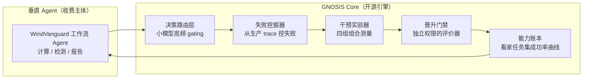

# GNOSIS 产品 PRD：回归受控的 Agent 持续进化引擎

版本 v1.0，日期 2026-10-04。本文档是产品执行依据；科研计划保留在 [GNOSIS-科研计划.md](GNOSIS-科研计划.md)，两份文档冲突处以本文档为准。文中新闻证据均出自 [Everyday News.md](research/GPT/Everyday%20News.md)（2026-09-24 至 10-04 各期）。

## 1. 拍板

GNOSIS 拆成两层交付：

- **GNOSIS Core（开源引擎，MIT）**：给已有 Agent Harness 接入"失败挖掘 → 干预实验 → 晋升门禁 → 能力账本"的持续进化能力。不收费，目标是开发者心智和真实失败数据。
- **垂直 Agent（收费主体）**：首个场景为 WindVanguard 风工程计算-报告工作流，面向设计院与检测机构。卖点一句话：这个 Agent 越用越强，每次升级附带零回归证据。

核心商业主张：工程领域 Agent 的可靠性鸿沟（Argo-Bench 实测最强模型完整解决率 34.8%）靠人工调试填不平；GNOSIS 用实测的组合退化证据自动修复，每次晋升都在客户的看家任务集上验证不掉能力。

## 2. 关键假设与失效条件

| 编号 | 假设 | 撤掉后结论是否成立 |
|---|---|---|
| A1 | 风工程/交通领域存在高频重复、结果可自动核对的数字化工作流 | 撤掉后垂直收费线失效，退到 L3 档（见 5.4） |
| A2 | 真实使用中组合退化高频发生且可修复（科研计划 H1/H2） | 撤掉后进化引擎没有工作对象，产品线整体不成立 |
| A3 | 能拿到至少一个真实用户场景（课题组、WindVanguard 合作方、设计院联系人） | 撤掉后没有失败分布，引擎磨不出差异化，退到 L3 档 |
| A4 | 大厂两年内不把回归受控的持续进化做成免费标配 | 撤掉后独立窗口关闭。当前 CoreWeave Forge 绑自家算力、OpenAI Agents API 只做执行环境，进化管理层是空位，窗口真实存在 |
| A5 | 单次进化干预的全口径费用能压到人工调试同等工时的十分之一以下 | 撤掉后单位经济不成立，只能做开源工具 |

## 3. 市场判断依据

**判断一：通用入口战争已结束，单人不做通用 Agent。** Muse 三周 500 万下载（Reuters，10-02），OpenAI Dots 拿到云电脑与 MCP Events（DevDay，09-29），微软 Autopilot 拿到企业身份与计费体系（09-25）。入口被三家分完。

**判断二：产品差异整体移出模型层，进化管理是分层里的空位。** 当前分层为 模型 → Loop → Memory → Tool/Skill → Runtime/Sandbox → Permission → Evaluation/Audit（09-30 期总结）。执行环境被 OpenAI Agents API 托管，沙箱被 NVIDIA OpenShell 占据，观测有 LangSmith 与 Forge。"上线后的 Agent 如何可靠地变好"没有任何一家做成 harness 中立的独立产品。Forge 已验证需求存在（Canva、MasterClass 付费），它绑死自家算力，留下了中立空位。

**判断三：封闭工作流是当前唯一被验证能跑通的 Agent 环境，可靠性鸿沟就是定价空间。** The Verge 实测 Dots（10-02）：边界明确、数据可访问、工具稳定、权限可控的 workspace 内表现好，开放 Web 卡住。Argo-Bench（10-02）：最强 Agent 在真实企业任务上完整解决率 34.8%。谁能把一个封闭工作流的可靠性从 35 分磨到 90 分，谁就收钱。GNOSIS 的组合干预加联合修复恰好是磨可靠性的机器。

## 4. 产品架构

| 模块 | 职责 | 依据 |
|---|---|---|
| 决策路由层 | 是否触发干预、是否升级人工等高频决策用小模型，大模型只做复杂归因与修复提议 | 参照 Cloudflare Clef（10-01）：中位决策延迟 38.8ms，科研版没有这一层，加它的唯一目的是压成本 |
| 失败挖掘器 | 从生产 trace 提取可复现失败，绑定组件版本背景 | 参照 CoreWeave Forge 闭环（10-01） |
| 干预实验器 | 四组组合测量，输出丢失成功与保留成功的实测清单 | 科研计划核心算法原样保留（科研计划第 5.2 节） |
| 晋升门禁 | 新旧版本在看家任务集上配对评价，达标才晋升 | 科研计划第 5.6 节 |
| 能力账本 | 每个版本在看家任务集上的成功率曲线，对客户公开 | 销售武器，客户买的就是这张图 |
| 费用计量 | 每次进化的全口径费用与换来的保留成功数 | 计费参照微软 Autopilot 的 usage-based 模式（09-25） |

**架构铁律：晋升门禁与评价器部署在 Agent 权限范围之外。** Agent 对 trace 与账本只有追加写权限，无删除权限。依据：Agent 可删除自身执行记录的实测论文（09-26）、NVIDIA OpenShell 把策略执行放在 Agent 进程外（09-29）、FTC 对 Agent 越权的联邦调查（10-01）。这一条同时是合规卖点。

## 5. 核心风险裁决：效应量未知

### 5.1 两个风险是同一个问题的两面

信息增量不足（四组证据帮不了修复器）与成本失控共享同一个根因：**组合退化的发生率和干预信息的效应量都未知，而规模设计不能拍在未知参数上。** 信息增量越弱，分辨它需要的样本量越大，成本越高；成本越高，能收集的候选对越少，越检测不出弱增量。因此先导阶段的任务有两个：决定做不做，决定做多大、做哪一档。

### 5.2 风险一的产品含义与验证点

组合退化如果是指令语义层面的竞争，得分矩阵只描述现象，修复器可能只会表面修补，甚至退化成悄悄删掉其中一项改进。产品的对应处理：

- 信息增量的验证放在全链条最便宜的位置：第 4 周固定候选快照上的修复对照实验（四组证据加普通反思 对 普通反思 对 随机修改对象消融），不跑完整进化，烧掉大头预算之前出结果。
- "修复实为删改"单独统计：把其中一项改动完整移除的结果计为选择分支，不计入联合修复（沿用科研计划第 5.3 节口径）。
- 两轮机制调整后仍不优于普通反思，放弃干预实验器，产品降档。

### 5.3 风险二的三处低估修正

科研计划的预算逻辑是先定统计功效再算钱，产品版倒置过来：先定可承受总费用，再让效应量门槛适配预算。三处低估按以下修正执行：

- **单次运行均价**按 $0.10–0.20 估，不采用 $0.05 的乐观值。AppWorld 类长轨迹任务挂高思考强度，推理 token 是大头。
- **提议与反思费用**单列预算项，按进化总费用的 40–60% 估。GEPA 每次反思读完整轨迹，修复器读四组轨迹片段。
- **因素试验边际成本**按 4 倍普通评估估，配对设计要求从官方初始状态重跑，H10/H01 的旧结果默认不能直接搬用。

### 5.4 三档产品降级阶梯（先导结束前冻结本阶梯）

| 档位 | 产品内容 | 触发条件 |
|---|---|---|
| L1 完整进化引擎 | 全部五个模块 | 先导测得可重复退化 ≥2 对，且第 4 周对照实验显示四组证据有增量，且全口径单次均价 ≤$0.15 |
| L2 回归门禁版 | 砍掉因素试验与联合修复，保留失败挖掘、能力账本、晋升门禁；改动由人做，门禁负责验证零回归 | 信息增量对照无优势，或退化率过低凑不齐机制样本。成本降一个数量级，客户仍买"升级不掉能力"的证据 |
| L3 纯开源工具 | 垂直收费线关闭，只维护 GNOSIS Core | A1 或 A3 被否定 |

**候选对筛选费用设硬上限。** 科研计划要求 30 个合格候选对；产品版放弃该统计目标，机制验证的候选对数量与实测退化率挂钩：退化率低于 10% 时，筛选费用达到预设上限即冻结样本量，直接走 L2，不许为凑样本追加预算。

## 6. 成本模型与单位经济

### 6.1 倒置的预算逻辑

先定自费硬上限，再推可做的事：先导阶段 ≤$200（含提议、反思、执行、评分全口径），第 5–8 周 ≤$300，第 9–12 周 ≤$300，全程自费上限 $800。超出部分必须来自试点客户付费，不追加自费。

产品版放弃科研版"5 个百分点统计分辨"的目标，改为"在一个真实客户场景展示可重复的零回归晋升闭环"。这决定了产品所需的样本规模比科研版小一个数量级以上，$800 预算与目标是匹配的。

### 6.2 单位经济目标

单次自动进化（干预实验 + 修复 + 验证）全口径费用目标 <$3。对标：工程师人工排查一次组合退化约 2–4 小时。假设 A5 的十分之一阈值由此而来。

### 6.3 三条压成本手段

1. **缓存复用放行一种情形**：H10、H01 若在普通搜索晋升阶段已在完全一致配置（模型版本、采样参数、任务集、评分器）下测过，直接复用并保留原始重复编号，只补测 H11 与必要配对重复。因素试验边际成本由此砍掉约一半，代价是配对纯洁性略降，在缓存规则里显式放行这一种情形（修订科研计划第 5.5 节）。
2. **决策路由层**：高频 gating 全部走小决策模型，大模型只处理复杂归因与修复提议。
3. **取消统一模型约束**：科研版全程 DeepSeek V4.1 Flash 高思考强度是科学控制变量；产品版改为按环节分档选模型，路由与挖掘用便宜模型，修复提议用强模型。

### 6.4 先导硬费用门槛

72 小时先导必须实测出全口径单次均价。若超过 $0.15：垂直任务范围收窄到最短闭环工作流，引擎单次进化预算上限减半，并在第 4 周对照实验前重新核算 L1 是否还负担得起。

## 7. 用户与首个场景

首个工作流从 WindVanguard 的计算-报告流程切。选它的三个理由：评分确定（数值结果与规范条文可核对，满足"评价必须依靠实际任务后果"）；自有源码，工具封装没有授权障碍；真实用户可触达（课题组与合作方）。

任务筛选只保留满足四个条件的工作流：边界明确、数据可访问、工具稳定、权限可控（The Verge 对 Dots 的实测结论，10-02）。

开源引擎的目标用户是使用 Claude Code、Codex 类 harness 的开发者，借 Skills 与 MCP 生态分发。收费主体的目标客户在 9–12 周内以试点形式接触，定价采用订阅（账本与门禁）加按次（进化运行）的混合计费。

## 8. 十二周里程碑与门禁

| 周次 | 工作 | 门禁 |
|---|---|---|
| 第 1–2 周 | WindVanguard 工作流 Agent 化：工具封装、任务定义、确定性评分器 | 评分器全程无模型打分，数值与条文可核对 |
| 第 3 周 | 引擎 MVP 接通真实流程，执行 72 小时先导 | G1：可重复组合退化 ≥2 对；实测全口径均价出炉；>$0.15 触发 6.4 的缩减规则 |
| 第 4 周 | 固定候选修复对照：四组证据加普通反思 / 普通反思 / 随机修改对象消融 | G2：四组证据无增量则冻结 L1，转 L2 |
| 第 5–8 周 | 真实用户持续试用，积累失败分布；能力账本 dashboard 交付 | G3（第 8 周末）：没有真实用户连续两周使用，停止垂直线 |
| 第 9–12 周 | GNOSIS Core 开源发布（接 Claude Code / Codex 类 harness）；垂直 Agent 谈收费试点 | 试点签约或明确拒绝，二者都算结论 |

## 9. 度量指标

| 指标 | 定义 | 用途 |
|---|---|---|
| 单位费用保留成功数 | 每美元换来的、且后续版本仍保留的新增成功任务数 | 单位经济核心，对客户与对自己都用同一个数 |
| 零回归晋升率 | 通过看家任务集验证、无历史能力丢失的晋升占比 | 能力账本的可信度 |
| 干预费用占比 | 因素试验与修复占进化总费用比例，上限 30% | 沿用科研计划口径 |
| 联合修复率 | 退化组合中修复后保留双方改进的比例；删改式修复单独计数 | 引擎有效性 |
| 能力账本曲线 | 各版本在看家任务集上的成功率序列 | 对外销售材料，对客户公开 |

## 10. 停止规则

| 观察到的结果 | 行动 |
|---|---|
| 先导退化率不足（可重复退化 <2 对） | 按 5.4 转 L2 或 L3，不扩大任务范围硬找 |
| 信息增量两轮机制调整仍无优势 | 冻结 L1 转 L2，干预实验器代码保留在引擎中但默认关闭 |
| 第 8 周末无真实用户连续使用 | 停止垂直线，引擎转纯开源维护 |
| 任一阶段费用击穿硬上限 | 冻结开发，复盘后重新选择档位，不许静默追加预算 |

核心假设被否定时结束对应主张，保留真实负结果与可复用代码，不以无限重试代替产品进展。

## 11. 与科研计划的关系

| 科研计划内容 | 产品版去向 |
|---|---|
| 四组干预实验、联合修复算法 | 引擎内核，不变 |
| 晋升与能力保留测量（5.6 节） | 能力账本产品功能 |
| 费用核算框架（8.2 节） | 单位经济与计费报表 |
| AppWorld / τ² 实验 | 降级为开源 repo 的公开 benchmark 证据 |
| 第二组机制比较实验（7.3 节） | 提前为第 4 周产品门禁 G2，兼作白皮书素材 |
| 统一模型配置（7.1 节） | 取消，科学控制变量在产品版改为成本变量（见 6.3） |
| 统计功效目标（7.7 节） | 放弃 5 个百分点分辨目标，改为真实场景可重复闭环演示 |
| AAAI 投稿 | 可选副产品，引擎跑出真实数据后顺手写，不反向绑架产品节奏 |
