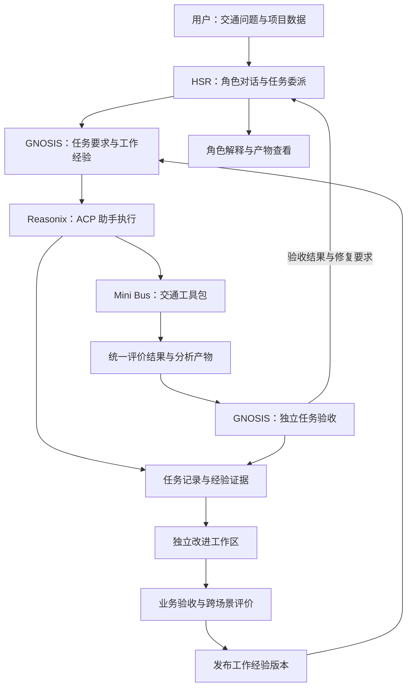

# GNOSIS 产品 PRD v5：HSR 中的交通研究与方案分析搭档

版本 v5.0，2026-10-14。本文档规定产品定位与实施要求。HSR Partner Harness 提供用户入口，Mini Bus 提供交通工具与评价环境，GNOSIS Core 提供任务验收及经验改进。科研实验按各自冻结协议执行，产品开发以本文档为准。

## 1. 产品决策与关键假设

**将 GNOSIS 接入 HSR 的任务执行过程，以 Mini Bus 的交通方案分析作为首个场景。** 用户与角色讨论问题，角色形成委派，助手调用交通工具完成实验，GNOSIS 核验实际产物，角色根据核验结果解释方案。合格的工作经验供后续同类任务调用。

首个完整任务为：**给定一批出行需求，比较两种已有调度策略，输出可复核的业务指标与图表，并解释未服务请求的原因。** 收费价值来自减少实验操作与结果核对的时间，以及跨任务复用经过验证的工作经验。

| 编号 | 关键假设 | 撤掉后，结论是否成立 |
|---|---|---|
| A1 | 用户会在绑定项目中反复开展相近的交通实验与方案分析 | 经验复用价值失效，任务验收价值保留；重新评估首场景 |
| A2 | Mini Bus 的需求数据、策略及模型文件可用于完整评价 | 首个交通闭环的执行前提失效，先补齐对应数据与模型资产 |
| A3 | 用户要求可关联到实际产物，独立评价能够检查完成状态 | 可核验交付的主张失效，先建立任务要求与产物检查的对应关系 |
| A4 | HSR 能向 GNOSIS 提供完整委派及执行事件，并向助手开放交通工具 | 直接融合的架构假设失效，先完成 ACP 工具接入与事件传递 |
| A5 | 用户节省的操作、复核和返工时间足以支撑付费 | 收费假设失效，依据真实试用重新裁决交付价值 |

A2、A4 在首个完整任务中核实，A1、A5 通过两周真实使用与付费试点核实。A3 由任务验收协议及产物检查实现。首个交付按照第 9 节推进。

### 1.1 交付关系

| 层次 | 产品职责 | 交付方式 |
|---|---|---|
| HSR Partner Harness | 角色对话、任务委派、助手执行与结果解释 | 复用现有桌面工作台及移动查看能力 |
| Mini Bus 交通工具包 | 读取需求与场景，运行已有策略评价，生成方案分析产物 | 接入 HSR 的项目工具，作为首个业务场景 |
| GNOSIS Core | 保存任务要求与执行证据，核验产物，形成和发布工作经验 | 接入 HSR 执行前后；提供独立工具接口与开源引擎 |
| 研究工作区 | 分析经验形成与采用，评价候选改进 | 使用获准的任务证据，按独立协议运行，合格结果进入产品验收 |

客户承诺为：**和角色搭档完成交通方案分析，结果可追溯，工作经验经验证后用于下一次任务。**

### 1.2 项目推进次序

HSR 与 Mini Bus 共同构成首条产品线。完成交通分析闭环及经验采用验证后，沿同一工具接口接入 SMC 的公交走廊校准与跨日验证，再接入 WindVanguard 的工程后处理。每个场景采用自身的业务评价器和交付要求。

## 2. 已有证据如何约束产品

| 材料 | 已记录的结果 | 产品决策 |
|---|---|---|
| [正式实验交付，10 月 8 日](GNOSIS-正式实验交付-2026-10-08.md) | GNOSIS 留出严格成功 101/150，fixed 96/150，global 93/150；主比较 Holm p 均为 0.656250。冻结执行费用比 fixed 低 49.81%，计入全部阶段后 GNOSIS 费用最高。48 条选择验证计划全量重测，复用为 0 | 保留执行效率优化；产品收益按包含前期投入与人工复核的完整成本计算 |
| [P1 交付，10 月 9 日](GNOSIS-P1实验交付-2026-10-09.md) | 三个成熟候选均为 GLOBAL，各覆盖 36/36 执行，执行与费用节省均为 0 | 激活边界选择性验证保留为研究能力，正式验收采用所声明支持工作流的全量重测 |
| [研究结论，10 月 11 日](GNOSIS-研究结论-2026-10-11.md) | 八个来源的宿主依赖范围覆盖全部审计池，选择性验证费用更高；研究路线结束，产品转入 L2 | Core 采用 L2 的版本验收职责；其验证费用按实际执行核算 |
| [下一步科研计划，10 月 13 日](GNOSIS-下一步科研计划-2026-10-13.md) | P2 同批 18 题各两次：fixed 与 GNOSIS 均成功 20/36，工具失败分别为 651 与 112；global 成功 25/36 | 业务要求完成作为交付终点；工具错误与步数承担效率指标 |
| [下一步科研计划](GNOSIS-下一步科研计划-2026-10-13.md)、[独立解释](独立解释.md) | 两份材料尚未完成；65 次编辑的反馈利用链仍待重建，反馈组织与执行采用的机制需要裁决 | 可据此设计问题观测与候选改进；正式产品采用通过真实工作流验收的实现 |

L2 在本 PRD 中具体指**业务工作流的执行证据与版本验收**。业务验收检查声明支持的全部工作流；局部证据复用待真实场景同时获得准确性和费用收益后，才进入正式验证策略。

## 3. 首个用户与完整产品范围

### 3.1 用户及使用场景

直接使用者为交通研究者和交通工程学生，团队场景覆盖导师课题组及方案分析人员。首批使用从用户自己的 Mini Bus 项目开始，随后邀请具有相近实验任务的真实使用者。收费试点面向承担分析与交付成本的团队负责人。

典型任务：用户在 HSR 绑定交通项目目录，向角色提出策略比较问题。角色结合当前数据形成任务，助手执行交通工具，GNOSIS 读取评价结果并核对交付要求。角色据此解释方案，用户直接打开结果文件和图表。

### 3.2 当前交付范围

输入包括需求数据、站点图和场景配置；采用已有策略及其所需模型文件。每次任务明确比较对象与评价条件，产物保存在绑定项目的指定目录。

| 环节 | 系统行为 | 可交付结果 |
|---|---|---|
| 理解任务 | 角色整理用户问题，登记策略、场景及交付要求 | 结构化委派与任务验收条件 |
| 准备评价 | 核对数据与模型，保存实际使用的配置及运行条件 | 可重复执行的评价任务 |
| 执行比较 | 调用 Mini Bus 统一评价器，在共同条件下运行两种已有策略 | 逐次结果与汇总指标 |
| 形成交付 | 从真实结果生成指标表与图表，关联未服务请求的原因记录 | 可打开的分析报告与原始结果 |
| 独立核验 | 读取产物，核对比较条件及要求覆盖情况，重新计算关键汇总 | 逐项验收结果与证据位置 |
| 解释与复用 | 角色依据核验结果解释方案；候选经验经过第 6 节验收后发布 | 结果解释与可调用的工作经验 |

首个工具包覆盖场景检查、策略评价和分析产物生成。车辆动作由 Mini Bus 已有策略执行，方案指标由统一评价器计算。GNOSIS 的改进对象为任务组织、工具操作与经验表示。新增训练任务在用户明确指定后执行，并采用独立的策略评价流程。

### 3.3 产品界面

HSR 时间线沿用现有角色与助手身份，增加任务要求及验收结果卡片。任务执行时呈现真实工具事件，结束后展示产物位置和逐项核验结果。角色根据完整证据组织解释。

结果卡片可打开指标表、图表及原始评价记录。Mini Bus 地图用于查看车辆状态和服务分布，任务交付指标取自对应的统一评价结果。用户更改需求或评价条件后，系统关联新任务版本并重新运行受影响步骤。

## 4. 任务要求与交付判定

### 4.1 任务要求

模型根据用户请求与项目资料整理要求，委派中明确评价条件及交付物。用户提供的新要求随任务版本记录，每个要求关联具体对象与证据来源。

| 要求类型 | 示例 | 核验依据 |
|---|---|---|
| 必要行动 | 在指定需求上完成两种策略的比较，并输出约定指标及图表 | 评价记录、结果表与图表文件 |
| 保持事项与操作范围 | 保留原始需求和既有模型；使用用户指定的策略与场景 | 实际文件操作与最终对象状态 |
| 取值与对象正确性 | 两侧使用共同需求和种子，保持统一终止条件与指标定义 | 生效配置、逐次评价结果与汇总重算 |

语义判断由模型完成，涉及用户新增决策的事项提交用户。程序负责协议格式与权限控制；数值检查由 Mini Bus 评价器及明确的计算规则完成。

### 4.2 执行与结果的一致性

执行前保存任务要求、输入关联与验收条件。执行期间记录实际工具事件及生效配置，助手结束后由独立验收读取对应产物，再更新要求完成状态。

报告表格和正文中的关键数值来自同一份已核验结果。需求、策略或评价条件变化后，结果关联到新的任务版本。模型组织解释，评价器提供指标依据。

执行状态与验收状态分别保存。助手回合结束后任务进入“验收中”；要求全部满足且产物读取核对通过时标记“已完成”。核验失败标记“验收失败”，角色依据具体失败要求形成修复委派；需要用户决定的事项标记“待确认”。

Mini Bus 验收明确登记需求范围、随机种子及终止规则。`structural_unserviceable` 独立统计，服务率与流失率沿用统一分母；截断后的剩余请求与结束原因随结果展示。关键汇总从逐次结果重新计算，报告中的策略判断引用相应业务指标。

### 4.3 评价边界

AutomationBench 原评分继续用于冻结科研记录。产品验收依据实际交通任务的要求，检查真实执行和最终产物。任务完成率衡量搭档是否完成分析工作；服务率、等待时间等指标衡量被比较策略的业务表现，两类结果分别记录。

## 5. 系统架构与接入责任

### 5.1 模块职责

| 模块 | 实施职责 |
|---|---|
| HSR 角色与任务编排 | 形成结构化委派，提供完整任务与项目状态，向角色传递真实验收结果 |
| ACP 助手接入 | 向 Reasonix 会话注册交通工具与经验工具，传递任务上下文及执行事件 |
| Mini Bus 交通工具包 | 封装场景检查、策略评价和产物生成，返回实际生效条件及真实错误 |
| GNOSIS 任务验收 | 读取对应产物，核对要求、比较条件与指标，保存逐项结论和来源 |
| 经验运行时 | 按项目和场景提供获准经验，记录实际送达及后续工具行为 |
| 任务与版本记录 | 关联输入、工具结果和交付产物，记录经验版本的业务变化与完整成本 |
| 改进工作区与发布 | 根据真实失败生成候选经验，通过跨场景评价与历史任务验收后发布 |

### 5.2 HSR 的接入位置与协议

HSR 的任务编排是 GNOSIS 的主接入位置。执行前登记任务要求并装配获准经验，执行中关联工具事件，助手回合结束后调用独立验收，再向角色返回逐项结论与产物证据。

当前 HSR 的 ACP 适配器以 `mcpServers=[]` 创建和恢复会话，实施时新增交通工具服务与 GNOSIS 经验工具的配置，并贯通创建、恢复及审批路径。MCP 负责工具连接，HSR 负责委派和任务生命周期。项目权限沿用 HSR 的沙箱与审批机制。

当前 `end_turn` 进入执行完成回执，实施时保留其执行含义，并新增独立验收状态。角色结果输入增加检查结论及证据引用，包含实际命令退出状态和产物核对结果。GNOSIS 的 [mcp_proxy.py](../engine/mcp_proxy.py) 与组件宿主作为工具和经验执行基础，完整任务上下文由 HSR 显式传入。

任务中途固定产品与经验版本，候选在独立工作区运行。评价器与发布控制处于受测 Agent 权限之外。正式任务按用户授权读写项目文件，失败状态和原始错误保留。角色记忆沿用 HSR 的现有作用域，工作经验以任务证据及版本管理。

### 5.3 已有资产与待实现能力

| 资产 | 当前用途 | 产品化需要完成的工作 |
|---|---|---|
| [HSR 任务编排](<E:/AI/HSR Partner Harness/src/pair_harness/core/orchestrator.py>) | 委派、执行事件、回执与角色结果轮 | 加入任务验收，向角色传递逐项结果及证据 |
| [HSR ACP 接入](<E:/AI/HSR Partner Harness/src/pair_harness/adapters/acp/engine.py>) | Reasonix 会话、工具事件与审批 | 接入 MCP 服务配置，贯通创建与恢复路径 |
| [Mini Bus 评价器](<D:/Documents/Bus Project/Mini Bus/Churn-Aware-GNN-RL/src/eval/evaluator.py>) | 策略执行及统一指标 | 封装工具接口，登记共同评价条件，核对产物 |
| [Mini Bus 评价入口](<D:/Documents/Bus Project/Mini Bus/Churn-Aware-GNN-RL/scripts/run_eval.py>) | 配置、策略和模型参数的命令入口 | 提供可恢复的任务调用及真实结果返回 |
| [Mini Bus 实时会话](<D:/Documents/Bus Project/Mini Bus/Churn-Aware-GNN-RL/src/realtime/session.py>) | GNN 推理、事件环境和车辆状态 | 在结果页面关联场景与实际运行，展示服务分布 |
| [mcp_proxy.py](../engine/mcp_proxy.py)、[host/](../host/) | MCP 转发与隔离组件运行 | 提供工具和经验接入，验证真实调用、权限及消息送达 |
| [evolution.py](../engine/evolution.py)、[activation.py](../engine/activation.py) | 工作、发布、冻结版本及范围分析 | 复用版本管理，接入交通任务的全量验收 |

首个任务使用 `E:/AI/HSR Partner Harness/` 与 `D:/Documents/Bus Project/Mini Bus/Churn-Aware-GNN-RL/` 的当前实现。接口能力以真实调用验收，产品实施涉及的模块在修改后运行各项目标准检查。

## 6. 经验改进与产品版本验收

### 6.1 改进过程

任务产生问题后，系统保留当时的要求、实际模型输入及结果。改进工作区使用获准记录生成候选修改，修改对象为工具操作组件或经验表示。经验按项目及适用场景登记，核心业务评价规则由独立验收维护。

每条候选经验说明适用条件、所依据的证据及完成后的可观察结果，关联来源任务。运行记录同时区分登记、实际送达和采用，便于定位改进是否真正生效。

相同条件下的再次执行与跨场景收益分别评价。候选经验在新需求窗口或新场景中运行，检查完成情况与实际采用。经验带来的变化落到配置选择、工具调用及产物内容上，合法性与业务评价由原任务规则检查。

### 6.2 版本验收

候选版本与当前版本在相同初态的真实任务上比较。验收覆盖支持的全部工作流，包含业务例外和此前失败任务。学习来源与跨场景评价分别登记，正式比较使用共同模型、相同任务条件和预定重复次数。出现退化或结果分歧时定位到具体要求。

| 判断项 | 发布要求 |
|---|---|
| 业务完整性 | 策略比较及指定产物齐全，操作范围符合任务要求 |
| 数值及来源 | 关键汇总与逐次记录一致，产物关联正确需求及评价配置 |
| 历史能力 | 已验收任务的关键业务错误为零，结果分歧全部结案 |
| 修改价值 | 任务完成率或用户总耗时有明确改善，完整成本在试点约定范围内 |
| 发布决策 | 保存比较证据，维护者确认发布；运行中的任务沿用原版本 |

产品能力页面展示已完成任务及版本差异，每项结果关联原始执行与验收证据。团队收费按约定任务范围及服务内容说明。

### 6.3 两份未完成文档的影响

65 次历史编辑重建用于确定反馈形成或执行采用的主要问题。200 元同源实验按科研计划的进入条件执行，使用独立研究预算。HSR 与 Mini Bus 的产品接入同步推进，研究成果进入相同的产品验收流程。

| 后续研究结果 | 产品采用方式 |
|---|---|
| 反馈组织改善经验且提高新任务净完成 | 将反馈组织作为候选学习策略，在交通任务验收后启用 |
| 关键要求已完整写入经验，主要失效发生在采用 | 候选改进聚焦当前对象的决定与结果核验 |
| 只有已有边界经验表示有效 | 采用通过产品验收的边界表示，按其实际来源登记 |
| 新干预无实用收益 | 继续使用稳定工具、人工改进与全量验收完成产品工作流 |

## 7. 商业交付与成本

### 7.1 收费对象

首笔收费对应真实团队的交通方案分析试点。交付包括交通工具包接入、任务验收与经验复用，约定支持的数据和策略范围，按团队的实际分析任务完成试用与报价。

HSR 沿用开源与用户自配模型账号的使用方式，GNOSIS Core 提供开源引擎。收费主体为交通工具包的团队适配与维护服务；常规团队订阅包含约定任务范围，新增数据格式或专有工作流单独报价。

价格由首批任务的人工节省和完整成本确定。试点记录实际付款、重复使用及继续订阅的决定，形成后续报价依据。

### 7.2 完整成本

每个完成任务的完整成本包含模型调用、计算资源和必要存储，用户操作、复核与返工时间一并计量。团队适配及版本验收费用分摊到约定任务量，失败任务的支出计入总成本。

\[
C_{\text{完成任务}}=
\frac{C_{\text{全部执行}}+C_{\text{复核返工}}+C_{\text{适配分摊}}+C_{\text{版本验收分摊}}}
{N_{\text{验收通过任务}}}.
\]

用户自配账号的模型支出计入用户总费用，团队服务支出按实际承担方记录。报价覆盖适配与维护的交付成本，用户节省的工时价值高于订阅和调用费用合计。团队服务目标毛利率为 60%，以真实收入及服务成本核算。

产品模型配置依据业务验收选定并登记版本。研究固定的输出上限、组额度和价格计算继续用于原实验；产品按真实调用与账单核算。增加计算投入由项目授权范围及报价决定。

### 7.3 部署

首个交付采用 HSR Windows 桌面程序、Python Sidecar 与本地交通工具服务，Mini Bus 评价在绑定项目环境中执行。项目数据和产物保存在指定目录，移动端沿用 HSR 的配对与任务查看能力。模型调用的数据范围按用户授权设置，远程计算按任务授权及报价执行。

## 8. 产品指标

| 指标 | 定义 | 判断用途 |
|---|---|---|
| 验收通过的任务完成率 | 规定周期内验收通过任务数 / 全部受理任务数 | 产品是否完成用户工作 |
| 关键业务错误数 | 比较条件错误、汇总错误及违反明确要求的任务错误 | 交付验收，关键错误清零 |
| 用户总耗时 | 操作、复核与返工时间合计，和同范围手工作业比较 | 付费价值，试点目标减少至少 30% |
| 每个完成任务的完整成本 | 按第 7.2 节核算 | 使用价值、报价与毛利 |
| 重复使用与付费 | 同一用户在两周内完成至少两次同类任务；团队产生真实付款 | 商业验证 |
| 版本退化 | 相同验收范围内候选相对当前版本的新增失败及分歧 | 版本发布判断 |
| 工具效率 | 失败调用、执行步数、计算时间及模型费用 | 定位成本与性能问题 |
| 经验采用及迁移收益 | 记录实际送达和后续工具行为；固定其他条件，在新需求或场景中比较装载与撤除同一经验的任务结果及完整成本 | 持续改进的业务价值 |

## 9. 实施顺序与验收里程碑

实施从 2026-10-14 开始，按下表连续推进。每项交付用真实服务和项目数据验收，完成结果及实际时间进入任务记录。

| 目标时间 | 具体交付 | 验收条件 |
|---|---|---|
| 10 月 14–18 日 | 首个交通任务协议与工具接口 | 选定真实需求、站点图和两种可执行策略；确认模型文件；人工跑通共同条件评价，记录产物及操作耗时 |
| 10 月 19–25 日 | HSR 与 GNOSIS 接入，Mini Bus 工具封装 | ACP 新建与恢复会话均可调用真实工具；完整委派和工具事件进入 GNOSIS；执行状态与验收状态分别显示 |
| 10 月 26–31 日 | 角色委派至核验交付的完整闭环 | 从 HSR 对话发起策略比较，生成真实指标及图表；独立核验通过，角色引用实际结果解释方案；运行受影响项目的标准测试与构建 |
| 11 月 1–15 日 | 经验改进与跨场景验证 | 至少三个需求窗口或场景，包含业务例外；按共同条件重复三次评价，关键业务错误为零；记录经验采用及新任务收益，用户总耗时减少至少 30% |
| 11 月 16–30 日 | 团队试用、付费试点与安装交付 | 至少一个团队真实付款；两周内重复完成同类任务；在用户环境安装后运行通过，实际收费覆盖服务成本 |
| 12 月 | 稳定接口、团队订阅与后续交通工具接入 | 登记续用决定及实际毛利；Core 在独立环境复现支持工作流；按同一接口接入 SMC 的校准与跨日验证 |

首项具体工作是登记一个 Mini Bus 策略比较任务，保存其共同评价条件与人工产物，随后完成 HSR 工具接入及独立验收。科研文稿按各自协议同步推进，研究候选进入第 6 节的产品验收。

## 10. 决策与停止条件

| 观察到的结果 | 行动 |
|---|---|
| 首任务缺少所需数据、模型或参考产物 | 补齐该任务的执行资产，取得可运行的共同评价条件 |
| 工具结果错误或关键数值核验失败 | 任务标记验收失败，定位真实根因，修复后重新验收 |
| 候选版本出现关键退化或结果分歧 | 拒绝候选，正式任务继续使用当前已验收版本 |
| 复核与返工使用户总耗时未减少 | 定位增加耗时的具体环节，结束该工作流的收费试点 |
| 使用者重复使用成立，购买者拒绝付费 | 依据拒绝理由裁决收费对象与交付价值，结束原收费假设 |
| 局部验证没有准确性与费用收益 | 正式版本继续采用全量工作流验收 |
| 模型服务不可用或余额不足 | 任务终止并保留状态，恢复后按已完成操作继续，实际费用入账 |

## 11. 文档与证据关系

| 文档 | 在产品中的作用 |
|---|---|
| [GNOSIS 科研计划](GNOSIS-科研计划.md) | 原连续修复、组件与验证范围的研究协议；其冻结条件用于解释原结果 |
| [正式实验交付](GNOSIS-正式实验交付-2026-10-08.md)、[P1 交付](GNOSIS-P1实验交付-2026-10-09.md) | 已执行实验的性能、费用与复用证据 |
| [研究结论](GNOSIS-研究结论-2026-10-11.md) | 已结束路线的裁决，以及转入 L2 的依据 |
| [EVO-PATH 计划](EVO-PATH-研究计划-2026-10-12.md) | 功能组织与后续学习的研究方向，按自身资格条件推进 |
| [下一步科研计划](GNOSIS-下一步科研计划-2026-10-13.md) | 待完成的反馈利用链重建与同源干预协议 |
| [独立解释](独立解释.md) | 待完成的解释稿；具体产品判断引用可定位的执行与结果 |
| [HSR README](<E:/AI/HSR Partner Harness/README.md>)、[设计哲学](<E:/AI/HSR Partner Harness/PHILOSOPHY.md>) | 产品入口、角色职责与执行架构 |
| [Mini Bus 架构](<D:/Documents/Bus Project/Mini Bus/Churn-Aware-GNN-RL/docs/架构文档.md>)、[评价规范](<D:/Documents/Bus Project/Mini Bus/Churn-Aware-GNN-RL/specs/eval_spec.md>) | 首个交通工具包、环境条件与业务指标 |
| 本 PRD | HSR 中交通研究与方案分析搭档的产品定位、交付判定及商业实施要求 |
