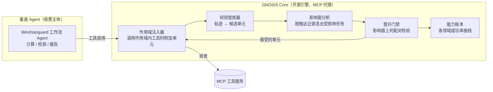

# GNOSIS 产品 PRD v2：改动级回归受控的 Agent 持续进化引擎

版本 v2.0，日期 2026-10-05，取代 v1.0（归档于 [GNOSIS-产品PRD-v1-20261004.md](../archive/2026-10-06/documents/plans/GNOSIS-产品PRD-v1-20261004.md)）。本文档是产品执行依据；科研计划见 [GNOSIS-科研计划.md](GNOSIS-科研计划.md)，两份文档冲突处以本文档为准。v1 的新闻证据出自 [Everyday News.md](research/GPT/Everyday%20News.md)；v2 新增证据附原始链接。

## 1. 拍板

两层交付不变：

- **GNOSIS Core（开源引擎，MIT）**：给任何工具调用型 Agent 接入“经验 → 作用域知识单元 → 影响面门禁 → 能力账本”。以 MCP 代理的形态部署，不改 Agent 本身的代码。不收费，目标是开发者心智和真实失败数据。
- **垂直 Agent（收费主体）**：首个场景仍为 WindVanguard 风工程计算-报告工作流，面向设计院与检测机构。

卖点一句话升级为：**这个 Agent 越用越强，每次升级都附带零回归证据，而证据的成本只取决于这次改动影响了什么。** 这对应软件工程里的测试影响分析：改了哪个模块，只重跑依赖它的测试。

v2 相对 v1 的三处改变：

1. 引擎内核从“四组组合干预 + 联合修复”换成“作用域知识单元 + 影响面门禁”。原因见科研计划 §1：AppWorld 上执行模型已到 92%，组合退化不可观测，搜索 $5.15 没有产出可确认的改进。
2. 引擎的公开验证场从 AppWorld 换成 AutomationBench（Zapier 出品的业务工作流基准，47 个模拟 SaaS），前沿模型约 50%，失败形态与企业客户的真实痛点一致。
3. 差异化从“提供自进化”收缩到“让自进化可验收”，理由见 §3 判断四。

## 2. 关键假设与失效条件

| 编号 | 假设 | 撤掉后结论是否成立 |
|---|---|---|
| A1 | 风工程/交通领域存在高频重复、结果可自动核对的数字化工作流 | 撤掉后垂直收费线失效，退到 L3 档（见 §5.3） |
| A2 | 封闭工作流中 Agent 的失败主要是环境知识缺失，能写成带作用域的知识单元。证据：StarHarness 在 AutomationBench Finance 上靠接口修复、环境约定、操作知识涨 20–35 分；AutomationBench 论文中 72–91% 的失败是 Agent 自称完成而状态错误 | 撤掉后进化引擎没有工作对象，降到 L2 |
| A3 | 能拿到至少一个真实用户场景（课题组、WindVanguard 合作方、设计院联系人） | 撤掉后没有真实失败分布，退到 L3 |
| A4 | 大厂两年内不把“改动级回归验收与能力账本”做成免费标配 | v1 版本的“进化管理层是空位”已部分失效：微软 SkillOpt-Sleep 已为 Claude Code、Codex、Copilot 提供每晚离线自进化加留出集门控。撤掉 A4 后，独立窗口只剩垂直场景 |
| A5 | 单次晋升的全口径验证费用压到人工排查同类问题工时成本的百分之一以下 | 按 Flash 实测单题约 $0.01–0.03、每单元验证上限 8 题，单次晋升约 $0.1–0.3。撤掉后单位经济不成立，只能做开源工具 |

## 3. 市场判断依据

**判断一：通用入口战争已结束，单人不做通用 Agent。** Muse 三周 500 万下载（Reuters，10-02），OpenAI Dots 拿到云电脑与 MCP Events（DevDay，09-29），微软 Autopilot 拿到企业身份与计费体系（09-25）。

**判断二：产品差异整体移出模型层。** 当前分层为 模型 → Loop → Memory → Tool/Skill → Runtime/Sandbox → Permission → Evaluation/Audit（09-30 期总结）。执行环境被 OpenAI Agents API 托管，沙箱被 NVIDIA OpenShell 占据，观测有 LangSmith 与 Forge。

**判断三：封闭工作流是当前唯一被验证能跑通的 Agent 环境，可靠性鸿沟就是定价空间。** Argo-Bench 上最强 Agent 完整解决率 34.8%（10-02）；AutomationBench 公开集上最强的 Claude Opus 5 为 50.3%。

**判断四（v2 新增）：自进化本身正在商品化，验收层没有。** [SkillOpt](https://github.com/microsoft/SkillOpt) 开源 5 个月获得约 1.8 万星，v0.2.0 已带 Claude Code、Codex、Copilot、Devin 接入与 OpenClaw 适配；ACE 的社区实现 [kayba](https://github.com/kayba-ai/agentic-context-engine) 已提供托管服务。它们的门控都在固定的全局留出集上判定，历史任务一多，要么验证费用线性上涨，要么旧能力退化看不见。企业客户买单的是“升级不掉能力”的证据和这份证据的价格，GNOSIS 卡在这一层。

## 4. 产品架构

| 模块 | 职责 | 依据 |
|---|---|---|
| 作用域注入器 | 作为 MCP 代理位于 Agent 与工具服务之间；只在调用作用域内工具时把对应单元附加到工具返回；记录每次运行触达了哪些工具 | 作用域外的输入逐字节不变，这是零回归证据的来源（科研计划 §5.2） |
| 经验提炼器 | 从运行轨迹、报错与奖励信号产出带作用域的候选单元 | 复用 ACE 的反思与整理提示词 |
| 影响面分析 | 按触达记录算出单元会影响的任务集合 | 软件回归测试选择（Ekstazi）的同构 |
| 晋升门禁 | 只在影响面上做逐项配对检验，赢多输少且显著才接受，否则弃权 | 规则采用 SAGE |
| 能力账本 | 每个版本在看家任务集上的分领域成功率曲线与每次晋升的证据，对客户公开 | 销售武器，客户买的就是这张图 |
| 费用计量 | 每次晋升的全口径费用与换来的保留成功数 | 计费参照微软 Autopilot 的 usage-based 模式（09-25） |

**架构铁律不变：晋升门禁与评价器部署在 Agent 权限范围之外。** Agent 对轨迹与账本只有追加写权限，无删除权限。依据：Agent 可删除自身执行记录的实测论文（09-26）、NVIDIA OpenShell 把策略执行放在 Agent 进程外（09-29）、FTC 对 Agent 越权的联邦调查（10-01）。MCP 代理形态让这条铁律天然成立：Agent 只看得到工具返回，碰不到代理内部的门禁与账本。

v1 的“决策路由层”推迟。Flash 单题约 $0.01–0.03，用小模型做路由省下的钱不足以抵消新增组件的维护成本；单题费用上升到 $0.15 以上时再启用。

## 5. 核心风险裁决

### 5.1 v1 的风险已经被实验回答

v1 把“组合退化的发生率与干预信息的效应量都未知”列为根风险。AppWorld 的冻结结果给出了答案：在执行模型已饱和的环境里，效应量低于噪声，整条线不可测。v2 的处理是先选有余量的环境（StarHarness 已在 AutomationBench 实测 +20–35 分），再把测量集中到改动的影响面上。

### 5.2 v2 的三个风险与验证点

| 风险 | 表现 | 最便宜的验证点 | 出口 |
|---|---|---|---|
| R1 采纳 | 单元注入了，Flash 不照做 | P1 结束时的采纳率日志（科研计划 G1） | 单元改为可执行的接口包装规则，绕过遵循问题 |
| R2 作用域局部性 | 有用知识大多是全局的，影响面接近全集，验证费用优势消失 | P1 结束时单元作用域分布与验证运行数（G3） | 作用域细化到端点级；仍不行则主张收缩为净增益与保留 |
| R3 商品化 | SkillOpt-Sleep 类产品补上改动级验收 | 持续跟踪其仓库与发布说明 | 加快垂直线，引擎卖点转为“与任意进化器配套的验收层” |

### 5.3 三档降级阶梯（先导结束前冻结）

| 档位 | 产品内容 | 触发条件 |
|---|---|---|
| L1 完整引擎 | 全部模块，自动提炼、自动晋升 | G1 通过，且 G3 显示验证费用不随历史增长 |
| L2 回归门禁版 | 砍掉经验提炼器；改动由人或任意第三方进化器（SkillOpt、ACE）提出，GNOSIS 负责影响面分析、配对门禁和账本 | 自动提炼的净增益两轮调整仍不达标（G1 失败两次）。此档仍能卖“升级不掉能力，且验收成本与改动规模成正比” |
| L3 纯开源工具 | 垂直收费线关闭，只维护 GNOSIS Core | A1 或 A3 被否定 |

## 6. 成本模型与单位经济

### 6.1 预算来源与硬上限

全部模型调用走 Command Code GOAT 网关，额度窗口为 5 小时 $14、7 天 $35、自然月 $70；受测模型 deepseek/deepseek-v4.1-flash 的自然月额度 $60。研究阶段硬上限 $45，账本里同时生效三级上限：研究总预算 $45、当前阶段上限（先导 $5）、5 小时滑动窗口 $12（留 $2 给研究者的 CLI 操作）。正式研究分段：10 月 10 日前 ≤$8，10 月 11–17 日 ≤$15，10 月 17 日后 ≤$22，每段另受 5 小时窗口 $12 约束。任何一段击穿即冻结，复盘后重选档位，不静默追加。v1 的自费 $800 口径作废，以网关额度为准。

### 6.2 单位经济目标

- 单次晋升（提炼 + 影响面配对验证）全口径费用目标 <$0.5。
- 对标：工程师人工排查一次回归约 2–4 小时。
- 对客户的计价单位是“保留成功数”：每美元换来、且后续版本仍保留的新增成功任务数。

### 6.3 压成本手段

1. **影响面验证**：每个单元只在受影响任务上验证，每单元上限 8 题；对照组直接复用账本中依赖未变的历史结果。
2. **作用域不相交的单元批量验证**：一次运行同时检验多个互不影响的单元。
3. **缓存命中**：网关缓存读价为输入价的 2%，固定前缀放在提示开头。AppWorld 实测缓存命中率 90.2%。

## 7. 用户与首个场景

**开源引擎的目标用户**：用 MCP 工具构建 Agent 的开发者，以及已经在用 SkillOpt、ACE 一类进化器、需要回归验收的团队。分发形态是一个 MCP 代理加一个账本页面，接入时只改 MCP 配置，不改 Agent 代码。公开证据是 AutomationBench 上的持续进化结果与账本曲线。

**垂直首场景**：WindVanguard 的计算-报告流程。选它的三个理由不变：评分确定（数值结果与规范条文可核对）；自有源码，工具封装没有授权障碍；真实用户可触达。v2 的变化是封装方式：WindVanguard 的工具直接做成 MCP 服务，GNOSIS 代理放在前面，与 AutomationBench 上验证过的形态一致。

任务筛选仍只保留满足四个条件的工作流：边界明确、数据可访问、工具稳定、权限可控（The Verge 对 Dots 的实测结论，10-02）。

## 8. 里程碑与门禁

| 时间 | 工作 | 门禁 |
|---|---|---|
| 10 月 5–11 日 | AutomationBench 先导与基线；注入器、账本、计费接入 | G0：单题费用 ≤$0.05，基线严格通过率在 20–65% |
| 10 月 12–18 日 | 第一阶段领域流（Sales、Operations）；ACE 对照 | G1：留出任务提升 ≥5 个百分点；采纳率日志出炉 |
| 10 月 19 日–11 月 1 日 | 全部领域流、终测、预算对齐比较 | G2 遗忘 ≤2 个百分点；G3 验证费用曲线；G4 对 test-time scaling 的盈亏平衡 |
| 11 月 2–15 日 | GNOSIS Core 打包为 MCP 代理加账本页面；AppWorld 第二环境 | 在 AutomationBench 上用代理形态复现主结果 |
| 11 月 16–30 日 | Core 开源发布；论文定稿；WindVanguard 工具 MCP 化启动 | 发布时附完整复现命令与账本 |
| 12 月 | WindVanguard 试用与收费试点 | 没有真实用户连续两周使用，停止垂直线；试点签约或明确拒绝，二者都算结论 |

## 9. 度量指标

| 指标 | 定义 | 用途 |
|---|---|---|
| 单位费用保留成功数 | 每美元换来的、且后续版本仍保留的新增成功任务数 | 单位经济核心，对客户与对自己都用同一个数 |
| 零回归晋升率 | 影响面验证通过、且事后无历史能力丢失的晋升占比 | 能力账本的可信度 |
| 单次晋升验证费用 | 每次晋升的验证运行数与美元 | 与“历史任务数”画在一起，展示不随历史增长 |
| 遗忘 | 早期领域在终态相对其历史最佳的下降 | 持续进化的核心指标 |
| 采纳率 | 注入后 Agent 的下一步动作与单元内容一致的比例 | R1 的直接度量 |
| 能力账本曲线 | 各版本在看家任务集上的分领域成功率序列 | 对外销售材料，对客户公开 |

## 10. 停止规则

| 观察到的结果 | 行动 |
|---|---|
| 先导单题费用 >$0.05 或基线不在 20–65% | 按科研计划 §7 定档或换领域，不扩大预算 |
| 自动提炼的净增益两轮调整仍不达标 | 冻结 L1 转 L2，经验提炼器代码保留但默认关闭 |
| 验证费用随历史增长、与全局门禁无差别 | 撤下“按改动规模计费”卖点，引擎只保留账本与门禁 |
| 12 月末无真实用户连续使用 | 停止垂直线，引擎转纯开源维护 |
| 任一阶段费用击穿硬上限 | 冻结开发，复盘后重新选择档位，不许静默追加预算 |

核心假设被否定时结束对应主张，保留真实负结果与可复用代码，不以无限重试代替产品进展。

## 11. 与科研计划的关系

| 科研计划内容 | 产品版去向 |
|---|---|
| 作用域知识单元与使用时注入（§5.1–5.2） | 作用域注入器，以 MCP 代理实现 |
| 影响面与 SAGE 门禁（§5.3） | 晋升门禁，部署在 Agent 权限外 |
| 账本与淘汰（§5.5） | 能力账本产品功能 |
| 干扰诊断（§5.6，v1 四组算法的保留形态） | 引擎内的诊断工具，默认关闭 |
| AutomationBench 主实验、AppWorld 第二环境 | 开源 repo 的公开证据 |
| 统一模型配置（Flash，high） | 产品沿用，单题费用已足够低 |
| 论文投稿 | 与 Core 开源同步完成，结果直接作为开源发布的证据 |
