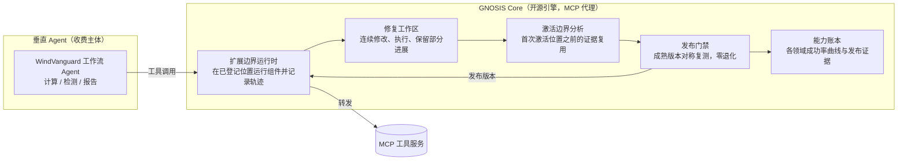

# GNOSIS 产品 PRD v3：验证成本按激活范围计价的 Agent 持续进化引擎

版本 v3.0，日期 2026-10-07，取代 v2.0（2026-10-05，保存在提交 `f2cb244`）。本文档是产品执行依据；科研计划见 [GNOSIS-科研计划.md](GNOSIS-科研计划.md)，两份文档冲突处以本文档为准。v3 的依据是 [先导报告](../experiments/pilot/pilot_final_report_2026-10-06.md) 与 [先导后计划](GNOSIS-先导后计划.md)；市场证据出自 [Everyday News.md](research/GPT/Everyday%20News.md)。

## 1. 拍板

两层交付不变：

- **GNOSIS Core（开源引擎，MIT）**：给任何工具调用型 Agent 接入“连续修复 → 可执行组件 → 激活边界验证 → 能力账本”。以 MCP 代理的形态部署，扩展位置挂在 Agent 与工具服务之间，不改 Agent 本身的代码。不收费，目标是开发者心智和真实失败数据。
- **垂直 Agent（收费主体）**：首个场景仍为 WindVanguard 风工程计算-报告工作流，面向设计院与检测机构。

卖点一句话：**这个 Agent 越用越强，每次升级都附带回归证据，证据的成本只取决于这次改动第一次实际影响执行的位置。** 省下的验证费用继续投入修复，同样的预算换来更多有效升级。

v3 相对 v2 的三处改变：

1. 引擎内核从“作用域知识单元 + 影响面门禁”换成“自主修复工作区 + 可执行组件 + 激活边界”。先导 30 题通过 15 题，失败题中 9 道是输出截断；来源题失败后仍执行独立检查，占去先导费用的 68.6%；3 个候选全部为 `GLOBAL`，接受 0 个（科研计划 §1）。
2. 经验形态从“在工具返回后附一段文字”扩展到可执行组件。翻页、批量读取、按字段计算、写入后回读确认，都能写成 Agent 直接调用的操作函数，形式由进化模型按执行结果选择。
3. 影响范围的依据从“服务白名单与历史触达”换成执行轨迹上的扩展位置记录。一个改动第一次在哪里生效，历史执行就从哪里起重验，其余证据直接复用。

## 2. 关键假设与失效条件

| 编号 | 假设 | 撤掉后结论是否成立 |
|---|---|---|
| A1 | 风工程/交通领域存在高频重复、结果可自动核对的数字化工作流 | 撤掉后垂直收费线失效，退到 L3 档（见 §5.3） |
| A2 | 封闭工作流中 Agent 的失败能由环境操作经验修复，经验能写成可执行组件。证据：StarHarness 在 AutomationBench Finance 上靠接口修复、环境约定、操作知识涨 20–35 分；AutomationBench 论文中 72–91% 的失败是 Agent 自称完成而状态错误 | 撤掉后进化引擎没有工作对象，降到 L2 |
| A3 | 能拿到至少一个真实用户场景（课题组、WindVanguard 合作方、设计院联系人） | 撤掉后没有真实失败分布，退到 L3 |
| A4 | 大厂两年内不把“改动级回归验收与能力账本”做成免费标配。微软 SkillOpt-Sleep 已为 Claude Code、Codex、Copilot 提供每晚离线自进化加留出集门控 | 撤掉后独立窗口只剩垂直场景 |
| A5 | 局部组件在首次匹配的扩展位置之前对 Agent 完全不可见。MCP 代理掌握工具目录与每一条工具返回，这条性质由代理强制 | 撤掉后证据复用失效，卖点退回全局门禁 |
| A6 | 单次发布的全口径验证费用压到人工排查同类问题工时成本的百分之一以下。按先导单题约 $0.03、选择集 6 题每侧 2 次，全局重测上限约 $0.36，证据复用后更低 | 撤掉后单位经济不成立，只能做开源工具 |

## 3. 市场判断依据

**判断一：通用入口战争已结束，单人不做通用 Agent。** Muse 三周 500 万下载（Reuters，10-02），OpenAI Dots 拿到云电脑与 MCP Events（DevDay，09-29），微软 Autopilot 拿到企业身份与计费体系（09-25）。

**判断二：产品差异整体移出模型层。** 当前分层为 模型 → Loop → Memory → Tool/Skill → Runtime/Sandbox → Permission → Evaluation/Audit（09-30 期总结）。执行环境被 OpenAI Agents API 托管，沙箱被 NVIDIA OpenShell 占据，观测有 LangSmith 与 Forge。

**判断三：封闭工作流是当前唯一被验证能跑通的 Agent 环境，可靠性鸿沟就是定价空间。** Argo-Bench 上最强 Agent 完整解决率 34.8%（10-02）；AutomationBench 公开集上最强的 Claude Opus 5 为 50.3%。

**判断四：自进化本身正在商品化，验收层没有；验收费用决定一个 Agent 能进化多少次。** [SkillOpt](https://github.com/microsoft/SkillOpt) 开源 5 个月获得约 1.8 万星，v0.2.0 已带 Claude Code、Codex、Copilot、Devin 接入与 OpenClaw 适配；ACE 的社区实现 [kayba](https://github.com/kayba-ai/agentic-context-engine) 已提供托管服务。它们的门控都在固定的全局留出集上判定，历史任务一多，验证费用线性上涨。GNOSIS 自己的先导给出了同样的数字：验证占去 68.6% 的费用，修复只拿到剩下的三分之一。企业客户买单的是“升级不掉能力”的证据和这份证据的价格，GNOSIS 卡在这一层。

## 4. 产品架构

| 模块 | 职责 | 依据 |
|---|---|---|
| 扩展边界运行时 | 作为 MCP 代理位于 Agent 与工具服务之间；在任务初始化、工具发现、调用前、调用后、上下文与操作函数这些位置运行组件；成功、错误与搜索返回都经过同一条路径；记录每次执行经过的扩展位置 | 局部组件首次匹配前不可见，这是证据复用的来源（科研计划 §5.2） |
| 可执行组件 | 承载经验：操作函数、批量调用、观测改写、上下文重组、文字说明 | 先导 231 次组件调用只有 1 次实际新增提示，文字经验的采纳率撑不起进化 |
| 修复工作区 | 进化模型读取实现、轨迹与评分反馈，连续修改并执行；工作版本保留部分进展；来源任务完整成功后才进入发布比较 | 先导中来源题失败后仍跑验证，浪费 68.6% 费用 |
| 激活边界分析 | 用改动的激活条件检查历史轨迹，确定首次可能生效的位置；未经过该位置的执行直接复用证据 | 软件回归测试选择（Ekstazi）的同构，依赖粒度落到扩展位置 |
| 发布门禁 | 成熟版本在固定选择任务上对称复测，确定改进且零退化才发布；SAGE 配对统计随证据一并记录 | StarHarness 的选择判定与 SAGE |
| 能力账本 | 每个版本在看家任务集上的分领域成功率曲线与每次发布的证据，标明哪些证据来自复用，对客户公开 | 销售武器，客户买的就是这张图 |
| 费用计量 | 每次发布的验证执行数、复用数与美元，以及换来的保留成功数 | 计费参照微软 Autopilot 的 usage-based 模式（09-25） |

**架构铁律不变：发布门禁与评价器部署在 Agent 权限范围之外。** Agent 对轨迹与账本只有追加写权限，无删除权限；组件只能调用任务原有的能力，权限检查与评分保持原样。依据：Agent 可删除自身执行记录的实测论文（09-26）、NVIDIA OpenShell 把策略执行放在 Agent 进程外（09-29）、FTC 对 Agent 越权的联邦调查（10-01）。MCP 代理形态让这条铁律天然成立：Agent 只看得到工具返回，碰不到代理内部的门禁与账本。

v1 的“决策路由层”继续推迟，单题费用上升到 $0.15 以上时再启用。

## 5. 核心风险裁决

### 5.1 v2 的风险已经被先导回答

| v2 风险 | 先导结果 | v3 的处理 |
|---|---|---|
| R1 采纳：单元注入了，Flash 不照做 | 231 次组件调用只有 1 次实际新增提示 | 可执行组件直接完成稳定计算与重复操作；记录每次干预之后的实际动作 |
| R2 作用域局部性：有用知识大多是全局的 | 3 个候选全部为 `GLOBAL` | 作用域由模型选择，验证费用摆在模型面前：作用域越广验证越贵，局部经验获得更多迭代机会 |
| 未列出的根因 | 15 道失败题中 9 道是输出截断；修复只覆盖编译错误 | 输出上限提高到 393216；失败结果返回同一修复过程 |

### 5.2 v3 的四个风险与验证点

| 风险 | 表现 | 最便宜的验证点 | 出口 |
|---|---|---|---|
| R1 余量收窄 | 修正截断后基线接近饱和 | 固定 Agent 修正基线（科研计划 G0） | 卖点重心转到验证费用与证据复用准确率 |
| R2 证据复用出错 | 激活规则漏掉某条路径，复用了本该重验的证据 | 固定候选重测比较：同一批候选上全局重测与按范围重测的逐题一致率（G1） | 把漏掉的路径纳入扩展位置，重测通过后再对外主张 |
| R3 作用域退回全局 | 模型偏好 `GLOBAL` 或通用服务，影响范围接近全集 | 发布记录中的作用域分布与复用比例（G3） | 作用域细化到端点级 |
| R4 商品化 | SkillOpt-Sleep 类产品补上改动级验收 | 持续跟踪其仓库与发布说明 | 加快垂直线，引擎卖点转为“与任意进化器配套的验收层” |

### 5.3 三档降级阶梯

| 档位 | 产品内容 | 触发条件 |
|---|---|---|
| L1 完整引擎 | 全部模块，自主修复、自动发布 | G1、G2、G3 通过 |
| L2 回归门禁版 | 砍掉修复工作区；改动由人或任意第三方进化器（SkillOpt、ACE）提出，GNOSIS 负责扩展边界记录、激活边界分析、发布门禁和账本 | G1 通过，GNOSIS 的学习收益不优于全局验证组与固定 Agent。此档仍能卖“升级不掉能力，且验收成本与改动的影响范围成正比” |
| L3 纯开源工具 | 垂直收费线关闭，只维护 GNOSIS Core | A1 或 A3 被否定 |

## 6. 成本模型与单位经济

### 6.1 模型服务与计费

全部模型调用走 DeepSeek 官方 API（`https://api.deepseek.com`，模型 `deepseek-flash` 即 DeepSeek-V4.1-Flash），思考模式开启，`reasoning_effort=high`，温度 1，单次输出上限 393216（官方最大值，上下文 1M）。

费用不设上限：总额、时间窗口、单题都不拦截，账本 `state/research_ledger.sqlite` 只记账。唯一保留的额度是实验设计里的组学习额度，它是对照条件：两个修复组在同样的学习与验证花费下比较，GNOSIS 省下的验证费用直接变成更多修复次数，这正是要测的量。

| 组 | 学习与验证合计额度（USD 参照价） |
|---|---|
| 固定 Agent | 2 |
| ACE | 3 |
| 全局验证 | 8.5 |
| 完整 GNOSIS | 8.5 |

额度按已结算费用判定，用完即结束该组学习并冻结发布版本。留出评估、中途检查、固定候选重测与等预算组不设额度。

计价按官方 deepseek-flash 价目：闲时每百万 token 输入（缓存未命中）1 元、输入（缓存命中）0.02 元、输出 4 元，高峰时段（北京时间工作日 9–12 点、14–18 点）翻倍。账本 `cost` 按闲时价折成美元（7.1 元/美元）记账，组额度与等预算比较只用它，避免高峰时段让某一组吃亏；`billed` 按实际时段报告扣费。整套实验按先导 token 用量估算闲时约 250 元，安排在闲时运行。

任务执行最多 8 路并行。基线、留出评估、选择集两侧、中途检查、固定候选重测与等预算组的各题互相独立，并行执行；ACE、全局验证、GNOSIS 三个学习组同时运行，共用这 8 个名额；组内的修复步骤仍按顺序进行。中断后再次运行按断点复用全部执行与修复操作。修复器输入使用精简证据（完整作答轨迹、断言、扩展位置序列与干预记录），逐步重复提示的 `wire_trace` 只留在磁盘：单次输入从中位 2.4MB 降到 239KB。

### 6.2 单位经济目标

- 单次发布（修复提议 + 成熟版本验证）全口径费用目标 <$0.5。
- 对标：工程师人工排查一次回归约 2–4 小时。
- 对客户的计价单位是“保留成功数”：每美元换来、且后续版本仍保留的新增成功任务数。
- 证据复用率（复用执行数占验证执行总数的比例）越高，单次发布越便宜，这是按改动影响计价的依据。

### 6.3 压成本手段

1. **激活边界复用**：未经过首次激活位置的历史执行直接复用证据，新增验证费用为零。
2. **成熟后才验证**：来源任务完整成功之前不进入独立验证。
3. **缓存命中**：网关缓存读价为输入价的 2%，固定前缀放在提示开头。
4. **前缀恢复**：环境状态可恢复的工具服务，从首次激活位置起重跑，激活之前的执行前缀也复用。AutomationBench 接入层目前从任务开头重跑。

## 7. 用户与首个场景

**开源引擎的目标用户**：用 MCP 工具构建 Agent 的开发者，以及已经在用 SkillOpt、ACE 一类进化器、需要回归验收的团队。分发形态是一个 MCP 代理加一个账本页面，接入时只改 MCP 配置，不改 Agent 代码。公开证据是 AutomationBench 上的持续进化结果、固定候选重测比较与账本曲线。

**垂直首场景**：WindVanguard 的计算-报告流程。选它的三个理由不变：评分确定（数值结果与规范条文可核对）；自有源码，工具封装没有授权障碍；真实用户可触达。WindVanguard 的工具直接做成 MCP 服务，GNOSIS 代理放在前面，与 AutomationBench 上验证过的形态一致。计算流程里的批量读取、单位换算与结果回读，正是可执行组件最擅长的重复操作。

任务筛选仍只保留满足四个条件的工作流：边界明确、数据可访问、工具稳定、权限可控（The Verge 对 Dots 的实测结论，10-02）。

## 8. 里程碑与门禁

| 时间 | 工作 | 门禁 |
|---|---|---|
| 10 月 7–8 日 | 先导后改造；无模型调用的离线检查与 30 题完整重放 | 当前版本离线证明通过 |
| 10 月 9–10 日 | 固定 Agent 修正基线 | G0：截断不再是主要失败类型；单题费用 ≤$0.05 |
| 10 月 11–20 日 | ACE、全局验证、GNOSIS 三组学习 | 各组冻结，费用在组额度内 |
| 10 月 21–25 日 | 最终留出评估、等预算组、固定候选重测比较 | G1 证据复用一致；G2 学习收益；G3 有效进化次数；G4 盈亏平衡；G5 早期能力 |
| 10 月 26 日–11 月 15 日 | GNOSIS Core 打包为 MCP 代理加账本页面 | 在 AutomationBench 上用代理形态复现主结果 |
| 11 月 16–30 日 | Core 开源发布；论文定稿；WindVanguard 工具 MCP 化启动 | 发布时附完整复现命令与账本 |
| 12 月 | WindVanguard 试用与收费试点 | 没有真实用户连续两周使用，停止垂直线；试点签约或明确拒绝，二者都算结论 |

## 9. 度量指标

| 指标 | 定义 | 用途 |
|---|---|---|
| 单位费用保留成功数 | 每美元换来的、且后续版本仍保留的新增成功任务数 | 单位经济核心，对客户与对自己都用同一个数 |
| 有效进化次数 | 发布版本被推进的次数，以及每美元推进次数 | 验证费用转化为学习的直接度量 |
| 证据复用准确率 | 固定候选上，按影响范围重测与全局重测的逐题一致率 | 能力账本的可信度 |
| 单次发布验证费用 | 每次发布的验证执行数、复用数与美元 | 与“历史任务数”画在一起，展示不随历史增长 |
| 早期能力保持 | 中途检查中早期能力相对首次成熟版本的变化 | 持续进化的核心指标 |
| 干预生效率 | 组件干预后，下一步实际动作与组件效果一致的比例 | 经验是否生效的直接度量 |
| 截断率 | 以 `finish_reason=length` 结束的执行占比 | 执行条件是否健康 |
| 能力账本曲线 | 各版本在看家任务集上的分领域成功率序列 | 对外销售材料，对客户公开 |

## 10. 停止规则

| 观察到的结果 | 行动 |
|---|---|
| 修正基线后截断仍是主要失败类型 | 先修执行条件，学习不开跑 |
| 固定候选上两种重测的判断出现分歧 | 撤下“按改动影响计价”卖点，修正激活规则并重测通过后恢复 |
| GNOSIS 的学习收益不优于全局验证组与固定 Agent | 冻结 L1 转 L2，修复工作区代码保留但默认关闭 |
| 12 月末无真实用户连续使用 | 停止垂直线，引擎转纯开源维护 |
| 充值余额耗尽（API 返回余额不足） | 进程退出、状态保留，充值后再次运行按断点续跑 |

核心假设被否定时结束对应主张，保留真实负结果与可复用代码。

## 11. 与科研计划的关系

| 科研计划内容 | 产品版去向 |
|---|---|
| 扩展位置与激活边界（§5.2） | 扩展边界运行时，以 MCP 代理实现 |
| 可执行组件与整组版本（§5.1） | 组件库与版本管理 |
| 自主修复工作区（§5.3） | 修复工作区，L2 档默认关闭 |
| 成熟版本比较与证据复用（§5.2、§5.4） | 发布门禁，部署在 Agent 权限外 |
| 执行记录与干预记录（§5.5） | 能力账本的证据来源 |
| AutomationBench 主实验与固定候选重测比较 | 开源 repo 的公开证据 |
| 统一模型配置（deepseek-flash，思考 high，温度 1，输出上限 393216） | 产品沿用 |
| 论文投稿 | 与 Core 开源同步完成，结果直接作为开源发布的证据 |
