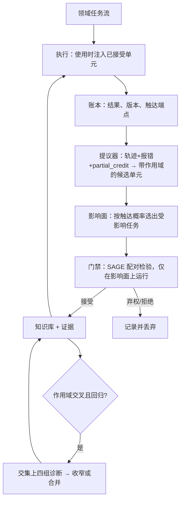

# GNOSIS 科研计划 v2：作用域化自进化与按改动规模计费的回归门禁

版本 v2，2026-10-05，取代 v1（2026-10-04，归档于 [GNOSIS-科研计划-v1-20261004.md](../archive/2026-10-06/documents/plans/GNOSIS-科研计划-v1-20261004.md)）。研究对象不变：冻结模型权重，Agent 依据自己的执行反馈持续修改自身可编辑部分。变化的是主基准、核心算法增量和预算口径。当前目录与启动方式见 [项目入口](../README.md)，历史实验见 [归档索引](../archive/2026-10-06/INDEX.md)。

## 0. 一句话

**在 AutomationBench（47 个模拟 SaaS、6 个业务领域）上做跨领域持续自进化：每条经验写成带作用域的知识单元，只在 Agent 实际调用作用域内接口时注入；作用域外的任务在构造上不受影响，因此每次晋升只需重测受影响的任务。目标是让 Agent 越用越强、几乎不遗忘，而验证费用随单次改动的影响面增长，不随历史累积增长。**

## 1. 转向裁决：冻结实验说明了什么

| 事实（原始数字） | 含义 |
|---|---|
| v2 基线 train 90 题 TGC 92.2%（83/90），v1 基线 90.0%（81/90）；失败只有 7 题，集中在 5 个 scenario，b0a8eae 三题全灭 | 执行模型在 AppWorld 上已到天花板，可学习的失败样本只有个位数 |
| 同配置重复运行的执行代码序列差异率 0.883；6104387_1 在基线自身两次重复间翻转 | 单题结果噪声与可能的组件效应同量级 |
| GEPA v2 搜索：60 次提议、547 次真实运行、$5.15；最好候选 85/90，种子 84/90 | 一题之差，处在噪声内；整轮搜索没有产出可确认的改进 |
| 唯一形式合格的同父互补对（W×S，互补 3）独立重跑，种子、A、B 三者 8/8 全过 | v1 的 H1（自然组合退化）在该环境不可观测 |
| pool_mechW_r1 80/90，低于基线；全部实验目录合计 $13.79 | 继续投入 v1 主线的期望收益为零 |

**裁决：v1 主线（四组因素试验 + 联合修复，AppWorld train）终止。** 根因有两个：一是选了执行模型已饱和的基准；二是在全量训练集上做全局测量，单次改动的效应被噪声淹没。v2 两处都改：换到前沿模型也只有约 50% 的基准；把测量集中到改动真正影响的任务上，提高单位费用的信噪比。

同时，领域已经推进到 v1 的位置之外：组合交互已有 [Compositional Safety Failures](https://arxiv.org/abs/2609.33123)，逐项配对门禁已有 [SAGE](https://arxiv.org/abs/2609.36043)，企业环境的 harness 进化已有 [StarHarness](https://arxiv.org/abs/2608.24804)。v2 的增量必须落在这三者之外。

v1 资产的去向：执行器、计费（GnosisLM、费用账本）、配对评价、审计与加固都保留；Cordis 组件宿主与 T 组件只在第二环境 AppWorld 上使用；GEPA 搜索循环冻结；`factorial.py` 只在作用域交叉的干扰诊断中使用（见 §5.6）。

## 2. 关键假设

| 编号 | 假设 | 证据 | 撤掉后结论是否成立 |
|---|---|---|---|
| A1 | Flash 在 AutomationBench 公开集的严格通过率处于 25–60% | DeepSeek 官方 54.8（max 思考，温度 1.0）；公开集前沿最高 Claude Opus 5 50.3% | 若实测 >65%，主终点换成 Finance/HR/Support 子集；若 <15%，主终点换成 partial_credit。主线仍成立 |
| A2 | 失败主要来自环境知识：接口发现、应用约定、业务策略、未核验就宣告完成，而非推理能力上限 | StarHarness 在 AutomationBench Finance 上 +20–35 分，增益来自接口修复、环境约定与压缩搜索的操作知识；AutomationBench 论文中 72–91% 的失败是 Agent 自称完成而状态错误 | 撤掉后进化增益消失（HSI 的基座能力上界），论文退为负结果刻画，产品降到 L2 |
| A3 | 大部分有用知识可以挂在具体应用或端点上 | StarHarness 归纳的三类增益都是应用局部的 | 撤掉后作用域节省不了验证费用，C2 不成立；C3 的净增益与保留仍可检验 |
| A4 | 使用时注入能保证作用域外的模型输入逐字节不变 | 工程性质，可直接验证；v2 宿主已做过首个请求逐字节一致的 parity 检查 | 撤掉后退回全局配对重测（SAGE 原版），C1、C2 不成立 |
| A5 | Flash 会遵循使用时注入的知识 | 2605.30621：强档模型从 harness 获益低于中档；2601.22436：凝练经验常被忽略。使用时注入把知识放到动作发生的位置 | 撤掉后把知识单元的形式从文字说明改为可执行的接口包装规则（参数规范化、自动翻页、写后回读），绕开遵循问题 |

**最关键的是 A2。** StarHarness 已经在同一基准上实测到大幅增益，A2 有直接证据，“自进化能不能涨分”这一环的失败概率很低。论文的风险集中在 C2、C3 的增量能否成立，这两项都有降级出口（§8）。

## 3. 新基准选型：七份调研交叉核验后的结论

筛选条件按重要性排序：足够难；确定性评分；可重置；单题便宜；无需 sudo 即可落地；任务之间共享应用，知识可迁移。

| 基准 | 核实结果 | 裁决 |
|---|---|---|
| **AutomationBench v1.0.6**（[论文](https://arxiv.org/abs/2604.18934) 2026-04-21；任务集 2026-07-31 重标定；[仓库](https://github.com/zapier/AutomationBench) MIT，最后提交 2026-08-04） | 公开 600 题，6 个领域各 100 题，另有 200 道简单题不计分；纯 Python 加 Pydantic 模拟器，无 Docker、无外部服务；终态断言评分，零 LLM 评委；每题输出 partial_credit 与严格通过两个指标；`--base-url` 接 OpenAI 兼容端点；最多 50 步；公开集前沿最高 50.3% | **主基准** |
| AppWorld（现有栈） | train 已 92%；test-challenge 未测；ACE 官方代码自带 AppWorld 流水线 | **第二环境**，用作与 ACE 公开结果对齐的锚点，先测余量 |
| VibeLifeBench（[2608.10875](https://arxiv.org/abs/2608.10875)） | 只开放 200 题中的 100 题；仓库无总许可证；22 个服务各需 Docker 镜像；按 V4-Pro 的 token 剖面（13.7M 上下文、91K 输出）折算 Flash 约 $0.2–0.3/次，单题耗时数小时 | 研究方向贴合，预算不容；进入后续工作 |
| ClawMark（2604.23781，4 月） | 99 个 task.py 中有 96 个依赖真实 Notion 或 Google Sheets 账号；CC BY-NC | 淘汰 |
| WildClawBench（2605.10912） | 需联网、Brave Search key、YouTube 下载；语义项用 GPT-5.4 评委；任务异质，知识难复用 | 淘汰 |
| Claw-Eval（2604.06132，4 月） | 部分项用 Gemini-3-Flash 与 Claude Opus 4.6 评委；V4 Flash 在 general Pass^3 已 57.8 | 淘汰 |
| ττ-Bench（2609.04611） | 一次配置约 $3,000，评委需 OpenAI key；研究的是“Agent 构建 Agent” | 淘汰 |
| Terminal-Bench 3.0/4.0、ProgramBench、Agents' Last Exam | 需要 GPU、VM 或单容器 60GB 内存；单次全量运行消耗数十亿 token | 淘汰 |
| DeepSWE v1.1、NL2Repo | Flash 已 74.2 / 64.0；Epoch 标注 DeepSWE 有缺陷 | 淘汰 |
| SkillsBench v1.1 | 需 Docker，任务异质；SkillOpt、EvoSkill 等已占位 | 备选 |

调研报告之间的冲突按原始来源裁定：ClawMark“全部本地 mock”的说法与仓库 task.py 不符；“Flash 在 AutomationBench 54.8 已偏易”的说法忽略了公开集前沿只有 50.3% 且 54.8 用的是 max 思考强度。

**关于日期条件。** AutomationBench 的论文早于 5 月，但它的任务集在 7 月按前沿模型重新标定过：4 月论文中前沿低于 10%，现版前沿约 50%。用户真正要的是“当前仍未被打穿、能做多轮实验”的基准，它满足；5 月后发布的高难基准全部卡在费用、评委或 Docker 上。

结构数据（按任务声明的工具统计，零费用得出）：Gmail、Google Sheets、Google Drive、Slack 几乎出现在所有领域；领域两两之间的应用集合 Jaccard 为 0.18–0.59（Operations–HR 0.59 最高，Finance–HR 0.18 最低）。以 Sales 与 Operations 的应用为已学集合，其余领域的任务平均应用覆盖率为：Marketing 0.984、HR 0.978、Finance 0.935、Support 0.751（Support 无一题被完全覆盖）。这给出了可以事前登记的迁移预测（§6.3）。

## 4. 前人工作与空位

| 工作 | 已经做到的 | 对 v2 的约束 |
|---|---|---|
| [ACE](https://arxiv.org/abs/2510.04618)（[代码](https://github.com/ace-agent/ace)，Apache-2.0，含 AppWorld 流水线） | 生成、反思、整理三角色维护全局 playbook，支持在线自适应 | 直接作为基线；提议器复用其反思与整理提示词 |
| [SkillOpt](https://arxiv.org/abs/2605.23904)（[代码](https://github.com/microsoft/SkillOpt)，MIT） | 单份技能文档的有界编辑，验证集严格提升才接受 | 全局验证集门禁的代表 |
| [SAGE](https://arxiv.org/abs/2609.36043) | 逐项配对、单侧检验、可弃权；DeepSeek-V4 上回归率降到 0 | 门禁规则直接采用，不再声称门禁是贡献 |
| [StarHarness](https://arxiv.org/abs/2608.24804)（[代码](https://github.com/ServiceNow/StarHarness)，MIT） | AutomationBench Finance 单领域离线进化，+20–35 分，留出任务成立，跨模型可迁移 | 证明余量存在；它只做单领域、离线、部分得分，没有测遗忘和验证费用 |
| [VACE](https://arxiv.org/abs/2609.37105) | 在 AutomationBench 上交替做 RL 与验证门控的 harness 进化 | 动权重，与本课题设定不同 |
| [Self-Evolving Harness on Multiple Tasks](https://arxiv.org/abs/2609.38372) | 多基准预训练加持续训练两阶段 | 持续阶段只报单基准涨分，未测遗忘与验证费用 |
| [CL-Bench](https://arxiv.org/abs/2606.05661)、[SkillEvolBench](https://arxiv.org/abs/2605.24117)、[EvoAgentBench](https://arxiv.org/abs/2607.05202)、[EverMine](https://arxiv.org/abs/2609.33524) | 共同结论：自进化增益不稳定，凝练技能常不如原始轨迹，记忆系统不如朴素 ICL | 这是 v2 要正面回答的问题 |
| [Rethinking Harness Evolution](https://arxiv.org/abs/2607.12227) | 预算对齐后 harness 进化不敌 test-time scaling；只在有余量、需要适应环境、反馈细粒度的场景占优 | AutomationBench 三条都满足；必须做预算对齐比较 |
| [2605.30621](https://arxiv.org/abs/2605.30621)、[2601.22436](https://arxiv.org/abs/2601.22436) | 强模型从 harness 获益有限；凝练经验常被忽略 | 使用时注入，并测知识的实际采纳率 |
| [RTS for capability modules](https://arxiv.org/abs/2604.26689)；Ekstazi（Gligoric 等，ISSTA 2015） | 软件与 ML 模块的回归测试选择：记录每个测试的依赖，改动只重测依赖它的测试 | v2 把这一机制搬到 Agent 知识上 |

**空位：** 现有门禁（SkillOpt、SAGE、VACE、StarHarness 的隐藏选择集）都在固定的全局验证集上判定。持续进化中历史任务不断累积，要么验证费用随历史线性增长，要么验证集过时、遗忘不可见。没有工作把“改动影响到哪些任务”做成可证明的边界，也没有工作在企业基准上同时测量跨领域前向迁移、遗忘和预算对齐收益。

## 5. 方法

### 5.1 知识单元

一个单元记作 \(u=(D_u, c_u, \pi_u, e_u)\)：

- \(D_u\)：作用域，一组服务或端点，例如 `google_sheets` 或 `google_sheets:values.append`；特殊值 GLOBAL 表示全局程序性知识，如“写入后回读核验”。
- \(c_u\)：内容，一段不超过 120 token 的说明，或一条接口包装规则（A5 的降级形态）。
- \(\pi_u\)：来源任务与预期效果，由提议器写出，作为可检验预测。
- \(e_u\)：证据记录，即配对运行的结果与门禁裁决。

单元类型沿用 StarHarness 的归纳：接口修复、环境约定、压缩搜索的操作知识；另加 GLOBAL 程序性知识。

### 5.2 使用时注入与边界性质

单元只在一个回合中**首次成功调用** \(D_u\) 内的接口时，附加到该次工具返回的末尾；GLOBAL 单元进系统提示。AutomationBench 的 `api_fetch` 拒绝任务白名单之外的服务（`compute_allowed_services`），越界调用不会成功，也就不会触发注入。

**边界性质。** 设知识库 \(L'=L\cup\{u\}\)。对任一任务，在其轨迹首次触达 \(D_u\) 之前，两种知识库下模型收到的输入逐字节相同。于是任务得分期望的变化满足

\[
\bigl|\mathbb E_{L'}[Y_\tau]-\mathbb E_{L}[Y_\tau]\bigr|\le P_L\bigl(\tau\text{ 触达 }D_u\bigr).
\]

服务不在白名单内的任务，触达概率为 0，变化严格为 0；其余任务的触达概率由账本中的历史运行估计。这是回归测试选择在 Agent 上的形式：每次运行记录自己触达的端点（相当于 Ekstazi 记录测试读过的文件），改动只使依赖它的结果失效。

### 5.3 影响面与门禁

影响面 \(I_\varepsilon(u)=\{\tau:\hat p_\tau(D_u)>\varepsilon\}\)，其中 \(\hat p_\tau\) 来自账本记录；从未运行过的任务按服务白名单保守计入。门禁只在 \(I_\varepsilon(u)\) 的抽样（每单元最多 \(m\) 题）上运行“加入 \(u\)”的版本。“不加 \(u\)”的对照直接取账本中该任务的最新结果，前提是这条结果所依赖的端点自那以后没有被任何改动触及；不满足就重跑。

判定分两段。**阶段一准入**（每个单元）：源任务由败转胜，且影响面 8 对内没有确认退化——输掉的配对重跑一次，重跑仍输才算确认退化；出现确认退化的单元弃权。**阶段末**：对本阶段新增单元的配对整体做原版 SAGE 二元配对门禁，逐题严格通过作为二元结果，单侧检验 \(\alpha=0.05\)，退化惩罚系数为 1，退化率上限为 0。不显著就弃权；partial_credit 保留为诊断指标。作用域互不相交的单元在同一次运行中批量检验；同时触达两个待检单元作用域的任务单独处理（§5.6）。

两段式的理由是统计功效：在 8 对配对之内，0 负要 5 胜、1 负要 7 胜才达到 \(\alpha=0.05\)，只要配对里出现 2 道以上退化的题，原版门禁必然弃权。把宽松的入口（准入只看源任务翻转与确认退化）与严格的关口（阶段末仍是原版 SAGE）分开，两者各自可解释，失败时的诊断也分得清。

先导的阶段末配对用“每题最后一次运行”近似最终知识库；正式实验必须用最终知识库把受影响题的并集重跑一遍再检验。

阶段末的实现口径：单题结果以确认后的结果为准；每道题只保留一个配对，取最后一次运行（它已经带着全部已接受单元，等于最终知识库），不重复计数也不额外花钱；抽题种子按轮次区分，避免不同单元抽到同一批题。判负的后果只有一种：出现确认退化时，撤回在那道题上被注入过的单元；仅仅不显著时保留单元并标记为未显著。SAGE 的统计量与参数一律不改。

验证费用约为 \(m\times|\text{待检单元}|\) 次运行，与历史任务总数无关；全局门禁的费用是验证集大小乘以候选数。这是 C2 要实测的量。

### 5.4 提议

提议器与执行模型相同，都是 DeepSeek V4.1 Flash（high）。复用 ACE 的反思与整理提示词，输出格式增加作用域字段与预期效果。输入为流式训练任务的执行轨迹、环境报错和标量奖励 partial_credit；**不提供断言文本**，对应部署时没有标注的条件。断言文本只用于事后分析。

### 5.5 账本与淘汰

账本记录每个任务的最新结果、版本、触达端点集合与费用。单元在后续运行中的配对证据转负时，按同一门禁淘汰。各领域的成功率曲线即能力账本，同时作为产品的对外材料。

### 5.6 作用域交叉时的干扰诊断（v1 算法的保留形态）

两个已接受单元作用域相交，且交集任务出现回归时，只在交集任务上做 \(H_{00},H_{10},H_{01},H_{11}\) 四组运行（复用 `factorial.py`），按测得的交互收窄作用域或合并单元，最多两次。跨领域策略冲突（同一应用在不同领域约定不同）是这类干扰的自然来源。这一节是次要机制，不作为主张。

## 6. 实验设计

### 6.1 固定条件

- 基准：AutomationBench v1.0.6，固定在 2026-08-04 的提交；`--toolset api`、`--max-steps 50`；单独的 uv 虚拟环境（Python ≥3.13、pydantic 2），与 AppWorld 环境隔离。
- 模型：DeepSeek V4.1 Flash，reasoning_effort=high，经 Command Code 网关；采样参数沿用 stage2 配置，runner 不支持的参数按实际值记录。
- 划分：每个领域按固定种子抽取流式训练 \(n\) 题、留出测试 \(n\) 题，\(n\) 由先导实测的单题费用定档（§7）；剩余任务封存。
- 领域流顺序：P1 {Sales, Operations} → P2 {HR, Marketing} → P3 {Support, Finance}。
- API 服务断流最多重试 10 次，指数退避 2→60 秒并遵守 Retry-After；失败尝试一并释放预留，单题重试用完即记该题失败、整批结束后补跑，不中止整批。每次请求先检查三级预算并预留上界，独立记录提示与响应；单题费用上限 $0.15，超过即停该题。AI 格式错误最多重试 1 次（执行器出错记该题失败并继续下一题），AI 组件修复最多 3 次。组件类型由受测 AI 自选，提示词里写明 lmRequest 单次约 $0.0059 与单题 $0.15 上限。先导轮数由余额决定（每轮开跑前检查是否够 19 题的最坏费用），正式实验每道失败的流任务触发一次提议。

### 6.2 对比臂

| 臂 | 内容 | 隔离的变量 |
|---|---|---|
| B0 | 冻结 Agent，测试集跑两遍 | 噪声底；与第二遍组合成 test-time scaling 基线 |
| ACE | 官方代码，在线模式跑同一流，全局 playbook、无门禁 | 现成方法的强基线 |
| SAGE-global | 与 GNOSIS 相同的提议器，单元进系统提示，SAGE 门禁跑在固定的全局验证集上 | 只差作用域与影响面 |
| **GNOSIS** | 作用域单元、使用时注入、影响面门禁 | 主方法 |
| GNOSIS-prompt | 同一批已接受单元改放系统提示 | 注入位置对采纳的作用（A5） |
| TTS-2 | B0 两次运行，由同一模型读两份终态摘要与调用日志选一份；选择调用计入费用 | 预算对齐的 test-time scaling |

### 6.3 指标与事前登记的预测

- 主终点：留出测试集的严格通过率（官方指标），全部领域合并。
- 次终点：partial_credit；P1 结束时与全部结束时各测一次测试集，得到 2×6 的准确率矩阵，计算前向迁移与遗忘 \(F=\max(S_{\text{P1 后}},S_{\text{终}})-S_{\text{终}}\)（只对 P1 领域）。
- 费用：执行、提议、验证分列；验证运行数与历史任务数的关系曲线。
- 边界验证：作用域外任务的首个请求逐字节比对。
- 采纳率：注入后下一步调用是否与单元内容一致，由脚本按单元的结构化字段判定。

事前登记：
1. P1 后的前向迁移排序为 Marketing ≈ HR > Finance > Support，与 §3 的覆盖率一致。
2. GNOSIS 在 P1 领域的遗忘不超过 2 个百分点，ACE 的遗忘大于 GNOSIS。
3. 每次晋升的验证运行数，GNOSIS 不随历史增长，SAGE-global 随验证集大小增长。

### 6.4 统计

逐任务配对；严格通过用精确 McNemar 检验，partial_credit 用配对置换检验；按任务自助法给出 95% 区间；三项主比较（GNOSIS 对 B0、ACE、SAGE-global）做 Holm 校正。测试集只在两个预定时点使用，过程中不据测试结果调参。

### 6.5 第二环境：AppWorld

先用 40 道 test-challenge 测 Flash 的余量。若低于 85%，在 test-normal 上按 ACE 的在线协议跑 B0、ACE、GNOSIS 三臂，GNOSIS 的单元经现有 T 组件（`formatObservation`）在调用 `api_docs` 与对应应用时注入，作用域取应用名。若不低于 85%，AppWorld 只承担边界性质验证与零回归检查，不进主表。

## 7. 预算与执行窗口

网关额度（GOAT 套餐，见 [Command Code.md](Command Code.md)）：5 小时 $14、7 天 $35、自然月 $70；受测模型 deepseek/deepseek-v4.1-flash 的自然月额度 $60，思考强度 high，单价为输入 $0.15/Mtoken、输出 $0.60/Mtoken（推理 token 计入输出）、缓存读 $0.003/Mtoken。2026-10-06 读数：7 天窗口已用 80%，折合本周余约 $7。

研究硬上限 **$45**。三段额度在账本里同时生效：研究总预算 $45 为硬顶，当前阶段上限只能在其之内调整，任何一次运行还受 **5 小时滑动窗口 $12** 约束（留 $2 给研究者在同一窗口内的 CLI 操作）。另有单题上限 **$0.15**（归档单题最大 $0.0803 的约两倍），超过即停该题，防止失控组件烧穿整批。先导阶段上限 **$5**，做 **6 个「单元×轮」**：每轮 1 道来源题加 8 道受影响题，实测单题 $0.0268，一个「单元×轮」约 $0.28，新版本基线并集一次约 $0.75，合计约 $2.8，占剩余额度的 81%；6 单元 × 2 轮约 $4.5，超出剩余。任一层越界即抛出终止并冻结，复盘后再定档。

**瓶颈是总耗时，不是 5 小时窗口。** 单题平均 242 秒（中位 210 秒），串行执行每小时约 $0.40、约 15 题。主实验约 1,500 次执行，串行约 100 小时，跨 20 个以上窗口；同时跑 3 题降到约 35 小时，每 5 小时约 $6，仍在 $12 窗口以内。7 天窗口 $35 由网关执行，排期按每天约 $9.6 估算。

正式研究的执行分段：10 月 10 日前不超过 $8，10 月 11–17 日不超过 $15，10 月 17 日之后不超过 $22，每段都另受 5 小时窗口 $12 约束。

单题费用 \(c\) 由先导实测，按 \(c\) 自动定档：

| \(c\)（美元/题） | 每领域训练/测试 \(n\) | 删减 |
|---|---|---|
| ≤0.020 | 15 / 15 | 无 |
| 0.020–0.035 | 12 / 12 | 无 |
| 0.035–0.050 | 10 / 10 | SAGE-global 只做终测 |
| >0.050 | 只保留 Sales、Operations、Finance 三个领域 | GNOSIS-prompt 取消 |

以 \(n=12\)（测试 72 题、流 72 题）、\(c=0.03\) 为例：

| 臂 | 运行数 | 费用 |
|---|---|---|
| 先导（基线 30 题 AutomationBench 与 40 题 AppWorld 已执行完，记 $1.57） | 70 | 上限 $5.0 |
| B0（测试 ×2 + 流 ×1） | 216 | $6.5 |
| GNOSIS（流 + 验证上限 160 + 两次测试） | 376 | $11.3 |
| ACE（流 + 两次测试） | 216 | $6.5 |
| SAGE-global（流 + 验证上限 120 + 终测） | 264 | $7.9 |
| GNOSIS-prompt（终测） | 72 | $2.2 |
| TTS-2 选择调用 | 72 | $0.5 |
| AppWorld 三臂（$0.009/题） | 约 300 | $2.7 |
| 提议与反思 | — | $2.0 |
| **合计** | — | **$41.6，上限 $45** |

砍预算的顺序：AppWorld 三臂 → GNOSIS-prompt → SAGE-global 中途测试。B0、ACE、GNOSIS 三臂不砍。

## 8. 判定门槛与失败后的调整

| 门槛 | 判定 | 失败后的下一步 |
|---|---|---|
| G0 先导 | \(c\le0.05\)，B0 严格通过率在 20–65% | \(c\) 超标按 §7 定档；通过率过高换难领域，过低把主终点改为 partial_credit |
| G1 P1 结束 | GNOSIS 在 P1 留出任务上比 B0 高 ≥5 个百分点（严格）或 ≥0.05（partial） | 查采纳日志：单元注入了没有、被遵循了没有。注入了但没被遵循，换成接口包装规则（A5 降级）；没注入就修触发条件 |
| G2 遗忘 | GNOSIS 的 \(F\le2\) 个百分点 | ACE 也几乎不遗忘时，撤下保留主张，主张收缩为净增益加验证费用（C2） |
| G3 验证费用 | GNOSIS 的验证运行数对历史规模的斜率显著低于 SAGE-global | 若大部分单元落在 Gmail、Sheets 等通用服务上，影响面接近全集，就把作用域细化到端点级 |
| G4 预算对齐 | 进化总费用摊到 600 道公开任务后，GNOSIS 优于 TTS-2 | 不优就报告盈亏平衡所需的任务数，主张改成“任务流足够长时占优” |
| 停止 | 全流程结束后 GNOSIS 不优于 ACE，且不优于 SAGE-global | 发表诊断性结果与开源工具，产品转 PRD 的 L2 档 |

每轮调整只改一个已定位的变量，原始结果全部保留。

## 9. 开源复用与代码边界

| 来源 | 用途 |
|---|---|
| AutomationBench（MIT） | 环境、工具、断言、runner 全部原样使用；只继承 `AutomationBenchEnv`，覆盖 `env_response` 做注入与触达记录 |
| ACE（Apache-2.0） | ACE 臂直接跑官方代码；GNOSIS 的提议器复用其反思与整理提示词 |
| SAGE | 门禁规则按论文实现（逐项配对 + 单侧检验 + 弃权） |
| StarHarness（MIT） | 单元分类与轨迹分析口径；它的 GPT-5.4 提议器不跑 |
| 本仓库 `engine/` | GnosisLM 计费、费用账本、`promote.py` 的配对评价、`factorial.py`（干扰诊断）、AppWorld 执行器与 T 组件 |

新写的代码只有四块：AutomationBench 适配层（注入、触达记录、计费接入）；单元库加影响面与门禁；提议器包装；统计与出图脚本。不写新的 Agent 循环，也不写新的优化器。

## 10. 时间表

| 时间 | 工作 | 完成条件 |
|---|---|---|
| 10 月 5–10 日 | 装 AutomationBench；先导；B0 测试第一遍与训练流；适配层与账本 | G0 判定；花费 ≤$8 |
| 10 月 11–17 日 | ACE 适配；GNOSIS 与 ACE 跑完 P1；P1 测试 | G1、G3 初判；花费 ≤$15 |
| 10 月 18–31 日 | 全部臂跑完 P2、P3；终测；B0 第二遍与 TTS-2 | G2、G3、G4 判定 |
| 11 月 1–8 日 | GNOSIS-prompt、AppWorld 第二环境；干扰诊断案例 | 主表与全部图齐备；总花费 ≤$45 |
| 11 月 9–30 日 | 写作；GNOSIS Core 打包开源（见 PRD） | 投稿稿件与可复现包 |

目标会议：ICML 2027，按官方公布的截止日倒排。

## 11. 论文与完成标准

暂定题目：**Scoped Self-Evolution: Continual Agent Improvement with Regression Checks That Scale with the Change**。

论点：持续自进化的瓶颈在于每次改动的验证费用随历史增长、遗忘不可见。给知识划定作用域并只在使用时注入，可以把改动的影响限制在可计算的任务集合内，从而以与改动规模成正比的费用保证不遗忘。

必需的图表：
1. 主表：留出测试的严格通过率与 partial_credit，六个臂。
2. 准确率矩阵：P1 后与终态，前向迁移与遗忘。
3. 验证费用对历史规模：GNOSIS 与 SAGE-global。
4. 预算曲线：GNOSIS 对 TTS-2，含盈亏平衡点。
5. 迁移剂量反应：测试任务被已接受单元覆盖的比例与增益的关系，对照 §6.3 的事前预测。
6. 采纳率与单元分类：注入位置对采纳的影响。

投稿标准：GNOSIS 在留出测试上显著优于 B0 与 ACE；遗忘不超过 2 个百分点；验证费用曲线与 SAGE-global 分离；第二环境方向一致。

## 12. 下一步动作

1. 当前状态为准备完毕、等待用户明确开始。配置存放于 `config/`，当前实验输出目录 `experiments/pilot/` 为空。
2. 先前先导的完整执行记录已经归档；其中授权的 AutomationBench 记录可作为下一轮反思输入。新的做题与配对结果写入当前实验目录，门禁仅使用同一程序版本的独立配对结果。
3. 用户开始后，按项目入口启动作用域自进化先导，先导费用上限 $5，5 小时滑动窗口上限 $12，已发生费用和未结算预留继续计入。正式研究按 §7 定档。
