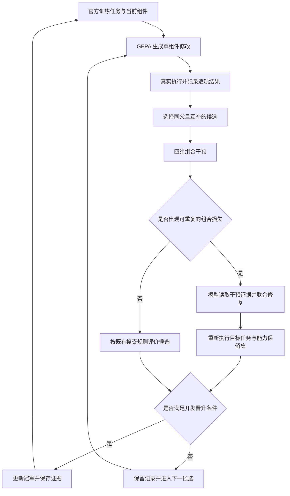

# GNOSIS 科研计划：以组合干预指导联合修复的持续自进化

调研与决策日期：2026-10-04。研究对象：冻结模型权重，通过执行反馈持续修改自身组件的 Agent。本文交付研究设计；文中的实验门槛与预算均为计划值，尚未产生实验结果。

## 1. 关键假设与路线决策

| 关键假设 | 为什么需要 | 撤掉假设，结论是否成立 |
|---|---|---|
| H1：真实搜索中存在可重复的组合退化：两个分别有效的改动合并后损失能力 | 为联合修复提供足够的研究对象 | 若组合退化罕见，本课题的收益空间不足，停止这条论文主线 |
| H2：至少一部分退化能通过同时调整相关组件修复 | 让检测结果转化为持续改进 | 若只能删除某个改动，联合修复的核心贡献不成立 |
| H3：任务环境能恢复到可比较的初始状态，并提供外部执行评分 | 使组件干预具有可测量的效果 | 撤掉后，四组运行无法分离环境差异与组件差异，本实验设计失效 |
| H4：干预与修复的额外费用低于重新搜索同等能力的费用 | 支撑固定预算下的优势 | 撤掉后，机制可能有效，但“更高效的持续自进化”结论失效 |
| H5：组件改动能影响未参与搜索的任务 | 满足科研中的泛化要求 | 撤掉后，只得到训练任务适配，达不到本文设定的投稿标准 |

**只推进一条道路：复用 GEPA 的搜索能力，以 Cordis 管理可替换组件，在 AppWorld 的真实执行环境中，用四组组件干预结果指导联合修复，使单独获得的能力在合并与后续进化中得到保留。**

主研究问题是：**在相同候选来源、相同模型与相同总预算下，明确测量组件交互，能否比已有的合并反思更有效地生成修复，最终提高未见任务上的累计能力？**

选择它的理由是，任务环境、优化器与组件运行机制均已有公开实现；需要研究的增量集中在一个可替换的修复算子。每次失败都能定位到“现象不足、测量不稳定、修复无效、费用过高、迁移失败”中的具体环节，下一轮实验可以改变一个变量。现有资料没有提供各路线的成功概率分布，因此采用上述可检验条件排序，不填写主观成功率。

计划中的自我进化有明确含义：系统根据自己的执行结果提出组件修改，自动验收，并把通过的组件带入后续任务；人不为单个失败任务手工编写答案或修复。优化算法、评分器与模型权重保持固定。

## 2. 本地材料如何进入研究设计

重点依据为 [Roads.md](E:/AI/GNOSIS%20Agent/docs/roads/Roads.md)、[Cordis 论文精读](E:/AI/GNOSIS%20Agent/docs/papers/2608.25512v1-精读.md) 与 [KIMI 总览](E:/AI/GNOSIS%20Agent/docs/research/KIMI/00-synthesis.md)。同时参考 KIMI 的归因、评价和搜索分题笔记，以及 GPT、Claude 与 Herta 目录中的研究和产品材料。

从现有材料保留三个有直接实验价值的判断：失败必须指向可修改资产；评价必须依靠实际任务后果；已获得的能力需要在后续修改中持续测量。Herta 的长期连续性诉求对应这里的“能力保留”，人格与叙事一致性暂不进入论文的测量目标。

### 2.1 对 Roads 四条道路的选择判断

| 原道路 | 可以保留的研究动机 | 本课题的处理 |
|---|---|---|
| 负向禁忌与拓扑约束 | 失败经验需要改变后续搜索 | 保留失败记录及其适用组件版本；全局禁止某种行为会损失探索空间，不作为核心算法 |
| 范畴控制论与状态恢复 | 修改后必须明确哪些状态被恢复 | 直接采用 Cordis 的组件生命周期机制，加上任务环境的官方重置；不另造范畴运行时 |
| 评价者与 Agent 共同进化 | 固定开发题集会遭遇适应性过拟合 | 使用隔离的最终测试与跨环境验证；本课题固定评分协议，避免同时改变学习对象和测量尺度 |
| 信息几何与相变预测 | 昂贵实验需要选择性分配 | 用实际修复收益与执行费用安排实验；缺少可测状态变量的曲率指标不进入主算法 |

最适合本项目的是第二条道路中的**组件化干预与状态边界**，结合现有失败驱动搜索，形成可直接验证的算法问题。四条道路中的宏大数学叙事不列为论文贡献。

评价固定与否应由实验目标决定。Reward hacking 的相关定理有其策略集合与奖励关系假设；有限受限策略集合存在非平凡的可成立情形。这里用固定官方评分器测量任务完成，并控制开发反馈的复用。[原始论文](https://arxiv.org/abs/2209.13085)

### 2.2 Cordis 的准确位置

Cordis 提供上下文中介的 effect 清理，以及依赖变化触发的组件生命周期协调。论文中的恢复结论依赖相应 witness 与独立性条件。环境已经发出的外部动作、组件私有状态，以及 LLM 后续生成的语义行为，需要另外处理。[论文](https://arxiv.org/abs/2608.25512)

因此划定三个状态边界：

1. **组件宿主状态**：注册服务与事件监听等，由 Cordis 的上下文机制管理。
2. **任务状态**：数据库、文件及应用操作记录，由 AppWorld 官方任务初始化与关闭流程重建。
3. **实验状态**：模型配置、候选文件和评价结果，由实验调度器按版本保留。

组件能正常装卸是运行条件；组件组合后是否保留能力，是本项目要测量的结果。依赖声明用来确定干预对象，行为兼容性由真实执行建立。

## 3. 前人已经完成什么，论文还需贡献什么

截至调研日，单纯组合“失败反思、局部编辑、回放、统计晋升”已经缺少足够新意。最接近的工作需要进入正文比较。

| 前人工作 | 已有实践 | 对 GNOSIS 的直接约束 |
|---|---|---|
| [GEPA](https://arxiv.org/abs/2507.19457) | 利用执行轨迹反思，搜索多个文本组件；已有共同祖先下的候选合并与合并验证 | 复用搜索器，普通组件合并不能作为新贡献 |
| [EvolveNet](https://arxiv.org/abs/2608.04968) | 依据行为证据合并程序，区分适用范围；合并退化后允许修订 | “检测退化后修复”已经有直接先例；必须比较干预证据的增量价值 |
| [ModularRSI](https://arxiv.org/abs/2609.14857) | 模块独立改进、保存演化历史，并进行跨模块整合修复 | 模块化和联合调整本身属于已有方法 |
| [HarnessCompass](https://arxiv.org/abs/2608.01918) | 分别改进结构与指导组件，再进行修订、重组和精炼 | 双路径改进加整合不足以形成区别 |
| [Compositional Safety Failures](https://arxiv.org/abs/2609.33123) | 已研究独立合格改动的组合失效，并用高阶交互结构进行增量监测 | 不主张首次发现交互，也不把局部交互图作为新贡献 |
| [DAAF](https://arxiv.org/abs/2609.32498) | 通过可编辑属性的受控替换开展归因，并降低后续诊断费用 | 借鉴干预方法；单次故障归因不是研究空白 |
| [SAGE](https://arxiv.org/abs/2609.36043) | 使用逐项配对的晋升评价并考虑回归 | 采用配对评价，统计门槛属于借用的实验工具 |
| [SkillCAT](https://arxiv.org/abs/2606.13317)、[EvoCUE](https://arxiv.org/abs/2609.34988) | 对照轨迹、局部修订及回放验收已有实践 | 给失败轨迹增加一条反思不构成区别 |
| [SkillSV](https://arxiv.org/abs/2608.04562)、[SkillShapley](https://arxiv.org/abs/2608.13173) | 已对技能单元贡献及交互进行测量 | 不把贡献估计包装为首次提出，也不预设交互普遍很强 |
| [RRSI](https://arxiv.org/abs/2609.24972) | 用搜索与选择约束缓解持续改写的过拟合 | 最终成绩必须来自未参与进化的数据 |
| [Rethinking Evaluation](https://arxiv.org/abs/2607.12227) | 强调预算匹配与跨任务评价 | 搜索费用、诊断费用和运行费用都计入比较 |

**拟贡献是一个特定的算法增量：将实际测得的组合损失作为联合修复的输入与目标，并验证这笔额外测量开销能否换来更高的长期能力保留。**

它需要形成三个相互支撑的结果：

1. 在自然产生的候选中，量化组合退化的发生率、可修复比例与持续进化中的累积损失。
2. 在固定候选快照上，证明四组干预证据比同预算的普通整合反思更有助于修复；进一步区分信息本身和修改范围选择的作用。
3. 在完整自主进化中，证明这种局部优势最终改善未见任务成绩及能力保留，并覆盖其额外费用。

这是待实验建立的贡献。若只得到更少的失败合并，而最终成绩与费用没有改善，主张应停留在局部机制分析，不能写成高效持续自进化。

## 4. 使用 prism-vector-synthesis 得出的设计依据

### 4.1 基本事实、目标与约束

成功与失败来自任务执行。组件修改改变后续行为，组件之间可能共同作用。运行一次任务有实际费用，反复利用同一组反馈会改变搜索方向。目标是以有限资源获得能保留、能迁移的改进。

硬约束为：保持官方任务与评分实现；使用真实服务和模型；公开记录搜索费用；不依靠手写任务意图词典决定行为。唯一需要新增的研究模块是“组合证据如何指导修复”。

### 4.2 历史与跨领域机制

| 来源 | 可迁移的机制 | 在 GNOSIS 中的具体用法 | 失效条件 |
|---|---|---|---|
| 历史上的农业试验设计：Rothamsted 与 Fisher | 用受控处理和重复实验分离因素作用 | 对同一任务起点运行四种组件组合 | 处理间起点不同，或把重复运行当成独立任务 |
| 进化遗传学的上位性 | 一个变化的效果依赖其背景；组合效果可能改变方向 | 保存组件版本背景，测量单独改动与联合改动的差异 | Agent 中实际交互很弱，或变化主要来自运行噪声 |
| 分布式系统的缓存有效性 | 证据的有效性依赖其生成条件；条件变化需要更新 | 缓存严格绑定完整实验配置；旧结果帮助选题，新候选仍需执行 | 根据不完整依赖信息直接继承成功结论 |
| 工业中的因素试验与故障诊断 | 主动选择干预，辨别哪组部件共同造成损失 | 只对高价值冲突做因素试验，并给修复器明确的目标 | 全局耦合很强，少量局部试验无法节约费用 |

历史依据见 [Rothamsted 的试验设计历史](https://www.rothamsted.ac.uk/news/surprising-birthplace-modern-data-analysis-celebrates-100-years)。背景依赖的实例见 [Weinreich 等，2006](https://pubmed.ncbi.nlm.nih.gov/16601193/)。缓存有效性借鉴 [Gray 与 Cheriton 的 Leases](https://web.stanford.edu/class/cs240/WWW/readings/89-leases.pdf)。这些来源提供设计启发；Agent 中的实际效应由本计划的实验测量。

提取出的可执行原则是：**证据必须带背景；交互必须经干预测量；测量必须服务下一次有效修改。**

### 4.3 三种视角的交叉裁决

| 视角 | 主张 | 对其他视角的关键质询 | 改变判断的证据 |
|---|---|---|---|
| 演化搜索 | 保留互补改进，允许联合修复 | 只拒绝冲突是否持续丢失有价值能力？ | 单独选择最佳分支就能达到同等成绩 |
| 实验设计 | 用可重复干预识别修复对象 | 模型给出的冲突解释是否与运行结果一致？ | 四组证据无法稳定改变修复成功率 |
| 系统与费用 | 复用现成运行环境，限制额外评估 | 发现的交互能否偿还诊断费用？ | 同预算普通搜索获得更多可迁移改进 |

三者的共同要求是实际任务收益。真正分歧在于：应把预算投入新候选，还是投入已有候选的诊断与修复。最终采用有费用上限的干预修复，并让同预算搜索基线决定它是否值得。

## 5. 核心方法：从四组运行到联合修复

### 5.1 可修改对象

一个 Agent 版本记作：

\[
H=(W,T,C,S),
\]

其中 \(W\) 为工作流，\(T\) 为工具调用包装，\(C\) 为上下文组织，\(S\) 为可复用技能。每个组件可以是指令文本或有固定接口的可执行模块。官方工具语义保持固定；包装层可以改变调用组织与结果呈现。

候选保存父版本、组件内容哈希、接口版本及修改理由。每次普通变异只修改一个组件；联合修复可以同时修改被实验指向的两个组件。这个限制控制研究变量，后续三组件实验用于检查它的适用边界。

语义诊断由模型读取真实轨迹完成。程序只验证结构、接口和文件访问权限，不根据关键词推断意图或修改模型措辞。

### 5.2 四组组合实验

从同一父版本 \(H_0\) 得到修改 \(A\) 与 \(B\)，构成：

\[
H_{00}=H_0,\quad H_{10}=H_0+A,\quad
H_{01}=H_0+B,\quad H_{11}=H_0+A+B.
\]

对任务 \(i\) 与运行重复 \(r\)，记官方得分为 \(Y_{ab}^{i,r}\)。主要使用任务成功率，其他官方分项用于解释行为。

\[
\widehat I_{A,B}
=\frac{1}{n}\sum_i\frac{1}{R}\sum_r
\left(Y_{11}^{i,r}-Y_{10}^{i,r}-Y_{01}^{i,r}+Y_{00}^{i,r}\right).
\]

\(\widehat I\) 衡量指定任务分布和组件背景下的交互。为避免二值分数接近上限时的非加性造成误解，实际触发修复还要求出现**组合退化**：合并版本相对较好的单独版本产生可重复损失，并能从任务结果中找到丢失的成功项。

例如，A 改善了任务集合中的一类失败，B 改善另一类失败；合并后部分已成功任务再次失败。修复的目标是恢复这些任务，同时保留新增成功。实际实验只使用自然搜索产生的修改，案例来自原始执行记录。

四组运行都从官方初始状态重新执行。按照任务与运行重复配对，随机化配置运行顺序。服务端不支持固定采样种子时，保留重复编号并报告采样配置；不把编号相同等同于随机数轨迹相同。任务中途恢复只有在环境公开提供完整快照时使用。

### 5.3 修复器收到什么

一次联合修复输入包括：

- 父版本及 A、B 的差异；两项改动原本要解决的失败。
- 四组运行在相同任务上的得分和关键执行片段。
- 单独改动保留的成功，以及合并后丢失的成功。
- 当前接口契约与允许修改的组件范围。

修复器输出一个候选 \(H_{11}'\)，解释它预期恢复哪种执行行为。说明只作为可检验预测；评分来自重新执行。每个冲突最多提出两次修复。两次均未通过则保留原候选记录，搜索进入下一组候选。

修复目标按顺序判断：恢复组合损失，保留两项改动带来的能力，再检查执行费用。模型可以调整两个组件间的信息传递或职责分配。把其中一项改动完整移除的结果计为“选择分支”，单独统计，不能计入“保留双方改进的联合修复”。

### 5.4 怎样选择值得修复的冲突

复用 GEPA 的候选前沿，优先选择在逐项结果上具有互补成功的同父候选。候选排序使用开发集上的互补成功数量，除以预计干预费用。排名只安排实验，不决定结果有效性。

一次完整因素试验提供了足够信息后，才尝试修复。普通搜索、因素试验与修复共享总预算，干预及修复预留上限为总搜索预算的 30%；超额后继续普通候选搜索。这个比例在先导实验阶段固定，正式实验不再根据测试结果调整。

不构建完整组合超图。主算法只保存已经执行过的组合表，以及候选的父子关系。此设计足以实现主要假设，也方便把算法增量插入已有搜索器。

### 5.5 证据复用与状态变化

结果缓存绑定完整版本：模型权重或服务版本、采样参数、任务初始状态、全部组件、官方评分器以及任务运行预算。只在这些条件完全一致时复用已有测量；统计分析保留其原始重复编号，同一结果不重复充当独立样本。

相关组件改变后，旧记录用于提示可能的冲突和选择待运行任务。新组合的晋升重新运行。Cordis 的依赖信息有助于找出受影响组件；提示文本改变会影响整体行为，不能据“没有显式依赖”继承结果。

### 5.6 晋升与持续进化

开发阶段比较当前冠军与修复候选，使用相同任务和运行预算。记录：新增成功 \(F\)、丢失成功 \(B\)、平均得分差，以及历史任务的保留率。采用配对置信区间辅助选择，并设置历史保留门槛。开发集会被反复使用，它承担搜索反馈职责。

最终科学结论来自冻结候选后的独立测试。反复开发筛选中的单次显著性，不解释为整条搜索过程的整体错误率保证。

## 6. 开源复用与实现边界

### 6.1 直接采用的项目

| 组件 | 已核验的官方代码 | 复用位置 | 项目状态与注意事项 |
|---|---|---|---|
| 搜索器 | [gepa-ai/gepa](https://github.com/gepa-ai/gepa) | 候选生成、前沿维护、反思与既有合并机制 | MIT；通过 adapter 接入 Agent 评价 |
| 组件宿主 | [cordiverse/cordis](https://github.com/cordiverse/cordis) | 生命周期、依赖解析、上下文 effect 清理 | MIT；论文对应 v4，实际使用固定同一提交中的包 |
| 主任务环境 | [StonyBrookNLP/appworld](https://github.com/StonyBrookNLP/appworld) | 官方应用环境、任务重置、执行器与评分器 | 公共代码 Apache 2.0；受保护数据按仓库说明获取与分发 |
| 合并强基线 | [junnie00/EvolveNet](https://github.com/junnie00/EvolveNet) | `fedkit` 中的整合逻辑和验收流程 | MIT；已有多种任务适配，AppWorld 需要新增 adapter |
| 跨环境实验 | [sierra-research/tau2-bench](https://github.com/sierra-research/tau2-bench) | 官方文本任务、工具状态与评分 | 仓库已演进为 tau3；固定版本和文本任务，不混用各版成绩 |

研究实现围绕 GEPA adapter 展开。已有接口包含 `evaluate` 与 `make_reflective_dataset`，可将组件字典映射到真实 Agent 运行；修复提议通过公开扩展接口接入。若当前版本的候选合并入口需要修改，只扩展合并算子位置，不复制整个优化循环。[GEPA adapter 文档](https://gepa-ai.github.io/gepa/guides/adapters/)

另外核验了 [RRSI](https://github.com/google-research/rrsi)（Apache 2.0）与 [EvoSkill](https://github.com/sentient-agi/EvoSkill)（Apache 2.0）。它们提供可参考的进化实践；主系统只维护一个搜索循环。RRSI 的官方实现包含语义关键词审查，直接运行该流程不符合本项目约束，因此只参考其正则化与预算实验，不把改写后的版本标为原版复现。

DAAF、SAGE、ModularRSI、HarnessCompass 和组合安全论文，本次未核验到可直接采用的官方实现。相关机制按论文说明形成有明确名称的“机制适配基线”，论文表格中区分官方代码和自行适配部分。

### 6.2 Argo-Bench 的安排

Argo-Bench 的官方仓库是 [TextQLLabs/Argo-Bench](https://github.com/TextQLLabs/Argo-Bench)。其公开材料提供任务与业务数据，并保留正式答案用于提交评测；本地生成执行结果不等于获得正式任务得分。它适合后续外部业务验证，不能承担本课题需要反复执行和立即评分的训练闭环。

因此主实验使用 AppWorld。Argo 的仓库访问、任务数据、正式评分渠道都具备后，再把已冻结的最终版本作为外部验证提交；这不影响主论文的完成条件。[Argo 论文](https://arxiv.org/abs/2610.02122)

### 6.3 系统连接方式

Python 侧保留 GEPA 和官方环境；TypeScript 侧用 Cordis 承载四类组件。两侧通过现成 JSON-RPC 库交换结构化请求。模型客户端使用成熟 SDK，格式解析使用标准库或对应 SDK。

实验调度器创建候选目录，把组件文件交给宿主加载，再启动独立任务实例。任务结束后回收环境，下一次运行从官方初始状态开始。冠军切换通过版本清单选择候选内容完成；研究执行不依赖 Git 回滚。

需要新增的代码仅承担以下职责：

1. GEPA 与官方任务执行之间的 adapter。
2. 组件版本清单及 Cordis 宿主桥接。
3. 四组干预结果的整理与联合修复算子。
4. 逐项能力保留和总费用统计。

固定评分器位于独立进程，候选只拥有组件目录与任务工作目录的写权限。基础设施错误保留原异常并终止受影响实验；候选自身语法或运行错误按失败记录。两类状态分开计数，基础设施失败不进入机制学习数据。

正式运行环境采用 Linux 或 WSL2，以适配各官方项目的运行流程。开工时记录依赖提交与官方标准验证命令，再运行真实任务。当前研究阶段未安装这些依赖，也未验证它们在本机的联合运行。

## 7. 实验设计

### 7.1 模型、数据与固定条件

按用户指定，统一使用 **DeepSeek 官方 V4.1 FLASH API，思考强度 high**。任务执行、候选提议、归因与联合修复均使用这一配置，所有比较方法保持一致。

正式实验记录实际模型标识、思考强度与调用上限，固定同一组 API 参数。实验通过第二任务环境检验方法迁移与组件迁移。

AppWorld 使用官方 train 开展搜索，dev 用于开发选择，test-normal 与 test-challenge 用于最终评价。任务数量以固定版本的实际清单为准，并记录 scenario 分组；同一 scenario 的实例始终在同一分区。保留官方完整说明与工具文档，不通过删除初始说明人为制造提升空间。

训练任务按官方应用组合或 scenario 信息划为三个连续阶段。每个阶段加入一批新任务，固定训练总量；轮换阶段次序开展五次独立搜索。为测量能力保留，每个阶段都有固定历史开发任务。跨阶段可以读取历史训练轨迹，不能读取最终测试轨迹。

### 7.2 第一组实验：现象与可修复性

从 GEPA 的真实搜索记录中按预设条件抽取同父候选对。候选对选择只依赖训练结果，不依赖事后测试结果。记录全部被抽取的候选，包括没有交互和无法修复的组合。

测量四个问题：

- 单独有效的候选对中，多少合并产生退化？
- 退化在重复运行及新 scenario 中是否继续出现？
- 普通合并反思能修复多少，干预证据能多修复多少？
- 修复后，两项改进各自覆盖的任务是否都得到保留？

正式机制实验目标收集至少 30 个合格候选对，来自不少于 5 次独立搜索。候选对数是分析单元之一；相同父版本下的大量任务运行不能冒充独立的演化样本。

另从真实搜索中抽取少量三组件组合，执行八组配置，检查二组件方法遗漏的高阶现象。其结果用于明确主方法覆盖范围，不扩展出另一套主算法。

### 7.3 第二组实验：固定候选，比较修复算子

所有方法收到完全相同的候选快照和正式评价任务。禁止让不同搜索历史代替算法差异。

| 方法 | 作用 |
|---|---|
| 原生 GEPA 合并 | 验证现成合并机制已能解决多少问题 |
| EvolveNet 整合机制适配 | 最接近的有代码强基线，包含失败后的修订机会 |
| 普通联合反思 | 读取父版本、单独候选与合并失败轨迹；使用相同修复模型和修改范围 |
| 四组证据 + 普通联合反思 | 增加全部干预结果，但保持基线的修复提示与选择方式，测量“信息更多”的作用 |
| GNOSIS 联合修复 | 使用四组证据，明确指定丢失成功与需要保留的新增成功，按测量结果选择修改对象 |

两种费用制度分别报告：一是给定同一批已测量证据，比较修复质量；二是从证据采集开始计费，比较固定总预算下的有效修复数量。普通反思节省的干预费用可以用于更多提议与执行，避免给 GNOSIS 额外预算优势。

再做一个必要消融：保留四组证据，但随机选择允许调整的组件。它检验“正确定位修改对象”是否贡献了实际收益。随机选择属于实验干预，不改变官方任务或评分。

### 7.4 第三组实验：完整持续进化

主比较保留四条完整运行：固定 Agent、GEPA、EvolveNet 整合机制适配、GNOSIS。所有进化方法使用相同组件空间、单次任务上限与总搜索费用上限。普通联合反思和证据消融集中在第二组实验，避免把所有机制组合重复开展完整搜索。

每种进化方法进行五次独立搜索。每次完整搜索包含三个任务阶段，总共 30 个提议轮次；达到费用上限则提前停止，并保留其最终版本。相同条件下比较预算曲线上的成绩，不能只比较相同轮数。

每次搜索完成后冻结最终版本。最终测试统一执行，输出五次搜索的分布。研究者只在全部预定运行完成后查看最终比较结果。

### 7.5 跨环境验证

使用固定提交的 τ 文本任务，以官方工具与评分器运行。已有仓库发生版本演进，因此正文报告准确提交和任务名称，不直接沿用旧论文的数字。

跨环境包含两项实验：

1. **方法迁移**：保留算法参数，在该环境重新从训练反馈自主进化，比较相同三种进化方法；它验证修复算法的通用性。
2. **组件迁移**：把 AppWorld 最终版本中的通用工作流与上下文组件带入新环境，只替换必要的官方工具 adapter；不给迁移版本目标测试反馈。它验证学到的组件是否可迁移。

模拟用户和外部状态会增加随机性，整段任务重新运行。迁移任务中的新训练分区只按官方可用分组确定，保留互斥的最终任务。若固定版本没有合适的公开训练与评测分区，先固定分组规则及任务清单，再开始模型调用。

### 7.6 主要指标

| 指标 | 定义与用途 |
|---|---|
| 未见任务成功率 | 官方最终测试成绩，作为主要终点 |
| 能力保留 | 对固定历史任务，当前成功率相对历史最佳成功率的下降；另报成功转失败的比例 |
| 联合修复率 | 出现组合退化的候选中，修复后保留双方改进且通过独立机制验证的比例 |
| 预算曲线面积 | 在相同累计费用节点测量开发成绩，使用归一化面积描述搜索效率；注明属于开发指标 |
| 单位费用收益 | 每单位真实费用新增且最终保留的成功任务数 |
| 干预费用占比 | 因素试验与修复占总搜索费用的比例 |
| 运行可靠性 | 候选语法错误、执行失败及基础设施失败分别统计 |

历史遗忘可写为：

\[
F_t=\frac{1}{|\mathcal K_t|}\sum_{k\in\mathcal K_t}
\left(\max_{u\le t}S_{u,k}-S_{t,k}\right),
\]

其中 \(\mathcal K_t\) 为已有固定任务组，\(S_{t,k}\) 为版本 \(t\) 在该组的实际成功率。开发任务上的遗忘描述搜索过程；最终测试上的成绩支撑泛化结论。

### 7.7 统计与判定

主要预设比较为 GNOSIS 对最强整合基线。逐任务配对，并按 scenario 和独立搜索运行分组计算置信区间，报告平均差及 95% 区间。方法间多重比较使用 Holm 校正；探索性分析与主要终点分开标注。

最低有意义的最终提升暂定为 5 个百分点，并同时要求历史遗忘有明确下降。在先导实验结束后，使用实际配对差方差估算可分辨效应，冻结正式目标。样本不足以分辨 5 个百分点时，优先利用完整官方测试与第二环境，不能把同一任务反复运行堆成更多独立任务。

独立配对单元的粗略样本量关系为：

\[
n\approx\frac{(z_{0.975}+z_{0.8})^2\sigma_d^2}{\delta^2}.
\]

仅作预算演算：若 \(\sigma_d=0.4\)，目标 \(\delta=0.05\)，约需 502 个独立配对单元。实际任务存在 scenario 相关性，须用先导数据估计有效样本量。这一计算说明“小任务集提升两点”不适合作为本项目的主要成功门槛。

## 8. 72 小时先导实验与完整预算

### 8.1 先导实验要回答的问题

先导只使用官方训练任务，验证 H1、H2 与实际执行费用。按以下顺序执行：

| 时间 | 操作 | 可执行判定 |
|---|---|---|
| 0–12 小时 | 固定依赖，运行官方验证和原始 Agent；完成两次独立任务初始化 | 工具、状态恢复、官方评分和模型调用均产生真实结果 |
| 12–30 小时 | 运行 GEPA 的单组件搜索，收集同父互补候选 | 候选确实改变执行行为，且存在单独有效的改进 |
| 30–48 小时 | 抽取最多 6 个候选对，完成四组因素试验 | 至少 2 对在重复运行中出现同方向组合损失 |
| 48–72 小时 | 用普通反思和干预修复比较，执行另外的训练 scenario | 至少 1 对修复保留双方改进，并在新 scenario 上保留同方向信号 |

这些门槛只用于决定是否开展正式研究。若 72 小时主要耗于下载或服务接入，按实际完成的实验量判断，不把日历时间当成负面实验结果。

先导因素试验的默认上限为：

\[
6\text{ 对}\times8\text{ 个任务}\times2\text{ 次重复}\times4\text{ 个配置}
=384\text{ 次任务运行}.
\]

候选生成、修复执行及新 scenario 验证另列费用，总先导运行上限设为 1,000 次。所有任务来自官方训练材料，不构造有利于算法的人工冲突。

### 8.2 费用必须怎样计算

总费用计入执行模型、提议模型、环境运行与评分：

\[
C_{\mathrm{total}}=
C_{\mathrm{propose}}+C_{\mathrm{diagnose}}+
C_{\mathrm{execute}}+C_{\mathrm{grade}}+C_{\mathrm{infra}}.
\]

API 费用使用实际输入输出 token 和调用时价格计算，思考过程的消耗按官方实际计费记录纳入。记录缓存命中与缓存价格，不能把所有命中当成免费。基础设施失败也保留其消耗，另报有效实验费用。

正式主环境预算可从以下数量级开始核算：3 种进化方法 × 5 次搜索 × 每次 2,000 次任务运行上限，共 30,000 次。主要消融再预留 6,000 次；最终测试额外计算。若固定版本的最终测试合计 585 项，3 种进化方法 × 5 个最终版本 × 585 项即 8,775 次单次运行；重复评价按倍数增加。跨环境费用单列。

这组预算是资源规划，运行前用先导实测均价更新。例如每次任务平均费用为 0.05 美元时，30,000 次执行约 1,500 美元；若为 0.5 美元则约 15,000 美元，尚需加提议与基础设施费用。没有实测前不承诺固定总价。

正式运行先确定可用总费用，再按同一比例分配给比较方法。若资源只能完成先导，交付先导结论，不将其写成完整顶会实验。

### 8.3 怎样比较测试时增加计算

额外执行也可能提高成绩，因此加入固定 Agent 的多次尝试基线。允许它使用相同单任务总调用预算，并使用预先固定、实际可运行的选择器决定提交结果。官方答案不参与选择；不把 oracle pass@k 当作可部署成功率。

报告离线进化费用的摊销规模。若进化耗费 \(C_e\)，每次部署节省 \(\Delta c\)，费用收支平衡任务数为 \(C_e/\Delta c\)。若收益主要是成功率提升，则报告相同成功水平下的总费用，避免只用平均 token 数代替业务收益。

## 9. 失败后怎样调整

每一轮调整都保留原始结果，改变一个已定位的研究变量。以下规则在正式测试前执行；最终测试开启后不据其结果继续搜索。

| 观察到的失败 | 下一项有信息价值的行动 | 停止条件 |
|---|---|---|
| 原始 Agent 已接近全成功或全失败 | 在训练集检查完整说明与调用上限，按预设任务难度分组测量改善空间 | 完整基线仍无可编辑组件带来的改善，停止该环境研究 |
| 单组件改动没有进入执行行为 | 检查组件是否真正加载、信息是否出现在模型输入或工具调用中 | 已确认加载且连续搜索仍无有效改进，H1 无法进入检验 |
| 找不到自然组合损失 | 扩展训练 scenario 与工作流、上下文组件的候选来源，总量最多扩为原先两倍 | 合格候选中仍少于 2 对可重复损失，停止组合修复主线 |
| 因素试验结果不稳定 | 检查初始状态与服务版本；在预留费用内增加重复运行 | 费用达到上限后效应仍被波动淹没，停止该效应的修复 |
| 四组证据没有提高修复率 | 在相同证据下比较修改范围和修复目标，确定信息是否真正被利用 | 两轮机制调整后仍不优于普通联合反思，放弃核心算法主张 |
| 修复只靠删除其中一项改进 | 查看是否存在职责或信息接口冲突，允许相关两组件联合修改 | 联合修改仍无法保留双方增益，计为不可修复组合 |
| 单次修复有效，总预算成绩更差 | 降低因素试验触发频率，按实测修复收益安排预算 | 冻结后的费用匹配实验仍落后，效率主张失败 |
| 开发集改善，未见场景不改善 | 在正式测试前采用更严格的 scenario 分组，压低候选增长并检验通用机制 | 冻结后的独立测试仍无收益，不提交持续泛化的强主张 |
| 二组件修复遗漏三组件冲突 | 完成预设的八组分析，量化其占比 | 高阶冲突占主要损失，当前局部算法假设失效，结束本方案 |

这条道路的连续推进依靠可定位的实验修正。核心假设被否定时结束该主张，保留可复用环境和真实负结果，不以无限重试代替研究进展。

## 10. 十二周执行安排

| 周次与日期 | 研究工作 | 完成条件 |
|---|---|---|
| 第 1 周，10 月 5–11 日 | 官方环境、GEPA、Cordis 接通；执行先导 | 获得可重复组合损失与实际费用；通过先导继续条件 |
| 第 2 周，10 月 12–18 日 | 固定四类组件接口，接入 EvolveNet 整合算子 | 同候选、同评分器下三种方法均能端到端运行 |
| 第 3 周，10 月 19–25 日 | 收集自然候选与因素实验 | 形成完整样本流，包含无效候选和不可修复组合 |
| 第 4 周，10 月 26 日–11 月 1 日 | 固定候选上的修复比较与信息消融 | 确定干预证据是否具有独立增量 |
| 第 5 周，11 月 2–8 日 | 冻结算法、数据分组和费用规则 | 明确正式主要终点及最强比较基线 |
| 第 6–7 周，11 月 9–22 日 | 五次搜索运行与能力保留测量 | 完成主环境预算匹配曲线 |
| 第 8 周，11 月 23–29 日 | 信息消融、修改范围消融及三组件分析 | 确定增益来源与局部修复的适用边界 |
| 第 9 周，11 月 30 日–12 月 6 日 | τ 文本环境的方法迁移与组件迁移 | 获得第二环境的独立结果 |
| 第 10 周，12 月 7–13 日 | 冻结全部候选，执行最终测试 | 生成预设统计结果，终止按测试反馈调参 |
| 第 11 周，12 月 14–20 日 | 完成论文正文和关键结果图 | 每项主张都对应实验；最接近工作明确比较 |
| 第 12 周，12 月 21–27 日 | 整理可复现实验包，运行标准构建与真实任务复现 | 使用固定版本重现核心结果，形成投稿稿件 |

关键路径是“自然现象成立 → 干预信息有增量 → 总预算获益 → 未见任务成立”。每一阶段都有明确实验判定，避免工程完成后才发现研究问题缺少效应。

## 11. AAAI 级论文应达到的完成标准

建议英文题目：**Learning to Preserve Improvements through Intervention Guided Harness Repair**。

正文围绕一个论点组织：组件独立改进的收益会在后续组合中流失，针对组合损失的干预证据可以改善联合修复，并在固定搜索预算下提升持续能力。Cordis 和 GEPA 出现在方法实现部分，算法贡献由对照实验支撑。

最少需要以下结果：

- **现象图**：自然候选中的组合退化与可修复性，附全部抽样分母。
- **机制表**：固定候选上普通反思、四组信息、GNOSIS 修复的比较。
- **主结果表**：完整预算匹配后的最终任务成功率与能力保留。
- **费用曲线**：干预开销、修复收益及总搜索成绩随费用变化。
- **迁移表**：第二环境结果，分开报告方法迁移和组件迁移。

投稿判断以证据为准：GNOSIS 在独立测试上超过最强整合基线，区间支持正向收益；历史能力保留改善；新增干预费用计入后仍有优势；关键消融能解释收益来源。优先争取约 5 个百分点的任务提升或在相近成绩下显著降低费用，并要求另一环境出现一致方向。

若论文只展示“搭好了一个可以自我修改的框架”，投稿力度不足。若完整链条成立，贡献具有明确的算法对象、强相关工作比较及可复现证据，适合以 AAAI 同等级综合 AI 会议为目标。

AAAI-27 的官方摘要与正文截止日分别为 2026 年 7 月 21 日和 7 月 28 日，当前已过。研究安排面向下一个可投周期；AAAI-28 的日期在官方公布后确定。[AAAI 官方审稿安排](https://aaai.org/conference/aaai/aaai-27/review-process/)

## 12. 开始执行时的具体次序

1. 固定 AppWorld、GEPA 与 Cordis 的版本，读取各自完整安装说明；建立真实模型调用与官方评分链路。
2. 在官方训练任务上测量基线，检查组件的改动确实改变运行行为。
3. 让 GEPA 自主产生候选，按预设条件抽取同父互补修改。
4. 执行四组组合实验，按先导门槛决定是否进入正式研究。
5. 完成 EvolveNet 整合基线与普通反思比较，再冻结算法开展完整进化实验。

当前优先获得的证据是：**至少一组自然产生、可重复、可以通过联合修复保留双方收益的组件组合。** 这个证据决定后续研究是否值得投入；实验环境和前人代码已经明确，无需重新构建通用自进化框架。
