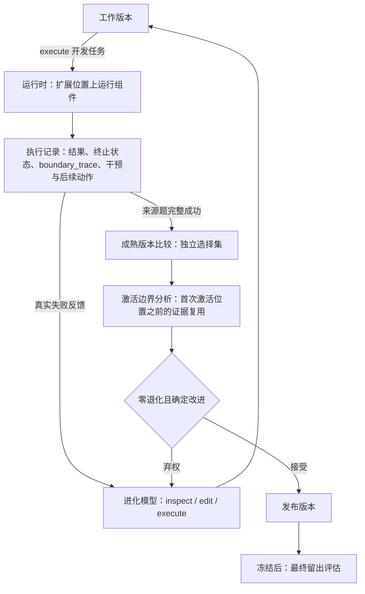

# GNOSIS 科研计划 v3：激活边界限定验证范围的连续自主修复

版本 v3，2026-10-07，取代 v2（2026-10-05，保存在提交 `f2cb244`）。依据为 [先导报告](../experiments/pilot/pilot_final_report_2026-10-06.md) 与 [先导后计划](GNOSIS-先导后计划.md)。研究对象保持不变：冻结模型权重，Agent 依据自己的执行反馈持续修改自身可编辑部分。当前目录、实现状态与启动方式见 [项目入口](../README.md)，产品边界见 [产品 PRD](GNOSIS-产品PRD.md)。

## 0. 一句话

**GNOSIS 是允许模型连续修复、组合经验的自主进化系统。经验由可执行组件承载，组件第一次实际影响执行的扩展位置决定哪些历史执行必须重跑，省下的验证费用投入继续修复。** 实验在 AutomationBench 六个领域上进行，测量能力迁移、验证费用与有效进化次数。

论文回答的问题：

> 持续进化时，能否根据一个改动第一次实际影响执行的位置，精确确定哪些历史执行必须重跑，并将节省的预算转化为更多有效学习？

## 1. 先导裁决

先导版本 `fa98b99a…` 的干净 B1 在 30 题上严格通过 15 题。3 轮准入检查提出 3 个候选，接受 0 个，本次先导费用 $1.1419。失败的首要原因是执行被截断和缺少语义修复循环，知识缺失排在其后。

| 实际证据 | 对 v3 的直接影响 |
|---|---|
| B1 的 15 道失败题中，9 道最后一次响应为 `finish_reason=length` | 先处理推理输出额度，避免把截断误归为知识问题 |
| 前两轮来源题的最后一次响应都用满 8192 个 completion tokens，全部是 reasoning tokens，正文和工具调用为空 | 候选连下一步动作都没完成，优化提醒措辞抓不到主因 |
| “最多三次修复”只针对编译或接口准备错误；来源题失败后没有围绕同一问题继续修改的循环 | 模型的语义迭代空间过小 |
| 来源题失败后仍执行独立题检查，花费约 $0.7836，占先导费用 68.6% | 验证吞掉了本该支持继续修复的预算 |
| 三个候选全部为 `GLOBAL`，最终接受零个 | 作用域机制尚未得到检验 |
| `project_profitability` 基线 5/6，候选仍为 5/6；任务要求排除 pro bono 项目，候选却把包含 Delta 总结成了经验 | 从失败轨迹提炼出了错误规则，修复器要用真实执行纠正自己的判断 |
| 231 次组件调用只有 1 次实际新增提示，29 次激活大多没有行为判定 | 直接记录组件产生的干预及其后的实际动作 |
| `api_fetch` 的错误结果在进入组件处理前被跳过，`api_search` 没有进入干预路径 | 最需要帮助模型理解错误、找到接口的位置，组件反而接触不到 |

**裁决：v2 的“单元×轮”准入流程停用，改为连续自主修复。** 单次输出上限提高到官方最大值 393216；全部工具观测经过统一扩展位置；来源题完整成功后才进入验证；影响范围按激活边界计算。先导的 50% 保留为先导结果，新实验的提升从修正执行条件后的基线计算。

v1（AppWorld 四组因素试验加联合修复）已于 2026-10-05 终止：执行模型在 AppWorld train 上已到 92%，单次改动效应落在噪声内。完整裁决见 v2 §1。

## 2. 关键假设

| 编号 | 假设 | 证据 | 撤掉后结论是否成立 |
|---|---|---|---|
| A1 | 受测模型权重冻结 | 研究设定 | 撤掉后研究对象变为权重学习，本计划整体失效 |
| A2 | AutomationBench 原始任务与评分器固定 | 上游固定提交 `4a8e106`，任务契约逐题记录指纹，契约变化即停止 | 撤掉后历史证据失去可比性，证据复用无从成立 |
| A3 | 不同任务之间存在可复用的接口操作经验 | StarHarness 在 AutomationBench Finance 上依靠接口修复、环境约定与操作知识涨 20–35 分；Gmail、Sheets、Drive、Slack 横跨全部领域 | 撤掉后自进化收益只留在当前任务，持续学习主线不成立 |
| A4 | 局部组件在首次匹配的已登记扩展位置之前对模型完全不可见：提示、工具目录、观测内容一致，宿主进程不加载 | 由运行时强制（§5.2）；当前版本离线检查覆盖初始化提示、工具目录、宿主加载、错误与搜索观测 | 撤掉后作用域外证据复用立即失效。例如新组件尚未被调用，却已出现在全局工具目录中，就可能改变模型的第一步选择 |
| A5 | 修正截断后基线仍留有学习余量 | 15 道失败题中 6 道与截断无关；公开集前沿最高 50.3% | 撤掉后留出集提升空间收窄，论文重心落到验证费用与证据复用准确率，这两项与基线高低无关 |

**最关键的是 A4。** A1、A2 由实验设定保证，A3 已有同基准的直接证据；A4 是证据复用的前提，也是唯一由本项目代码承担的假设。

## 3. 基准：AutomationBench

筛选条件按重要性排序：足够难；确定性评分；可重置；单题便宜；无需 sudo 即可落地；任务之间共享应用，知识可迁移。七份调研交叉核验后的结论：

| 基准 | 核实结果 | 裁决 |
|---|---|---|
| **AutomationBench v1.0.6**（[论文](https://arxiv.org/abs/2604.18934) 2026-04-21；任务集 2026-07-31 重标定；[仓库](https://github.com/zapier/AutomationBench) MIT） | 公开 600 题，6 个领域各 100 题；纯 Python 加 Pydantic 模拟器，无 Docker、无外部服务；终态断言评分，零 LLM 评委；每题输出 partial_credit 与严格通过；`--base-url` 接 OpenAI 兼容端点；最多 50 步；公开集前沿最高 50.3% | **主基准** |
| AppWorld（现有栈） | train 已 92%；ACE 官方代码自带 AppWorld 流水线 | 移出本轮预算 |
| VibeLifeBench（[2608.10875](https://arxiv.org/abs/2608.10875)） | 只开放 200 题中的 100 题；22 个服务各需 Docker 镜像；Flash 折算约 $0.2–0.3/次，单题耗时数小时 | 后续工作 |
| ClawMark（2604.23781） | 99 个 task.py 中 96 个依赖真实 Notion 或 Google Sheets 账号；CC BY-NC | 淘汰 |
| WildClawBench（2605.10912） | 需联网、Brave Search key、YouTube 下载；语义项用 GPT-5.4 评委 | 淘汰 |
| Claw-Eval（2604.06132） | 部分项用 LLM 评委；V4 Flash 在 general Pass^3 已 57.8 | 淘汰 |
| ττ-Bench（2609.04611） | 一次配置约 $3,000，评委需 OpenAI key | 淘汰 |
| Terminal-Bench 3.0/4.0、ProgramBench、Agents' Last Exam | 需要 GPU、VM 或单容器 60GB 内存 | 淘汰 |
| DeepSWE v1.1、NL2Repo | Flash 已 74.2 / 64.0 | 淘汰 |
| SkillsBench v1.1 | 需 Docker，任务异质；SkillOpt、EvoSkill 等已占位 | 备选 |

AutomationBench 的论文早于 5 月，任务集在 7 月按前沿模型重新标定：4 月论文中前沿低于 10%，现版前沿约 50%。它满足“当前仍未被打穿、能做多轮实验”这个真实要求；5 月后发布的高难基准都卡在费用、评委或 Docker 上。

结构数据（按任务声明的工具统计）：Gmail、Google Sheets、Google Drive、Slack 几乎出现在所有领域；领域两两之间的应用集合 Jaccard 为 0.18–0.59（Operations–HR 最高，Finance–HR 最低）。跨领域可复用的接口操作经验有充足的结构基础，这是 A3 的直接支撑。

## 4. 前人工作与空位

| 工作 | 已经做到的 | 对 v3 的约束 |
|---|---|---|
| [ACE](https://arxiv.org/abs/2510.04618)（[代码](https://github.com/ace-agent/ace)，Apache-2.0） | 生成、反思、整理三角色维护全局 playbook | 官方实现作为经验记忆基线，检验可执行经验相对文本记忆的价值 |
| [SkillOpt](https://arxiv.org/abs/2605.23904)（[代码](https://github.com/microsoft/SkillOpt)，MIT） | 单份技能文档的有界编辑，验证集严格提升才接受 | 全局验证集门禁的代表 |
| [SAGE](https://arxiv.org/abs/2609.36043) | 逐项配对、单侧检验、可弃权 | 预先安排的成熟版本配对统计，不声称门禁是贡献 |
| [StarHarness](https://arxiv.org/abs/2608.24804)（[代码](https://github.com/ServiceNow/StarHarness)，MIT） | AutomationBench Finance 单领域离线进化，+20–35 分，含提议、选择集评估、留出评估 | 证明余量存在；复用其进化循环与适配器契约。它只做单领域离线进化，未测验证费用与遗忘 |
| [VACE](https://arxiv.org/abs/2609.37105) | 在 AutomationBench 上交替做 RL 与验证门控的 harness 进化 | 动权重，与本课题设定不同 |
| [Self-Evolving Harness on Multiple Tasks](https://arxiv.org/abs/2609.38372) | 多基准预训练加持续训练 | 持续阶段只报单基准涨分，未测验证费用 |
| [CL-Bench](https://arxiv.org/abs/2606.05661)、[SkillEvolBench](https://arxiv.org/abs/2605.24117)、[EvoAgentBench](https://arxiv.org/abs/2607.05202)、[EverMine](https://arxiv.org/abs/2609.33524) | 自进化增益不稳定，凝练技能常不如原始轨迹 | 完整保留经验的操作过程与执行证据，短摘要只用于检索 |
| [Rethinking Harness Evolution](https://arxiv.org/abs/2607.12227) | 预算对齐后 harness 进化不敌 test-time scaling，只在有余量、需要适应环境、反馈细粒度的场景占优 | AutomationBench 三条都满足；设等美元预算的重复执行组 |
| [2605.30621](https://arxiv.org/abs/2605.30621)、[2601.22436](https://arxiv.org/abs/2601.22436) | 强模型从 harness 获益有限；凝练经验常被忽略 | 稳定计算与重复操作交给可执行组件直接完成，并记录干预后的实际动作 |
| [RTS for capability modules](https://arxiv.org/abs/2604.26689)；Ekstazi（Gligoric 等，ISSTA 2015） | 记录每个测试的依赖，改动只重测依赖它的测试 | 依赖粒度落到执行轨迹上的扩展位置 |

**空位：** 现有门禁都在固定的全局验证集上判定，持续进化中历史任务不断累积，验证费用随历史线性增长，并挤占修复预算。先导实测验证占去 68.6% 费用，正是这个问题。目前没有工作把“组件第一次实际影响执行的位置”与历史执行依赖联系起来，也没有工作把节省的验证预算重新投入学习并测量收益。

## 5. 方法

三个领域提供结构：数据库事务把工作版本与正式版本分开；反馈控制让执行结果持续修正下一次动作；增量构建按依赖关系决定重算范围。对应到 GNOSIS：**工作版本自由迭代，执行反馈持续返回，发布版本按影响范围验证。** 三个机制服务于同一个进化循环。

### 5.1 组件与整组版本

可编辑单元 `EditableUnit` 的字段：

- `scope` \(D_u\)：服务、端点或工具名组成的列表；`["GLOBAL"]` 表示全局，与任何局部值互斥。
- `hooks` \(H_u\)：允许激活的扩展位置。
- `content`：完整经验与操作过程；`summary` 供检索。
- `component` 与 `source`：组件类型与 TypeScript 源码，为空时是纯文字经验。

| 类型 | 导出函数 | 作用 |
|---|---|---|
| T | `formatObservation` | 改写工具观测 |
| C | `buildContext` | 重组上下文，每步最多一次 `lmRequest` |
| W | `beforeStep` | 每步前注入、继续或停止 |
| E | `onBoundary` | 在任一已登记扩展位置读写观测、参数与消息；激活后登记可调用的操作函数；通过原装 `api_fetch`、`api_search` 发起批量调用，取回真实结果后回到同一个函数，直到不再发起调用 |

E 是 v3 新增的主力形态。完整读取表格、翻页、按实际字段计算、写入后回读确认，都可以写成 Agent 直接调用的操作函数。组件只能调用当前任务的原装能力，权限检查与评分器保持原样。文字经验适合解释业务范围，稳定计算与重复操作交给可执行组件，形式由进化模型按执行结果选择。

发布单位是整组组件的版本。每组生成不可变版本目录，保存清单和源码，加载时校验一致。组件的新增、修改、删除、作用域改变与相对顺序改变都计入改动。

### 5.2 扩展位置与激活边界

已登记扩展位置：`task_start`、`tool_discovery`、`before_call`、`after_call`、`context`、`workflow`、`operation`。

受测模型看到的每条工具观测都经过 `after_call`：成功响应、错误响应、搜索结果、原装工具抛出的异常，以及参数无法解析时由运行时补出的错误消息。`api_search` 返回后，每个返回接口各登记一次 `tool_discovery`。组件发起的原装调用走同一批扩展位置。每次执行把经过的扩展位置写入 `boundary_trace`（`gnosis.boundaries.v1`）。

协议的两条硬规则：

1. **`GLOBAL` 与任何局部 scope 互斥。** 提议、加载、工作区编辑与激活判定四处校验，混合作用域在任何一处都会失败。
2. **局部组件只在首次匹配的已登记扩展位置之后影响模型输入。** 匹配之前不注入提示，不改工具目录与观测，不加载宿主进程；操作函数在激活后才进入工具目录。参数只能在 `before_call` 修改，消息只能在 `context`、`workflow` 修改。

**边界性质。** 设当前发布版本为 \(G\)，候选版本为 \(G'\)，改动集合为 \(\Delta\)。用同一随机源耦合两次执行（模型采样与环境生成的标识符共用随机源）。对任务 \(\tau\)，记 \(b^*(\tau)\) 为轨迹上第一个使 \(\Delta\) 中任一组件激活的扩展位置。由规则 2，两次执行在 \(b^*\) 之前逐步相同，于是：

- 记录轨迹没有到达 \(b^*\) 的任务，\(G'\) 下的耦合轨迹与记录完全相同，复用这条证据等价于在 \(G'\) 下执行一次；
- 到达 \(b^*\) 的任务从 \(b^*\) 起重新验证，路径改变后的全部后续执行纳入影响范围；
- 得分期望的变化满足

\[
\bigl|\mathbb E_{G'}[Y_\tau]-\mathbb E_{G}[Y_\tau]\bigr|\le P_{G}\bigl(\tau\text{ 到达 }b^*\bigr).
\]

新增组件的激活条件直接在旧轨迹上检查，所以新组件同样能确定首次可能生效的位置。

**验证费用。**

\[
C_{\text{验证}} \approx \sum_{\tau\in \text{受影响任务}} C_{\tau,\,\ge b^*}
\]

环境状态与执行前缀可恢复时，\(b^*\) 之前的前缀也可以复用。当前 AutomationBench 接入层让受影响任务从 `task_start` 重跑，验证费用按整题计。`validation_plan()` 的判定规则：

| 情况 | 处理 |
|---|---|
| 改动含 `["GLOBAL"]`，或处于全局验证模式 | 全部重跑 |
| 历史记录缺少 `gnosis.boundaries.v1` 边界结构 | 重跑 |
| 程序版本或组件版本与对照不一致 | 拒绝作为对照 |
| 轨迹上存在改动的激活位置 | 重跑，记录首次激活位置 |
| 轨迹上不存在改动的激活位置 | 复用，保留来源执行 ID，新增验证费用记 0 |

影响范围按轨迹上的首次激活位置计算，作用域标签只决定激活条件。局部组件若把 scope 写成每题都会经过的位置（例如工具目录发现），它在每条旧轨迹的开头就激活，验证自动变为全量重跑，结论保持正确。作用域越广，验证越贵；有效的局部经验因此获得更多迭代机会。**有限预算在这里成为学习资源分配机制的一部分。**

### 5.3 自主修复工作区

进化模型与执行模型相同，都是 DeepSeek V4.1 Flash（high）。它读取当前可编辑的整组实现、开发任务的执行记录（成败、partial_credit、终止状态、执行错误）、最近一次真实反馈与预算余额，用显式操作推进：

| 操作 | 作用 |
|---|---|
| `inspect` | 读取已授权任务的完整执行证据 |
| `edit` | 替换整组工作版本，可以修改、组合、删除组件 |
| `execute` | 用工作版本执行一道开发任务，真实结果返回同一修复过程 |
| `validate` | 来源题完整成功后，在独立选择集上比较成熟工作版本与发布版本 |
| `stop` | 结束修复，冻结发布版本 |

工作区维护 `working`、`released`、`frozen` 三个版本引用。修复翻页之后仍漏发通知，就继续修复通知，中间的有效改动保留在工作版本里。来源题未完整成功时 `validate` 被拒绝，不消耗独立验证预算。模型自己决定继续修复、改变假设或转向另一道任务，兼顾跨领域覆盖与修复价值。最终留出集的证据禁止进入工作区。

### 5.4 成熟版本比较

独立选择集每领域 1 题，共 6 题。每侧每题预定执行 2 次，两次都成功才算该题通过；两侧的任务、执行次数、编号与统计方法一致。GNOSIS 组的对照侧按 §5.2 复用证据，全局验证组全部重跑。

发布判定采用 StarHarness 的确定性改进判定加零退化约束。同一批证据上的 SAGE 二元配对统计（单侧 \(\alpha=0.05\)，惩罚系数 1，退化率上限 0）完整记录，作为论文的统计报告。这样分工的理由是统计功效：6 题配对在 \(\alpha=0.05\) 下需要 5 胜 0 负才显著，用作发布门禁几乎不会放行。接受后推进发布版本，选择集反馈可用于继续修复。

### 5.5 执行条件与干预记录

- 单次输出上限 393216，所有实验组一致。
- 终止状态分三类：`truncated`（`finish_reason=length`，含正文与工具调用都为空的响应）、`completed`、`tool_execution_failed`。截断立即终止该题，记 `execution_truncated`。
- 每次组件干预记录效果类型（`tool_catalog`、`capability_calls`、`call_arguments`、`observation`、`context`）、首次生效位置 `first_effect_boundaries`、随后的实际动作 `next_actual_tool_action`。经验是否生效由这些记录判定。

## 6. 实验设计

### 6.1 固定条件

- 基准：AutomationBench 固定提交 `4a8e106`，`--toolset api`，最多 50 步，严格断言评分。
- 模型：DeepSeek 官方 API（`https://api.deepseek.com`，模型 `deepseek-flash` 即 DeepSeek-V4.1-Flash），思考模式开启，`reasoning_effort=high`，温度 1，单次输出上限 393216（官方最大值，上下文 1M）。思考模式下温度不生效，重复执行是独立采样。
- 任务划分固定在 `config/research_selection.json`（种子 100，记录任务契约、授权服务与上游提交）：

| 集合 | 数量 | 用途 |
|---|---|---|
| 开发 | 30 | 三十道先导题全部进入，供修复反复执行 |
| 独立选择 | 6 | 每领域 1 题，成熟版本比较 |
| 最终留出 | 30 | 每领域 5 题；四个冻结版本独立执行 5 次（每组 150 次、四组共 600 次），各次恢复任务初态，结果完全隔离于学习反馈 |
| 中途检查 | 6 | 每领域 1 道开发题；学习费用达到组额度一半时执行，比较首次成熟版本与当前版本，结果不进修复反馈 |

- 服务断流最多重试 10 次，指数退避 2→60 秒并遵守 Retry-After，失败尝试释放预留；AI 格式错误重试 1 次；单题不设费用上限，等预算组的单题额度按已结算费用判定。
- **权限与审计边界**：
  1. checkpoint 取自开发题子集，题名出现属于合法开发任务引用，不构成违规；重点审查中途评估结果是否被物理隔离（禁止进入修复反馈）。
  2. 留出任务信息和结果绝对不得进入学习或修复上下文；最终评估时受测模型按设计接收当前任务初态。
  3. 修复器可以读取获准的开发题作答轨迹、断言和选择集结果；执行模型不得读取隐藏答案或判分材料。
  4. 字符串命中仅作为审查线索，必须结合真实数据流和权限门禁判断越权。

### 6.2 实验组

| 实验组 | 承担的比较 |
|---|---|
| 修正执行条件后的固定 Agent | 提供真实起点 |
| 官方 ACE | 检验可执行经验相对文本记忆的价值 |
| 同一自主修复器加全局验证 | 分离修复器本身带来的收益 |
| 完整 GNOSIS | 测量限定影响范围后，学习收益与验证费用的变化 |
| 等美元预算的重复执行／修订 | 判断额外费用用于持续学习是否值得 |

全局验证组与完整 GNOSIS 使用相同的可编辑能力、反馈权限、模型条件与学习额度，只差验证范围。

**四组重复留出评估。** fixed、ace、global、gnosis 四组在版本冻结后，在同一批 30 道留出题上各独立执行 5 次（共 600 次执行）。各次执行恢复任务初态，不得读取其他重复执行的过程或历史反馈；全部评估数据与学习工作区物理隔离。每笔执行通过稳定的断点标识 `[arm, "heldout", frozen_version, task, repeat]` 记录，中断后复用已完成记录，缺失执行继续调用并如实入账。

**固定候选重测比较。** 留出评估之后，取两组最后一次成熟版本比较（接受与否都纳入），在同一批冻结候选上分别做全局重测与按影响范围重测，记录接受判断的一致性、执行数量差、逐题证据复用准确率与费用。同一道题存在多条执行轨迹时，每条轨迹独立判断激活边界；某条轨迹未激活组件，只能支持复用该条证据。重复编号参与证据关联，直接测量证据复用的准确性与费用收益。

**等预算组。** 只看到自身前次过程，选择最后一次结果，评分不反馈给模型。明确独立重复评估（测量策略采样方差）与组内连续尝试（单题配额内基于历史修订）的区别，统一比较单位为任务（30 道留出题）。每道留出题的额度为 GNOSIS 全部费用（学习、验证、中途检查、留出）除以 30 道题；不机械地将额度乘以 5。评估池剩余不足时以剩余为准，实际对等程度写入汇总。

### 6.3 指标与事前登记

- 主终点：最终留出 30 题严格通过率（每组 150 次执行平均值）。
- 次终点：partial_credit（150 次平均值）；30 道题中 5 次全部成功的任务比例（pass@5-all）；每题成功次数与执行来源；中途检查中早期能力的变化；终止状态分布。
- 费用：学习、选择验证、中途检查、最终评估分列；报告参照费用与实际扣费；按实际评估任务数（30 题）统一分母计算摊销成本，报告持续使用达到盈亏平衡所需的任务数。
- 有效进化次数：发布版本被推进的次数，以及每美元推进次数。
- 证据复用：固定候选上两种重测的判断一致率、执行数量差、逐题复用准确率。
- 干预生效：干预后下一实际动作与组件效果一致的比例，按组件形态分列。

事前登记：

1. 同一批冻结候选上，按影响范围重测与全局重测的接受判断一致，重跑执行数明显更少。
2. 相同学习额度下，GNOSIS 的有效进化次数多于全局验证组，留出严格通过率不低于全局验证组。
3. GNOSIS 的留出严格通过率高于固定 Agent 与官方 ACE。
4. E 组件干预后的动作一致率高于纯文字经验。

### 6.4 统计

主终点按任务配对，对每题 5 次独立执行的成功比例（0~1 离散值）使用配对置换检验；置信区间按任务重采样（自助法给出 95% 区间），严禁将同题 5 次执行当作 5 道独立任务打乱统计单位。五次全部成功（pass@5-all）这一二元指标使用精确 McNemar 检验；partial_credit 同样按任务配对使用配对置换检验。三项主比较（GNOSIS 对固定 Agent、ACE、全局验证组）做 Holm 校正。留出集只在版本冻结后使用，过程中不据留出结果调整任何参数。

## 7. 预算

费用不设上限：总额、时间窗口、单题都不拦截，账本 `state/research_ledger.sqlite` 只记账。唯一保留的额度是实验设计里的组学习额度，它是对照条件：两个修复组在同样的学习与验证花费下比较，GNOSIS 省下的验证费用直接变成更多修复次数，这正是要测的量。

| 组 | 学习与验证合计额度（USD 参照价） |
|---|---|
| 固定 Agent | 2 |
| ACE | 3 |
| 全局验证 | 8.5 |
| 完整 GNOSIS | 8.5 |

额度按已结算费用判定，用完即结束该组学习并冻结发布版本。留出评估、中途检查、固定候选重测与等预算组不设额度。

计价按官方 deepseek-flash 价目：闲时每百万 token 输入（缓存未命中）1 元、输入（缓存命中）0.02 元、输出 4 元，高峰时段（北京时间工作日 9–12 点、14–18 点）翻倍。账本 `cost` 按闲时价折成美元（7.1 元/美元）记账，组额度与等预算比较只用它，避免高峰时段让某一组吃亏；`billed` 按实际时段报告扣费。

任务执行最多 8 路并行。基线、留出评估、选择集两侧、中途检查、固定候选重测与等预算组的各题互相独立，并行执行；ACE、全局验证、GNOSIS 三个学习组同时运行，共用这 8 个名额；组内的修复步骤仍按顺序进行。中断后再次运行按断点复用已完成的执行与修复记录，未完成请求重新调用产生的费用如实入账。修复器输入使用精简证据（完整作答轨迹、断言、扩展位置序列与干预记录），逐步重复提示的 `wire_trace` 只留在磁盘：单次输入从中位 2.4MB 降到 239KB。

## 8. 判定门槛

| 门槛 | 判定 | 未通过时 |
|---|---|---|
| G0 修正基线 | 固定 Agent 在 30 道开发题上完成执行，截断占失败不到一半（程序自动判定，写入 `baseline_gate.json`） | 先排查推理额度与单题上限，截断问题解决后再开学习 |
| G1 证据复用 | 固定候选上两种重测的接受判断一致，逐题复用结果与重跑一致，执行数少于全局重测 | 定位首个分歧任务的边界记录，把漏掉的路径纳入扩展位置后重测 |
| G2 学习收益 | GNOSIS 留出严格通过率高于固定 Agent 与 ACE | 查干预记录：没激活就修激活条件；激活了但没改变动作，修复器转向可执行组件 |
| G3 预算转化 | 相同学习额度下，GNOSIS 有效进化次数多于全局验证组 | 作用域大多落在 Gmail、Sheets 等通用服务时，把作用域细化到端点 |
| G4 等预算 | 实验任务数内 GNOSIS 的摊销成本低于重复执行组 | 报告盈亏平衡任务数，主张改为“任务流足够长时占优” |
| G5 早期能力 | 中途检查中早期能力不下降 | 定位引起下降的发布版本，回看对应的成熟版本比较 |
| 停止 | 全流程结束后 GNOSIS 既不优于全局验证组，也不优于固定 Agent | 发表诊断性结果与开源工具，产品转 PRD 的 L2 档 |

原始结果全部保留。

## 9. 开源复用与代码边界

| 来源 | 用途 |
|---|---|
| AutomationBench（MIT，`4a8e106`） | 环境、工具、断言、runner 原样使用；`ScopedAutomationEnv` 继承 `AutomationBenchEnv`，在 `setup_state`、`get_prompt_messages`、`call_tool`、`env_response` 接入扩展位置 |
| StarHarness（MIT，`a56d8f6`） | 进化循环与 `BenchmarkAdapter` 契约；发布判定使用其 `decide()` 与发布审查 |
| ACE（Apache-2.0，`82709de`） | ACE 组运行官方 `Reflector`、`Curator` 与 playbook，模型请求经 `ACETransport` 走本项目计费 |
| SAGE | 成熟版本配对统计 |
| 本仓库 `engine/`、`host/` | GnosisLM 计费、费用账本、QuickJS 组件宿主与隔离 |

v3 新写模块：`activation.py`（作用域、扩展位置、验证范围与证据复用）、`extension_protocol.py`（E 组件协议）、`evolution.py`（工作区、整组版本、配对比较、研究预算）、`run_research.py`（研究入口与修复控制）、`research_*.py`（任务划分、执行、模型请求、上游固定、重测比较、离线检查）、`service_quota.py`（实时额度接口）。

v2 资产的去向：`run_pilot.py` 保留以复现先导；`factorial.py`、GEPA 搜索冻结；AppWorld 第二环境移出本轮预算。

## 10. 时间表

| 时间 | 工作 | 完成条件 |
|---|---|---|
| 10 月 7–8 日 | 改造代码；无模型调用的离线检查与 30 题完整工具轨迹重放 | 当前版本离线证明为 passed，含完整重放 |
| 10 月 9–10 日 | 固定 Agent 修正基线 | G0 |
| 10 月 11–20 日 | ACE、全局验证、GNOSIS 学习 | 三组冻结，费用在组额度内 |
| 10 月 21–25 日 | 最终留出评估、等预算组、固定候选重测比较 | G1–G5 判定 |
| 10 月 26 日–11 月 30 日 | 写作；GNOSIS Core 打包开源（见 PRD） | 投稿稿件与可复现包 |

目标会议：ICML 2027，按官方公布的截止日倒排。

## 11. 论文与完成标准

暂定题目：**Activation-Bounded Validation: Reusing Evidence to Fund Continual Agent Self-Repair**。

论点：持续自进化的瓶颈在验证费用随历史增长、挤占修复预算。把经验做成经已登记扩展位置激活的组件，按改动第一次实际影响执行的位置确定必须重跑的历史执行，验证费用只取决于受影响的部分，省下的预算转化为更多有效学习。

必需的图表：

1. 主表：五组的留出严格通过率、partial_credit 与全口径费用。
2. 固定候选重测：全局与按影响范围两种重测的判断一致性、执行数与费用。
3. 学习效率：有效进化次数对累计费用，GNOSIS 与全局验证组。
4. 等预算曲线：GNOSIS 对重复执行组的摊销成本与盈亏平衡点。
5. 终止状态：先导（8192）与修正基线（393216）的截断、正常完成、工具失败分布。
6. 干预生效：按组件形态的干预后动作一致率。

投稿标准：GNOSIS 在留出测试上显著优于固定 Agent 与 ACE；固定候选上两种重测判断一致且执行数明显减少；相同学习额度下有效进化次数多于全局验证组。

## 12. 下一步动作

1. 当前程序版本已通过无模型调用的离线检查，准入证明在 `state/research_offline_check.json`。
2. 用户授权后执行 `run_research run`。基线、学习、留出评估、固定候选重测、等预算组与汇总一次完成，中断后再次执行即续跑。
