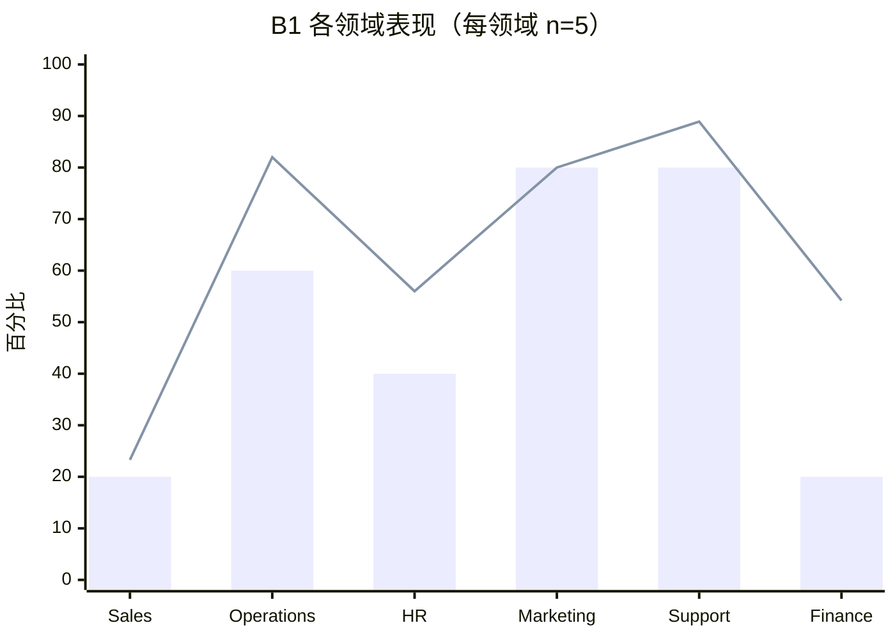
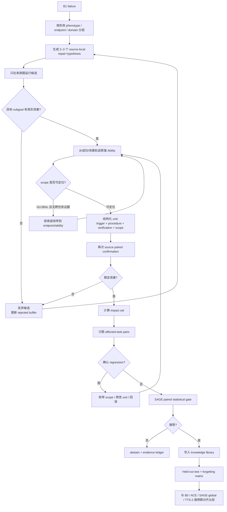

# GNOSIS 先导实验失败诊断与改进研究报告

## 执行摘要

**核心裁决：这次先导实验真正失败的不是 AutomationBench 选型，也不是 SAGE 门禁，而是门禁之前的“知识获取链路”。** 当前系统没有稳定地产生“正确、可作用域、会被执行器采用、能修复来源题”的知识单元：3 个候选来源题 **0/3 由失败翻为通过，0 个单元被接受**；3 个候选又全部退化成 `GLOBAL`，因此 GNOSIS 最核心的“scoped self-evolution”机制实际上尚未被真正检验。fileciteturn0file1 fileciteturn0file0

反而，**基础 Agent 能力并不差**。B1 空知识库在 30 题上严格通过 15/30=50%，`partial_credit=0.6406`，平均成本约 $0.0298/题；当前 AutomationBench 官方公开集列出的最高 600 题通过率约为 50.3%，因此你的基准难度基本落在正确区间。30 题样本的 50% Wilson 95% 区间约为 **33.2%–66.8%**，所以不能把 B1 本身视为性能崩溃。当前官方仓库同时确认其评分是终态 assertion-based，报告 strict pass 与 `partial_credit` 两类指标。citeturn6search2turn7view0

最值得重视的四个问题按优先级是：

1. **知识编码失败**：至少一个候选被 Agent 实际遵循，但知识本身是错的。第 3 轮要求把 Delta 纳入并标记，而原任务正确条件恰恰要求排除 Delta，说明 proposer 从“失败轨迹 + 标量 partial credit”中提炼出了错误因果解释。fileciteturn0file1
2. **知识采纳失败**：第 1 轮建议没有转化为所需写入；第 2 轮唯一真正触发的 nudge 后，Agent 仍继续无关 Drive 探索。即使候选文字正确，“注入”也没有稳定转化为动作。fileciteturn0file1
3. **作用域机制没有启动**：3/3 最终候选均为 `GLOBAL`。这直接偏离 GNOSIS 的论文核心——按应用/端点界定影响面。当前 pilot 测到的是“全局文本/组件提示能否帮助做题”，而不是“作用域化知识能否低成本持续进化”。fileciteturn0file0 fileciteturn0file1
4. **实验预算被低价值验证消耗**：`source_task_not_flipped` 是硬性拒绝条件，但三个来源题都失败后，实验仍累计跑了 24 个独立影响面对和 2 个确认复测。换言之，在当前门禁逻辑下，**26/29 次候选执行属于可以在 source gate 失败后短路掉的下游计算**。这显著压缩了候选搜索数量，最终只完成 3 轮便 `budget_stop`。fileciteturn0file1

文献与当前证据指向同一个方向：**不要马上推翻 GNOSIS 的 scoped regression-gating 主线；应先重构 candidate acquisition。** StarHarness 已在同一 AutomationBench 上证明，冻结权重情况下通过接口修复、环境约定和操作知识演化可以获得 **20–35 个百分点**提升；EvoAgentBench 则进一步显示，正确的程序性能力内容可以迁移，但自动方法常败在 **encoding、routing、uptake** 三环；HarnessCompass 也把“仅凭轨迹结果进行归因”和“多组件混合修改”识别为 harness evolution 的核心故障源。citeturn0academia2turn9view5turn10view4

**推进意见：暂缓正式主实验，做一个极短的 Pilot-2。不是扩大样本，而是先把生成器改成“成功轨迹锚定 + 默认非 GLOBAL + source-first 短路”。只要这个环节仍然不能产生至少若干个来源任务上的真实因果改善，继续跑六臂正式实验没有科研价值。**

## 结果究竟差在哪里

### 基础模型没有失败，失败发生在“自进化增量”

当前 B1 的各领域差异很大。Sales 与 Finance 是明显薄弱区，而 Marketing 与 Support 较强。因为每个领域只有 5 题，领域排序只能用于**故障采样**，不能作为总体能力排名。fileciteturn0file1



柱：严格通过率；线：`partial_credit × 100`。原始数值来自先导报告。fileciteturn0file1

| 层级 | 实际结果 | 对照/预期 | 判定 |
|---|---:|---|---|
| B1 严格通过率 | 15/30 = **50%** | G0 要求 20–65%；当前公开 AutomationBench 最高列示约 50.3% | **正常，不是主要失败点**。fileciteturn0file1 citeturn6search2 |
| B1 partial credit | **0.6406** | 存在大量“接近完成但漏断言”的任务 | 有改善空间，适合做密集反馈。fileciteturn0file1 |
| Sales | strict **20%**, partial **0.233** | 六领域最低之一 | 明显弱。fileciteturn0file1 |
| Finance | strict **20%**, partial **0.542** | 三个 evolution source 全来自此领域 | 弱，而且候选采样严重偏向该领域。fileciteturn0file1 |
| 来源题修复 | **0/3 flip** | 准入要求 failure→pass | **核心失败指标**。fileciteturn0file1 |
| 接受单元 | **0/3** | 至少需要接受单元才能测试持续进化、遗忘、验证成本 | **核心机制没有进入工作状态**。fileciteturn0file1 |
| 独立影响面对 | 初始 **2 胜 / 2 负 / 20 平**；两负复测均恢复 | 理想候选应产生系统性正迁移 | 正迁移极稀薄；没有确认回归，但也没有稳定收益。fileciteturn0file1 |
| 作用域 | **3/3 GLOBAL** | 计划核心假设是应用/端点 scoped knowledge | **GNOSIS 核心假设尚未真正进入实验**。fileciteturn0file0 fileciteturn0file1 |
| 采纳/行为 | 直接可判定事件中既有“不遵循”，也有“遵循错误知识” | 理想状态应同时满足正确编码与稳定采纳 | **encoding 与 uptake 双重故障**。fileciteturn0file1 |
| Pilot 完成度 | 3 轮后 `budget_stop`，原上限 6 轮 | 应产生足够 proposal 样本判断生成器质量 | **搜索深度不足**，且预算使用顺序低效。fileciteturn0file1 |

这里最关键的判断是：**“0 个 accepted unit”不能简单解释为 SAGE 太保守。SAGE 根本没有机会成为瓶颈。三个候选在最前面的 source-task criterion 就已经失败。** 阶段末 SAGE 因 `no_accepted_units` 而 `not_applicable`。fileciteturn0file1

另外，AutomationBench 的任务本身高度符合你的研究目标：47 个模拟 SaaS、跨应用工作流、API discovery、business policy、确定性终态评分。官方研究发现常见失败包括“实际上没有完成却宣布成功”、搜索不够持续、遗漏列表项以及没有精确遵循要求；原始研究中不同模型有 72%–91% 的失败伴随这种假完成现象。citeturn7view0 你的日志里又出现 **151 次 `unauthorized_tool`**，因此接口发现/环境交互仍然是非常值得针对的故障面，而不是继续生成泛化的“做事更仔细”式 GLOBAL 建议。fileciteturn0file1

## 症状到根因的诊断矩阵

我将所有可能原因按当前证据分成高、中、低三档。这里不是泛泛罗列，而是判断什么最可能导致这次 pilot 的结果。

| 类别 | 症状/证据 | 最可能原因 | 当前概率判断 | 最有信息量的验证 |
|---|---|---|---|---|
| **实验设计** | 三个 source 全是 Finance；15 个 B1 failures 分散于六领域 | source scheduler 没有按失败类型、领域、工具/端点分层，导致 proposal 多样性不足 | **高** | 对 15 个失败按 trace phenotype 聚类后分层抽 6–8 题 |
| **实验设计** | source flip 是硬条件，但仍跑 24 pairs + 2 confirmations | gate 顺序错误，预算先花在“不可能晋升”的候选上 | **极高** | 改为 `source → targeted local test → impact pairs → SAGE` 严格短路 |
| **数据/任务结构** | 应用重叠不等于解决过程重叠；三轮均未 source flip | 任务之间共享 SaaS，但未必共享可迁移的“程序性能力” | **高** | 建立 endpoint/operation/guard 级 Ability Graph，而不是仅按 app overlap |
| **知识编码** | 第三候选被遵循，但关于 Delta 的规则与正确条件相反 | proposer 从失败轨迹和标量奖励错误归因，学到了 failure-correlated rule | **极高** | 要求候选必须由“修复成功的 counterfactual trajectory”反向蒸馏 |
| **知识编码** | 第一个候选是笼统的“停止探索、完成登记通知” | 候选过于抽象，不包含可执行前置条件、工具、后置校验 | **高** | 单元 schema 强制包含 trigger → procedure → verification → scope |
| **Routing / Scope** | 3/3 候选为 `GLOBAL` | proposer 倾向输出泛化原则，scope 字段只是形式化标签而不是约束 | **极高** | 默认禁止 GLOBAL；scope 必须由实际失败 trace 中触达端点生成 |
| **Uptake** | 第 1 轮知识激活后没有进行要求写入；第 2 轮 nudge 后继续 Drive 探索 | 纯自然语言提示在长轨迹中权重太低，强模型选择忽略它 | **高** | 比较 text instruction vs deterministic wrapper 的 action compliance |
| **组件设计** | T 组件 231 次调用，仅一个 nudgeCount 增长事件，且该 nudge 未被遵循 | 触发条件与行为控制力都太弱；调用很多但有效干预稀少 | **高** | 统计每种 trigger 的 precision/recall 与 post-trigger action change |
| **模型** | 同一个 DeepSeek V4.1 Flash 同时 solver/proposer | solver 的盲点可能复制到自我诊断中，形成 correlated error | **中高** | 仅作为诊断，加入 stronger/independent proposer 一臂，不进主结论 |
| **模型能力上限** | B1 50%，失败 15/30 | Agent 可能缺乏部分深层业务推理能力 | **中低** | StarHarness 已表明同类企业环境仍可通过 harness 大幅提升，因此先排查 harness。citeturn0academia2 |
| **训练/搜索** | 每个失败基本是一轮 proposal → 一个候选 | proposal search 深度太浅；没有先在 source 上寻找“已证实修复” | **高** | 每 source 生成 2–3 个候选，但只对 source 执行；成功后才扩大验证 |
| **评估设计** | source 必须 strict failure→pass | 一个知识单元可能只修复一个子问题，却因另一独立 assertion 失败而被丢弃 | **高** | proposal pre-screen 用 targeted state delta / assertion vector；最终论文仍用 strict pass |
| **评估设计** | 候选拿不到 assertion text | deployment realism 很强，但 feedback 可能不足以识别精确业务错误 | **高** | 不泄漏断言语义；提供结构化 postcondition diff、失败类型及最终状态差异 |
| **工具/接口** | 151 次 `unauthorized_tool` | tool discovery、服务定位或 endpoint search 存在大量无效探索 | **中高** | 比较 pass/fail 任务的 unauthorized rate、search depth、首次正确 endpoint 时间 |
| **随机性** | source-task candidate 每次基本只判一次 | 单题 stochastic flip 可能远高于 600 题 aggregate variance | **中** | 对全部 15 个失败和 source candidate 各重复 3 次，估计 task-level transition matrix |
| **统计功效** | B1 仅 30 题、领域 n=5；影响面对每单元最多 8 对 | domain-level 结论极不稳定；后续 SAGE 对小效果功效有限 | **中** | 领域数字仅用于采样；主比较按 task pairing + bootstrap/McNemar |
| **Optimizer’s Curse / 多重选择** | 后续正式实验将不断尝试候选 | 选择最高 noisy validation 候选会高估真实增益 | **中，正式阶段高** | 保留 SAGE 的 paired one-sided gate；不要为当前 source failure 放宽它。SAGE 正是为这一问题设计。citeturn0academia0 |
| **实现** | W 组件一次 TS 编译错误；准备程序一次 JSONDecodeError | 代码路径仍有脆弱点 | **低—中** | preflight compile/replay 全部 zero-LLM smoke test |
| **实现正确性** | hash、契约、账本、1167 当前请求均核对；脚本错误修复未改变成绩文件 | 实现 bug 导致 0 accepted 的可能性较低 | **低** | 保持 current version frozen 即可。fileciteturn0file1 |
| **硬件** | 曾发生主机内存/Explorer 中断，但断点、哈希、账本恢复验证通过 | 硬件中断不是本轮负结果主因 | **低** | 正式实验改 headless worker + checkpoint；无需围绕硬件重构算法。fileciteturn0file1 |

这个矩阵可以进一步压缩成一个非常清晰的三段故障模型：

\[
\text{Experience}
\rightarrow
\underbrace{\text{Encoding}}_{\text{学对没有}}
\rightarrow
\underbrace{\text{Routing}}_{\text{该不该在这里出现}}
\rightarrow
\underbrace{\text{Uptake}}_{\text{Agent 是否实际照做}}
\rightarrow
\text{Outcome}.
\]

这不是人为创造的新分类。EvoAgentBench 2026 恰恰把当前自进化 Agent 的关键问题归结到经验的 **encoding、routing、uptake**，并发现“人工正确构造的 Ability 内容”可以稳定迁移，而当前自动方法仍在不同 scaffold/backbone/domain 上出现负迁移。citeturn9view5

你的三个候选几乎已经给出了三个实验案例：**第三轮主要是 encoding failure；第一、二轮主要是 uptake failure；三个 GLOBAL 单元说明 routing/scoping 没有被真正实现。**

## 近年文献与可迁移解决方案

相关研究真正爆发于 2022–2026，因此近五年的工作比把窗口机械拉到十年更有信息量。下表优先采用原论文与官方代码。

| 文献 | 解决的问题 | 方法 | 论文结果 | 优点 / 缺点 | 对 GNOSIS 的适用性 |
|---|---|---|---|---|---|
| [Reflexion, 2023](https://arxiv.org/abs/2303.11366) citeturn5academia1 | Agent 重复犯错、不能从 trial-and-error 学习 | 把任务反馈转成 verbal reflection，保存在 episodic memory | 多种决策/编码/推理任务提升；论文报告 HumanEval pass@1 91% | 简洁、无需改权重；但 reflection 本身也可能误诊 | **中高**：可用于 source-task repair，但 reflection 必须被后续执行成功验证 |
| [ExpeL, 2023](https://arxiv.org/abs/2308.10144) citeturn4academia0 | 如何把历史经验抽象为可重用规则 | 从多条成功/失败轨迹中抽经验，测试时检索 | 随经验积累呈现稳定增益和迁移能力 | 比单失败轨迹更可靠；需要高质量 retrieval | **高**：GNOSIS 应从“单失败→规则”升级为“成功/失败对比→规则” |
| [Voyager, 2023](https://arxiv.org/abs/2305.16291) citeturn5academia3 | 长期学习中的遗忘与技能重用 | executable skill library + execution feedback + self-verification | Minecraft 中获得 3.3× 更多独特物品、关键里程碑最高快 15.3× | **可执行技能**比纯文字更强；环境差异较大 | **高**：支持把高价值规则改成 API wrapper / executable guard，而非 nudge 文本 |
| [Dynamic Cheatsheet, 2025](https://arxiv.org/abs/2504.07952) citeturn8academia0 | 黑盒模型跨任务积累经验 | 自维护的紧凑 test-time memory | 多项数学/知识任务显著提升，部分任务从低成功率升至近满分 | 轻量、无需训练；长期增长与错误知识积累仍是风险 | **中高**：适合 candidate 表示，但必须配 scope + regression gate |
| [GEPA, 2025](https://arxiv.org/abs/2507.19457) citeturn8academia1 | 标量奖励信息不足，prompt 搜索效率低 | 对完整轨迹做自然语言反思 + Genetic-Pareto 搜索 | 六任务平均比 GRPO 高约 6%，最高减少约 35× rollout | 能从少量 rollout 提取丰富信号；搜索仍可能过拟合/noisy | **高，但仅用于 source-local search**；不要恢复 v1 的全局昂贵 GEPA |
| [ACE, 2025](https://arxiv.org/abs/2510.04618) / [官方代码](https://github.com/ace-agent/ace) citeturn1academia24turn6search1 | 反复重写上下文导致 context collapse / brevity bias | Generator–Reflector–Curator；增量 delta playbook | agent 任务平均 +10.6%，finance +8.6%；显著降低 adaptation overhead | itemized knowledge + curator 很成熟；原生倾向全局 playbook | **很高**：复用 reflector/curator，但把每个 delta 强制变成 scoped ability |
| [SkillOpt, 2026](https://arxiv.org/abs/2605.23904) / [官方代码](https://github.com/microsoft/SkillOpt) citeturn2academia0turn6search0 | self-revision 不稳定、编辑幅度不可控 | bounded add/delete/replace、textual learning rate、rejected buffer、validation gate | GPT-5.5 上不同 harness 相对 no-skill 提升约 19–25 个点 | 更新纪律非常强；全局 held-out validation 会变贵 | **高**：借鉴 bounded edit 和 rejected buffer；不要复制全局验证成本 |
| [CL-Bench, 2026](https://arxiv.org/abs/2606.05661) citeturn2academia2turn9view3 | “保存记忆”是否真的等于 continual learning | 六领域有共享潜结构的连续学习 benchmark | 专用 memory 系统并未稳定胜出，简单 ICL 甚至平均更强 | 非常有价值的负结果；不是直接算法 | **极高的警示价值**：必须设置 naive history/ICL baseline，证明知识抽象本身有增益 |
| [StarHarness, 2026](https://arxiv.org/abs/2608.24804) citeturn0academia2 | 企业 Agent 的模型—环境错配 | 按 baseline failure 分层搜索；演化 prompt、tool interface、skill、loop 等 harness | 在 AutomationBench Finance 等环境中，4–12 次 accepted change 后整体提升 **20–35 pp**，留出任务也提升 | **与你同 benchmark 最直接的正证据**；搜索成本和 edit space 较大 | **最高**：立即借用 failure stratification、interface repair、environment convention 三类改动 |
| [EvoAgentBench, 2026](https://arxiv.org/abs/2607.05202) citeturn9view5 | 为什么自进化技能有时迁移、有时负迁移 | trace-grounded Ability Graph，显式控制 train/test ability support | curated Anchor 所有设置为正；所有自动方法至少存在负迁移 cell | 能把失败定位为 encoding/routing/uptake；需要额外能力图构建 | **最高**：GNOSIS 的 scope 应升级成 “Ability + endpoint + precondition”，而非单纯 app label |
| [Rethinking Harness Evolution, 2026](https://arxiv.org/abs/2607.12227) citeturn9view4 | harness evolution 的提升是否只是多花了 inference compute | 等预算比较 parallel sampling、refinement、harness evolution，并用 disjoint held-out | Terminal-Bench 上 harness evolution 未稳定优于简单 TTS，held-out generalization 也有限 | 给评价设计上了一道必须过的门槛 | **最高**：你计划里的 TTS-2 不能删；所有结论必须 budget-matched |
| [SAGE, 2026](https://arxiv.org/abs/2609.36043) citeturn0academia0 | 平均分门禁会接受“总体涨、部分任务坏”的 edit，并受 Optimizer’s Curse 影响 | per-item paired comparison + 单侧统计检验 + abstain | 20 个设置中 19 个降低回归，部分设置回归率降至 0；最终分数全部最好 | 非常适合防 regression；**无法修复坏 proposer** | **保留原样**。它应该是候选已经有效之后的最后关口，而不是当前调参对象 |
| [HarnessCompass, 2026](https://arxiv.org/abs/2608.01918) citeturn10view4 | search-task overfit、仅凭轨迹误归因、多组件干扰 | constrained evolution + grounded first-person feedback + component-wise optimization | SWE-bench Verified GPT-5.4 Pass@1 从 54%→66%，仅 5 次 evolution | 很直接解决“proposal 乱改”问题；代码任务与企业 workflow 有域差异 | **很高**：尤其应引入 constrained proposal 和 component isolation |
| [SkillEvoReg, 2026](https://arxiv.org/abs/2609.30861) citeturn10view3 | skill evolution 长期过拟合、技能膨胀、更新引发 regression | skill dropout、complexity regularization、causal counterexample validation | 多个 skill-evolution 设置下控制技能膨胀并改善部分迁移/后期性能 | 很适合长期阶段；增加验证复杂度 | **当前低、正式阶段高**：现在连一个 unit 都没 accepted，先解决 acquisition，再谈 regularization |

这组工作给出的最重要结论不是“换一个算法名字”，而是一个非常清晰的架构方向：

> **失败经验不能直接等价于新知识。先找到真正修复失败的行为，再从成功反事实中蒸馏知识；知识必须有触发条件、操作过程和验证条件；之后才值得进行回归门禁。**

当前 pipeline 的顺序实际上更接近：

\[
\text{失败轨迹}
\rightarrow
\text{LLM 猜一个 lesson}
\rightarrow
\text{全局注入}
\rightarrow
\text{花钱验证}.
\]

更可靠的顺序应改成：

\[
\text{失败轨迹}
\rightarrow
\text{故障定位}
\rightarrow
\text{局部 repair search}
\rightarrow
\boxed{\text{成功轨迹}}
\rightarrow
\text{蒸馏 scoped ability}
\rightarrow
\text{source causal check}
\rightarrow
\text{affected-task gate}.
\]

## 优先级行动方案

### 最高优先级：先修“候选产生”，不要动 SAGE

| 优先级 | 修改 | 具体做法 | 预计工程量 | 风险 | 预期收益 |
|---|---|---|---|---|---|
| **P0** | **门禁短路** | candidate 先只跑 source。source 无改善立即 reject；只有 source 过关才跑 8 个 impact pairs | **0.5 天** | 极低 | 同等预算下 proposal 数可增加数倍；当前 26 次 downstream run 原则上都可避免 |
| **P0** | **Success-anchored distillation** | 不让 proposer 直接从失败轨迹写最终 unit。先提出 repair hypotheses，在 source 上试 2–3 个极小候选；只从真正改善/成功的 trajectory 蒸馏 unit | **1–2 天** | 中 | 直接打击第 3 轮“学到错误规则”的根因；与 Reflexion/ExpeL/GEPA/StarHarness 方向一致。citeturn5academia1turn4academia0turn8academia1turn0academia2 |
| **P0** | **默认禁止 GLOBAL** | `scope=GLOBAL` 必须提供跨 ≥2 个任务的独立证据；单任务 lesson 默认 scope 到 `service:endpoint:operation` 或 Ability | **1 天** | 中 | 终于真正测试论文主张；大幅缩小 regression impact set |
| **P0** | **重新定义 unit schema** | 从 `(scope, content)` 升级为 `trigger / procedure / verification / scope / evidence`；尤其强制写明“什么时候不要使用” | **1 天** | 中 | 降低泛化错误；直接对应 EvoAgentBench 的程序能力思想。citeturn9view5 |
| **P0** | **分层 source scheduler** | 15 个失败按 `API discovery / policy / incomplete enumeration / missing write / wrong entity / premature completion / auth` 等 phenotype 聚类；跨领域采样 | **0.5–1 天** | 低 | 避免再出现 3/3 Finance；提高能力覆盖率。StarHarness 的 stratified search 与此最接近。citeturn0academia2 |

**最重要的代码层改造不是多写 prompt，而是把 proposal 与 verification 之间增加一个“source-local repair loop”。**

示意：

```text
failure trajectory
      │
      ▼
diagnose 2–3 candidate causes
      │
      ▼
make tiny repair candidate
      │
      ▼
run source only
 ┌────┴─────┐
fail       improves
 │            │
drop          ▼
         distill ability
              │
              ▼
         impact-set gate
```

这和当前“生成一个 unit 就立即在 8 对上花钱”的策略相比，是数量级更合理的预算分配。

### 高优先级：把“文字建议”升级成可执行的环境修复

AutomationBench 官方分析明确指出 tool discovery、搜索不持续、漏项和错误完成声明是主要失败模式。citeturn7view0 StarHarness 又在同一类企业环境中发现，其有效改动主要来自接口修复、环境约定和压缩搜索的操作知识。citeturn0academia2

因此最值得演化的 unit 不应首先是：

> “Be more careful and verify all items.”

而应是类似：

```text
Trigger:
Google Sheets list/read endpoint returns a paginated result.

Procedure:
Continue pagination until nextPageToken is absent.

Verification:
Compare processed entity count against retrieved entity count.

Scope:
google_sheets:<specific-list-endpoint>:pagination
```

更进一步，可执行 wrapper 能直接实现：

```text
list_all_pages(...)
write(...)
read_back(...)
assert expected state...
```

这类规则绕过“LLM 是否愿意听建议”的 uptake 瓶颈。Voyager 对 executable skill library 的结果、StarHarness 的 interface repair，以及你的第 2 轮 “231 次组件调用但 nudge 基本没有行为效果”，都支持这一方向。citeturn5academia3turn0academia2 fileciteturn0file1

尤其建议优先做四类 deterministic capability：

**分页与完整枚举、write-after-read-back、自适应 endpoint search fallback、完成前 postcondition checklist。**

它们既有较强跨任务重用性，又可以挂到精确 endpoint/service scope 上，是 GNOSIS 论文叙事最漂亮的一类 accepted unit。

### 中优先级：把 strict pass 从“学习信号”降级为“最终科学终点”

AutomationBench 的 strict success 要求全部 assertion 同时成立；当前官方实现另外提供 `partial_credit` 用于更密集的训练/迭代反馈。citeturn6search2

正式论文的主终点坚持 strict pass 是正确的，但用它做**最早期单元学习判据**过于粗糙。

应分三层：

\[
\text{proposal signal}
\neq
\text{unit causal gate}
\neq
\text{paper endpoint}.
\]

建议：

**Proposal signal**：轨迹错误、最终状态 diff、`partial_credit`、unauthorized/error、搜索/写入行为。

**Source causal gate**：unit 所声称修复的目标 subgoal 确实改善；例如缺失对象被写入、漏项数降低、错误实体恢复，而不是要求整个复杂任务立刻 0→1。

**Commit gate**：在 source 及 affected tasks 上通过 paired checks，并最终由 strict pass/SAGE 决定是否持久化。

这可以避免一种典型误杀：一个 scope 很窄的 unit 成功修复“Sheets pagination”，但来源题还有另一个 Slack notification 错误，于是 strict pass 仍为 0；当前规则会把这个有价值的 pagination skill 整体丢掉。

不过这里有一个硬原则：**不要给 proposer 看 assertion 的自然语言答案。** 可以让评价程序使用 assertion vector 或状态差异来判断候选是否改善，但 knowledge generation 仍应依靠部署时可观测信息，否则会把 benchmark oracle 写进“经验”。

### 后续才处理统计与长期遗忘

当前最重要的问题是获得有效候选，而不是把 gate 再设计得更复杂。

一旦能稳定产生 accepted unit，再执行这些已有设计：

- paired task evaluation；
- accepted-candidate source 重跑；
- exact McNemar / bootstrap；
- SAGE one-sided acceptance；
- Holm correction；
- TTS-2 等预算基线；
- P1→最终的 continual forgetting matrix。

这部分你的 v2 计划总体是强的。SAGE 的研究直接说明 aggregate validation 会隐藏 item-level regression 并受到 Optimizer’s Curse 影响，因此配对门禁值得保留。citeturn0academia0 Rethinking Harness Evolution 则说明**必须**保留 budget-matched test-time scaling；否则即使未来 GNOSIS 涨分，也很难判断收益来自 reusable evolution 还是额外 rollout。citeturn9view4

## 下一轮调试工作流



这个流程最重要的变化有两个。

第一，**影响面验证被移动到 candidate 已经证明能够修 source 之后**。这会立即解决当前最明显的预算浪费。

第二，knowledge unit 不再是 proposer 对失败的“解释”，而是**对一个已经验证有效行为的压缩**。这是从“LLM 猜 lesson”升级为“行为证据驱动的程序性学习”。

## 建议的 Pilot-2 判定门槛

我不建议现在按原计划直接进入六臂正式实验。先跑一个**最小 Pilot-2**，只回答“candidate acquisition 是否活了”。

推荐配置：

| 项目 | Pilot-2 |
|---|---|
| Source 数量 | 6–8 个 |
| 选择方式 | 跨领域 + 跨 failure phenotype 分层 |
| 每 source proposal | 最多 2–3 个，仅 source-local 执行 |
| GLOBAL | 默认禁止 |
| 允许 unit 类型 | scoped text / deterministic wrapper；两者分开记录 |
| Impact pairs | **只有 source causal gate 成功才运行** |
| 主观察量 | source-target improvement、strict flip、scope specificity、uptake |
| 正式 test set | 不碰 |
| SAGE | 只有至少一个 candidate 进入 impact stage 才使用 |

达到以下状态才值得正式开跑：

**至少出现两个现象中的一个**：一是多个来源题得到 strict 0→1 修复；二是多个独立 source 上出现清楚、可复现、与候选声称机制一致的 targeted subgoal repair。

同时必须至少出现一个**真正非 GLOBAL 的可迁移单元**。否则论文题目中的 “Scoped Self-Evolution” 仍然没有实验对象。

这一轮还应加一个非常便宜但极有价值的诊断臂：对同一失败轨迹，让当前 DeepSeek proposer 与一个更强/独立 proposer 各生成 candidate，但执行模型保持不变。如果后者明显提高 source repair rate，问题就被准确定位为 **proposal-model bottleneck**；如果两者都失败，问题更可能是反馈信息本身不足或技能表示不对。这个 stronger-proposer 只作为诊断，不需要进入论文最终主方法。

## 最影响诊断的缺失信息与最终裁决

虽然先导报告已经足够定位主问题，下面几项信息最可能改变根因排序：

| 信息 | 为什么重要 |
|---|---|
| 三个 source 在 **before 与 after 的逐 assertion/partial-credit 向量** | 能区分“候选完全无效”“修了一个问题但被 strict pass 掩盖”“修一处坏一处” |
| 三个最终 unit 的完整文本、结构化 scope 生成理由 | 能判断 proposer 是否从一开始就在输出错误抽象 |
| 每个 `unauthorized_tool` 的任务、endpoint 和时序 | 能判断 interface discovery 是否与失败强相关，决定是否优先做 wrapper |
| 15 个 B1 failure 的完整 trace phenotype | 决定真正应该学习的是接口知识、业务规则、列表完整性还是完成核验 |
| source-task 的 3–5 次独立 rerun | 给出 task-level stochastic flip rate；这是 source gate 是否需要重复确认的关键 |
| proposer 的完整 prompt、temperature、reasoning 参数和模型版本 | 判断是否存在“同模型自我诊断盲点”或输出 schema 对 GLOBAL 的诱导 |
| 为什么 scheduler 连续选择三个 Finance source | 判断是代码排序偏置、随机事件还是主动策略 |
| T 组件 231 次调用中 trigger 判定逻辑 | 能确定它是“routing 太弱”还是“设计上只在极少数状态应该 nudge” |
| unit 所引用的 source evidence 与推断链 | 能检验错误知识到底源于观察缺失、归因错误，还是 curator 压缩失真 |

**最终裁决：当前不应把结果解释为“GNOSIS 假设失败”。更准确的结论是：GNOSIS 的核心机制尚未进入可评价状态。** Pilot 已经成功证明了三件很重要的事：AutomationBench 难度合适；执行与计费链路可信；门禁没有误收明显无效候选。fileciteturn0file1 当前真正阻塞研究的是 **candidate acquisition**。

因此最优路线不是降低门槛让 unit 强行通过，也不是扩大正式样本，更不是重做整套统计。**应该把精力集中到三件事：**

**失败轨迹先修复成功，再蒸馏；单元默认做细粒度 scope；source 未改善时立即短路全部下游验证。**

这三个修改完成后，GNOSIS 才会真正开始测试它想发表的科学命题：**正确的、局部作用域的程序性经验，能否在冻结模型下产生可迁移提升，同时把回归验证成本从“随历史规模增长”改成“随本次改动影响面增长”。** StarHarness 说明同一 benchmark 上存在足够 harness-improvement headroom；EvoAgentBench、HarnessCompass 和 SkillOpt 说明自动经验编码需要严格的结构与验证；SAGE 则已经提供了候选成熟后的统计防线。citeturn0academia2turn9view5turn10view4turn2academia0turn0academia0

换言之，**论文主线值得保留，但实验执行顺序必须立即重构：现在最需要优化的不是“怎么接受知识”，而是“怎么先学到一条真正正确的知识”。**